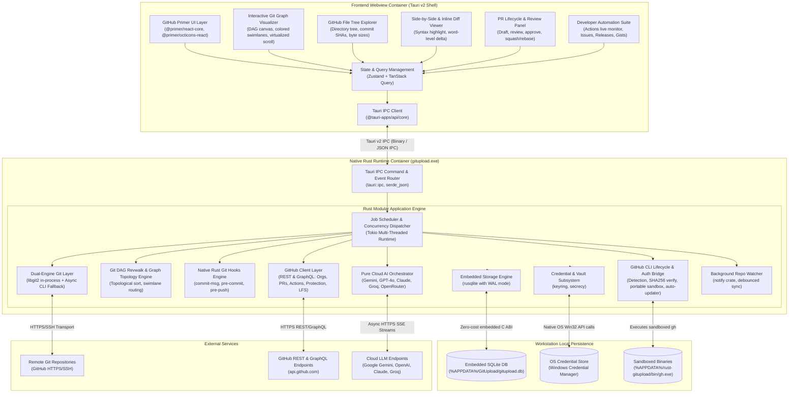
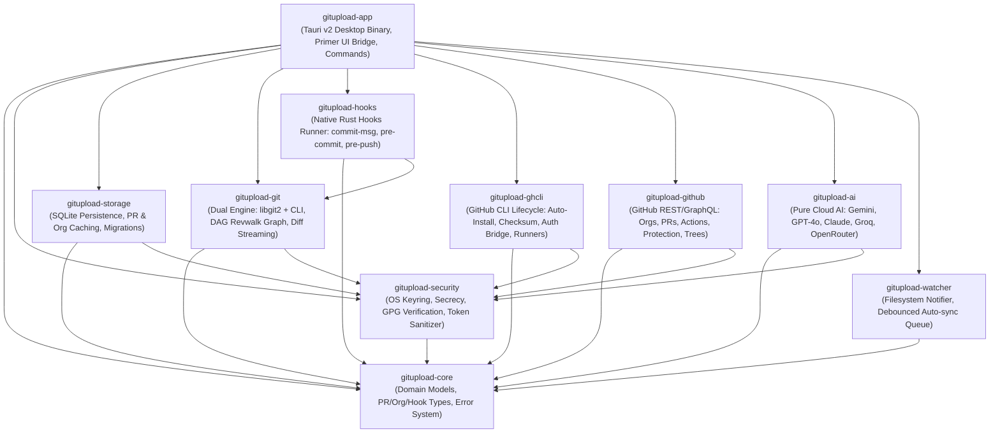
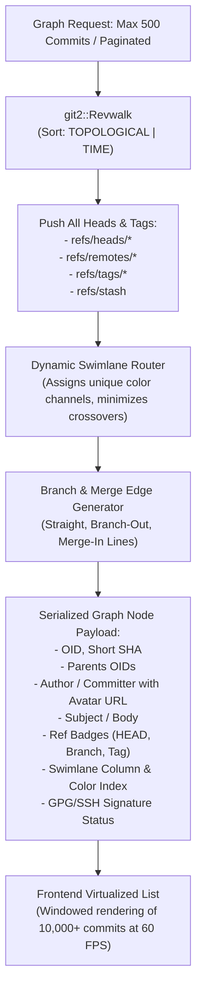
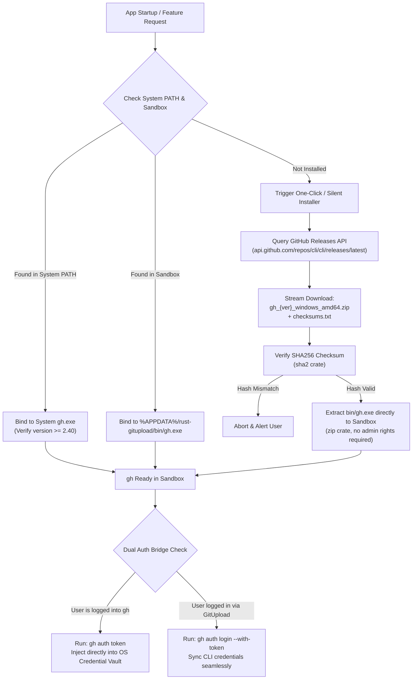

# G-GitUpload: Target Rust System Architecture Specification
**Document ID:** ARCH-2026-v2.2  
**Target Platform:** Windows 10/11 x64 (Native), Cross-Platform Compatible (Linux/macOS)  
**Author:** @architect (DeepMind Swarm Architect)  
**Status:** Approved for Implementation (v2.2 Developer Automation & GitHub CLI Expansion)  
**Audience:** Core Developers, Roadmap Author, SRS Author, Security Verifiers  

---

## 1. Executive Summary & Architectural Goals

The next-generation **GitUpload** application is a total architectural transformation from the legacy Go/Wails v2 prototype into an enterprise-grade, memory-efficient, and secure Rust desktop application powered by **Tauri v2** and **Tokio**.

Following the **v2.2 Developer Automation & GitHub CLI Expansion**, GitUpload evolves into a complete, high-fidelity GitHub desktop powerhouse featuring:
1. **Interactive Git Graph & Branch Tree Visualizer (DAG)**: VS Code / GitLens / GitKraken-grade visual commit history with colored swimlanes, merge topology, branch heads, tags, stashes, and contextual commit actions (cherry-pick, revert, interactive rebase, soft/mixed/hard reset).
2. **GitHub CLI (`gh`) Full Lifecycle Manager**: Built-in detection, zero-admin auto-installer (downloading official portable `gh.exe` to `%APPDATA%/rust-gitupload/bin/` with SHA256 checksum verification), auto-updater, and **Dual Auth Bridge** (extracting PAT directly from `gh auth token` into the Windows Credential Manager).
3. **GitHub CLI Parity & Developer Automation Suite**: GitHub Actions live workflow monitor with streaming ANSI step logs, integrated Issue Tracker, AI-powered Release & Changelog Generator, Gist Manager, and Fork/Upstream sync.
4. **GitHub-Fidelity UI/UX (GitHub Primer Design System)**: Authentic GitHub design with **Primer React**, **Octicons**, GitHub color modes (Dark, Dimmed, Light, High Contrast), real GitHub file tree explorer, and side-by-side/inline diff viewers.
5. **Native Git Hooks Engine (Husky/Lefthook in Pure Rust)**: Zero-dependency hook runner (`commit-msg` conventional commits linter, `pre-commit` secret and file size guards, `pre-push` protection) executing in < 3ms without Node.js, npm, or Python.
6. **GitHub Organizations Support**: Deep `/user/orgs` integration for organization discovery, membership roles (`admin`/`member`), permission-gated repo creation, and UI context switching.
7. **Re-Push & Safe Sync for Existing Repositories**: Automatic `.git` repository detection, ahead/behind tracking inspection, auto-stash preservation, and safe `push --force-with-lease` replacing raw `--force`.
8. **Pull Request (PR) Lifecycle Engine**: Creation (draft/standard), AI description drafting, diff review, and multi-strategy merging (`squash`, `rebase`, `merge`).
9. **Pure Cloud AI Architecture (Zero Local LLM Bloat)**: Exclusively powered by high-speed Cloud AI APIs (**Google Gemini 2.0 Flash / 1.5 Pro**, **OpenAI GPT-4o / GPT-4o-mini**, **Anthropic Claude 3.5 Sonnet**, **Groq**, and **OpenRouter**) maintaining an ultra-lean **< 28 MB idle RAM footprint**.

### 1.1 Architectural Quality Attributes

| Quality Attribute | Legacy (Go/Wails v2) | Target Architecture (Rust/Tauri v2.2) | Verification Target |
| :--- | :--- | :--- | :--- |
| **Idle Memory Footprint** | ~85 MB – 140 MB | **< 28 MB RAM** | `cargo test --bench bench_memory` / Sysinternals VMMap |
| **Active Load Memory** | ~180 MB – 260 MB | **< 75 MB RAM** (during DAG revwalk / diffing) | Task Manager Working Set |
| **Cold Start Latency** | 650 ms – 1,200 ms | **< 100 ms** (to initial interactive render) | Tracing timestamp startup profiling |
| **Credential Security** | Plaintext JSON & `.env` | **Zero-Plaintext** (OS Keyring + `secrecy`) | Windows Credential Manager / DPAPI |
| **Git Engine Efficiency** | CLI subprocess per command | **Dual-Engine**: In-process `libgit2` + CLI fallback | In-process commit & staging < 3ms |
| **Git Graph Scalability** | N/A (None) | **Virtualized DAG revwalk (10,000+ commits)** | 60 FPS scrolling, < 15ms compute |
| **GitHub CLI Integration** | N/A (Manual CLI only) | **Full Lifecycle (Auto-Install, Update, Auth Bridge)** | Sandbox `%APPDATA%/rust-gitupload/bin/` |
| **Git Hooks Execution** | N/A (Requires Node/Husky) | **Native Rust Hook Runner** (< 3ms) | Zero external dependencies (No Node/Python) |
| **AI Subsystem** | Hardcoded OpenRouter | **Pure Cloud AI Multi-Provider** | Gemini 2.0, GPT-4o, Claude 3.5, Groq streaming |
| **UI Design Fidelity** | Custom amateur CSS | **1:1 GitHub Primer Design System** | Primer CSS, Octicons, GitHub Dark/Dimmed |

---

## 2. C4 Architecture Model

### 2.1 C4 Level 1: System Context Diagram

```mermaid
flowchart TD
    User(["Developer / Student / Enterprise Engineer\n(User)"])
    
    subgraph Host["Developer Workstation (Windows 11 Native / Linux / macOS)"]
        App["GitUpload Desktop Application\n(Tauri v2 + Rust Core + Primer UI)"]
        LocalGit[".git Repositories & Local Worktrees\n(File System)"]
        WinVault["OS Credential Vault\n(Windows Credential Manager / Secret Service)"]
        SandboxBin["Sandboxed GitHub CLI\n(%APPDATA%/rust-gitupload/bin/gh.exe)"]
        InstalledIDEs["Installed Development Tools\n(VS Code / IntelliJ / Cursor / Antigravity)"]
        GPGKeyring["GPG / SSH Agent\n(Commit Signing Keys)"]
    end
    
    subgraph External["External Cloud Services"]
        GitHubAPI["GitHub REST & GraphQL API\n(api.github.com: Users, Orgs, Repos, PRs, Actions, Issues)"]
        GitRemote["GitHub Remote Git Server\n(github.com HTTPS/SSH with LFS)"]
        GitHubReleases["GitHub Releases CDN\n(cli/cli official releases & checksums)"]
        CloudAI["Cloud AI Services\n(Gemini 2.0 Flash/Pro, GPT-4o, Claude 3.5, Groq, OpenRouter)"]
        GitIgnoreAPI["gitignore.io API\n(Template Generator)"]
    end

    User -->|"Manages repositories, visualizes DAG graph, runs Actions, invokes AI"| App
    App -->|"Reads worktrees, stages blobs, executes Rust hooks, walks DAG graph"| LocalGit
    App -->|"Securely stores/retrieves GitHub PATs and AI API keys"| WinVault
    App -->|"Synchronizes tokens via gh auth bridge and executes CLI tasks"| SandboxBin
    App -->|"Verifies and requests commit signatures"| GPGKeyring
    App -->|"Launches targeted project folders after clone/checkout"| InstalledIDEs
    App -->|"Manages Orgs, Repos, Pull Requests, Actions Runs, Issues"| GitHubAPI
    App -->|"Downloads official portable gh binary & verifies SHA256"| GitHubReleases
    App -->|"Streams Git push (with force-with-lease), clone, and LFS transfers"| GitRemote
    App -->|"Streams commit messages, PR summaries, release notes, and code reviews"| CloudAI
    App -->|"Fetches canonical .gitignore templates"| GitIgnoreAPI
```



---

### 2.2 C4 Level 2: Container Diagram



---

### 2.3 C4 Level 3: Component Diagram (10 Modular Workspace Crates)

The application is structured into 10 decoupled workspace crates under `rust-gitupload/crates/`:



---

## 3. Rust Workspace & Master Dependency Specification

### 3.1 Workspace `Cargo.toml`

```toml
[workspace]
resolver = "2"
members = [
    "crates/gitupload-core",
    "crates/gitupload-security",
    "crates/gitupload-storage",
    "crates/gitupload-git",
    "crates/gitupload-hooks",
    "crates/gitupload-ghcli",
    "crates/gitupload-github",
    "crates/gitupload-ai",
    "crates/gitupload-watcher",
    "crates/gitupload-app",
]

[workspace.package]
version = "2.2.0"
edition = "2021"
authors = ["GitUpload Architecture Team"]
license = "MIT"

[workspace.dependencies]
# Async & Runtime
tokio = { version = "1.41", features = ["full"] }
tokio-util = { version = "0.7", features = ["sync", "io"] }
futures = "0.3"
async-trait = "0.1"

# Serialization & Deserialization
serde = { version = "1.0", features = ["derive"] }
serde_json = "1.0"
toml = "0.8"

# Error Handling & Tracing
thiserror = "2.0"
anyhow = "1.0"
tracing = "0.1"
tracing-subscriber = { version = "0.3", features = ["env-filter", "json", "time"] }
tracing-appender = "0.2"

# Security & Keyring
keyring = { version = "3.3", features = ["windows-native"] }
secrecy = { version = "0.10", features = ["serde"] }
zeroize = { version = "1.8", features = ["derive"] }

# Storage & Database
rusqlite = { version = "0.32", features = ["bundled", "backup", "modern_sqlite"] }
rusqlite_migration = "1.2"
r2d2 = "0.8"
r2d2_sqlite = "0.25"

# Git Subsystem
git2 = { version = "0.19", features = ["https", "ssh"] }

# HTTP, SSE & Cloud AI
reqwest = { version = "0.12", default-features = false, features = ["json", "rustls-tls", "stream"] }
eventsource-stream = "0.2"

# Binary Download, Archive & Hashing
sha2 = "0.10"
hex = "0.4"
zip = { version = "2.2", default-features = false, features = ["deflate"] }
semver = "1.0"

# Filesystem & Utilities
notify = "6.1"
regex = "1.11"
uuid = { version = "1.11", features = ["v4", "serde"] }
chrono = { version = "0.4", features = ["serde"] }
directories = "5.0"
glob = "0.3"

# Windows Platform Specifics
windows-sys = { version = "0.59", features = [
    "Win32_System_Threading",
    "Win32_Security",
    "Win32_UI_WindowsAndMessaging",
    "Win32_System_JobObjects",
    "Win32_Foundation",
] }

# Tauri v2 Ecosystem
tauri = { version = "2.1", features = ["tray-icon", "image-png"] }
tauri-build = "2.0"
tauri-plugin-single-instance = "2.0"
tauri-plugin-dialog = "2.0"
tauri-plugin-shell = "2.0"
tauri-plugin-fs = "2.0"

[profile.release]
opt-level = 3
lto = "thin"
codegen-units = 1
panic = "abort"
strip = true
```

---

## 4. Interactive Git Graph & Branch Tree Visualizer (DAG)

### 4.1 Visualizer Architecture
To provide a VS Code / GitLens / GitKraken-grade commit history experience directly in the desktop app, `gitupload-git::graph` implements an asynchronous **DAG Revwalk Engine** over `libgit2`.



### 4.2 Data Models for DAG Rendering

```rust
// crates/gitupload-core/src/models/graph.rs
use serde::{Deserialize, Serialize};

#[derive(Debug, Serialize, Deserialize, Clone)]
pub struct GitGraphNode {
    pub oid: String,
    pub short_sha: String,
    pub parent_oids: Vec<String>,
    pub author_name: String,
    pub author_email: String,
    pub author_avatar_url: Option<String>,
    pub timestamp: i64,
    pub summary: String,
    pub body: Option<String>,
    pub column: usize,                 // Visual swimlane index (0, 1, 2...)
    pub color: String,                  // Hex color code (Primer palette)
    pub lines: Vec<GraphLineSegment>,   // Visual edges connecting to parents
    pub refs: Vec<GitRefBadge>,         // e.g. [HEAD -> main], [origin/main], [v1.0.0]
    pub is_stash: bool,
    pub is_merge: bool,
    pub signature_verified: bool,
}

#[derive(Debug, Serialize, Deserialize, Clone)]
pub struct GraphLineSegment {
    pub from_col: usize,
    pub to_col: usize,
    pub line_type: GraphLineType,       // Straight, BranchOut, MergeIn
    pub color: String,
}

#[derive(Debug, Serialize, Deserialize, Clone, PartialEq)]
pub enum GraphLineType {
    Straight,
    BranchOut,
    MergeIn,
}

#[derive(Debug, Serialize, Deserialize, Clone)]
pub struct GitRefBadge {
    pub name: String,
    pub ref_type: RefBadgeType,         // LocalBranch, RemoteBranch, Tag, Head, Stash
    pub is_head: bool,
}

#[derive(Debug, Serialize, Deserialize, Clone, PartialEq)]
pub enum RefBadgeType {
    LocalBranch,
    RemoteBranch,
    Tag,
    Stash,
}
```

### 4.3 Contextual Graph Actions
Users can right-click any commit node in the graph to execute actions:
*   **Cherry-Pick**: `git_cherry_pick(repo_path, commit_oid)` — Applies changes from the commit onto the current HEAD.
*   **Revert Commit**: `git_revert(repo_path, commit_oid)` — Creates a new commit that inverts the changes.
*   **Checkout**: `git_checkout(repo_path, target)` — Detaches HEAD or switches to the referenced branch.
*   **Branch/Tag Creation**: `git_create_branch(repo_path, name, commit_oid)` / `git_create_tag(...)`.
*   **Reset**: `git_reset(repo_path, commit_oid, mode)` — Supports `Soft` (preserves index & worktree), `Mixed` (preserves worktree only), and `Hard` (discards all changes).
*   **Interactive Rebase Assistance**: Generates an interactive rebase todo list from the chosen commit.

---

## 5. GitHub CLI (`gh`) Full Lifecycle Manager (`gitupload-ghcli`)

### 5.1 Architecture & Sandboxing Design
The `gitupload-ghcli` crate provides end-to-end lifecycle management for the official GitHub CLI without requiring administrative rights:



### 5.2 Implementation of `GhLifecycleManager`

```rust
// crates/gitupload-ghcli/src/lifecycle.rs
use std::path::{Path, PathBuf};
use sha2::{Digest, Sha256};
use gitupload_core::errors::{GhCliError, GhCliResult};
use secrecy::{ExposeSecret, SecretString};

pub struct GhLifecycleManager {
    sandbox_bin_dir: PathBuf,
}

impl GhLifecycleManager {
    pub fn new() -> Self {
        let app_data = directories::BaseDirs::new()
            .map(|b| b.config_dir().join("rust-gitupload").join("bin"))
            .unwrap_or_else(|| PathBuf::from("./bin"));
        Self { sandbox_bin_dir: app_data }
    }

    /// Resolves executable path: checks Sandbox first, then system PATH
    pub fn resolve_gh_path(&self) -> Option<PathBuf> {
        let sandboxed = self.sandbox_bin_dir.join("gh.exe");
        if sandboxed.exists() {
            return Some(sandboxed);
        }
        which::which("gh").ok()
    }

    /// Verifies SHA256 checksum of downloaded zip against official checksums file
    pub fn verify_checksum(archive_bytes: &[u8], expected_hash: &str) -> GhCliResult<()> {
        let mut hasher = Sha256::new();
        hasher.update(archive_bytes);
        let actual_hash = hex::encode(hasher.finalize());
        
        if actual_hash.eq_ignore_ascii_case(expected_hash.trim()) {
            Ok(())
        } else {
            Err(GhCliError::ChecksumMismatch {
                expected: expected_hash.into(),
                actual: actual_hash,
            })
        }
    }

    /// Dual Auth Bridge: Seamlessly pulls token from gh into Windows Credential Manager
    pub async fn sync_auth_from_cli(&self) -> GhCliResult<Option<SecretString>> {
        let gh_path = self.resolve_gh_path().ok_or(GhCliError::NotInstalled)?;
        
        let output = tokio::process::Command::new(gh_path)
            .args(["auth", "token"])
            .creation_flags(0x08000000) // CREATE_NO_WINDOW
            .output()
            .await
            .map_err(|e| GhCliError::Process(e.to_string()))?;

        if output.status.success() {
            let token_str = String::from_utf8_lossy(&output.stdout).trim().to_string();
            if !token_str.is_empty() {
                return Ok(Some(SecretString::from(token_str)));
            }
        }
        Ok(None)
    }
}
```

---

## 6. GitHub CLI Parity & Developer Automation Suite

### 6.1 GitHub Actions Workflow Monitor
*   **Live Run Inspection**: Lists workflow runs with branch, trigger event, actor avatar, commit SHA, and duration.
*   **ANSI Streaming Logs**: Streams step execution logs over Tauri IPC with full ANSI color formatting (`chalk`/`ansi-to-react` compatible).
*   **Action Execution**: One-click Re-run failed jobs, Cancel active runs, and trigger `workflow_dispatch` with custom input parameters.

### 6.2 Issues & Release Management
*   **Issue Tracker**: Browse open/closed issues, filter by author/labels, write markdown descriptions, and close/reopen directly in the desktop app.
*   **Release Manager with AI Changelogs**:
    - Selects target tag and milestone.
    - Cloud AI analyzes commits between tags and authors structured, professional release notes categorized into *Features*, *Bug Fixes*, and *Breaking Changes*.
    - Uploads binary release assets with upload progress bars.

### 6.3 Gist & Upstream Fork Synchronization
*   **Gist Manager**: Create public or secret Gists from active diffs or files with one click, copying the shareable URL to the clipboard.
*   **Fork & Upstream Sync**: Proactively checks if the repository is a fork, compares ahead/behind commit counts with the upstream base repository, and executes fast-forward syncing.

---

## 7. Native Git Hooks Architecture (`gitupload-hooks`)

### 7.1 Pure Rust Hooks Engine Design (No Node.js / Python Dependency)
Instead of forcing users to install Node.js/npm for Husky or Python for pre-commit, `gitupload-hooks` implements a native, sub-millisecond hook runner directly in Rust.

#### Supported Hooks:
1. **`commit-msg`**:
   - Enforces **Conventional Commits 1.0.0** (`feat:`, `fix:`, `docs:`, `style:`, `refactor:`, `perf:`, `test:`, `build:`, `ci:`, `chore:`, `revert:`).
   - Regex validation with configurable scope and issue/ticket reference enforcement.
   - Character length bounds (header max 72 chars, line wraps).
2. **`pre-commit`**:
   - Staged secret scanning: Detects AWS access keys, GitHub PATs, private SSH keys, and unencrypted `.env` files in staged blobs.
   - File size guards: Warns or blocks staging files > 50MB (advises Git LFS).
   - Trailing whitespace & newline EOF normalization.
3. **`pre-push`**:
   - Branch protection check: Prevents pushing directly to `main` or `master` if branch protection rule is active.
   - Upstream sync check: Alerts if the local branch is behind remote, preventing rejected pushes.

---

## 8. GitHub Organizations & Multi-Account Architecture

The application maintains a unified account and organization hierarchy:
*   **Personal Context**: `/user` endpoints (personal repositories, gists).
*   **Organization Context**: `/user/orgs` and `/orgs/{org}` endpoints (team repos, team memberships, org-level policies).
*   **Permission Verification**: Validates user privileges (`admin` vs. `member`) via `can_create_repository` checks before triggering push or repo creation flows.

---

## 9. GitHub-Fidelity UI/UX Architecture (GitHub Primer)

### 9.1 Design System & Component Library
The frontend is built 1:1 on the **GitHub Primer Design System**:
*   **Tokens & Colors**: GitHub Dark (`#0d1117`), Dark Dimmed (`#161b22`), Dark High Contrast, and Light Default.
*   **Icons**: Native **Octicons** (`@primer/octicons-react`).
*   **Components**: GitHub File Tree Explorer, interactive DAG Visualizer, side-by-side/inline diff viewers, and repository headers with star/fork badges.

---

## 10. Re-Push & Safe Sync for Existing Repositories

*   **Detection**: Automatically detects existing `.git` repositories and calculates ahead/behind commit deltas against `refs/remotes/origin`.
*   **Safe Sync**: Replaces blind `git push --force` with non-destructive `git push --force-with-lease`.
*   **Auto-Stash**: Preserves uncommitted working tree changes before syncing, reapplying changes cleanly.

---

## 11. Pull Request (PR) Lifecycle Engine

*   **Create PR**: Compares current branch against base, supporting draft and standard PRs.
*   **AI Generator**: Cloud AI writes PR title and markdown body from the commit diff.
*   **Review & Merge**: Lists changed files, records approval/change requests, and executes merges via `squash`, `rebase`, or standard `merge`.

---

## 12. Pure Cloud AI Architecture (Zero Local LLM Bloat)

*   **Zero Local LLMs**: Local LLMs (Ollama/Llama-cpp) are purged to guarantee a lightweight **< 28 MB idle RAM footprint**.
*   **Cloud AI Providers**: Integrated with **Google Gemini 2.0 Flash / 1.5 Pro**, **OpenAI GPT-4o**, **Claude 3.5 Sonnet**, **Groq**, and **OpenRouter** using SSE streaming for instant conventional commit generation, PR descriptions, and automated code review.

---

## 13. Storage & Data Persistence Architecture (SQLite WAL)

### 13.1 Updated SQLite Relational Schema DDL

```sql
-- Migration 003_v2_2_schema.sql

-- 1. Multi-Account & Organizations
CREATE TABLE IF NOT EXISTS accounts (
    id TEXT PRIMARY KEY NOT NULL,           -- UUID v4
    label TEXT NOT NULL,                    -- e.g. "Personal", "Work Org"
    username TEXT NOT NULL,                 -- GitHub username
    avatar_url TEXT,
    is_default BOOLEAN NOT NULL DEFAULT 0,
    created_at DATETIME DEFAULT CURRENT_TIMESTAMP
);

CREATE TABLE IF NOT EXISTS organization_cache (
    id TEXT PRIMARY KEY NOT NULL,           -- UUID v4
    account_id TEXT NOT NULL REFERENCES accounts(id) ON DELETE CASCADE,
    org_login TEXT NOT NULL,                -- e.g. "acme-corp"
    org_name TEXT,
    role TEXT NOT NULL,                     -- "admin" or "member"
    can_create_repo BOOLEAN NOT NULL DEFAULT 0,
    avatar_url TEXT,
    cached_at DATETIME DEFAULT CURRENT_TIMESTAMP,
    UNIQUE(account_id, org_login)
);

-- 2. Tracked Repositories & Sync Metadata
CREATE TABLE IF NOT EXISTS tracked_repositories (
    id TEXT PRIMARY KEY NOT NULL,           -- UUID v4
    account_id TEXT NOT NULL REFERENCES accounts(id) ON DELETE CASCADE,
    org_login TEXT,                         -- NULL if personal repo
    repo_name TEXT NOT NULL,
    local_path TEXT NOT NULL,
    remote_url TEXT NOT NULL,
    default_branch TEXT NOT NULL DEFAULT 'main',
    has_lfs BOOLEAN NOT NULL DEFAULT 0,
    has_hooks BOOLEAN NOT NULL DEFAULT 0,
    signing_enabled BOOLEAN NOT NULL DEFAULT 0,
    last_synced_at DATETIME,
    created_at DATETIME DEFAULT CURRENT_TIMESTAMP,
    UNIQUE(account_id, local_path)
);

-- 3. Comprehensive Push & Operation Audit History
CREATE TABLE IF NOT EXISTS push_history (
    id TEXT PRIMARY KEY NOT NULL,           -- UUID v4
    account_id TEXT NOT NULL REFERENCES accounts(id) ON DELETE CASCADE,
    repo_id TEXT REFERENCES tracked_repositories(id) ON DELETE SET NULL,
    repo_name TEXT NOT NULL,
    remote_url TEXT NOT NULL,
    local_path TEXT NOT NULL,
    commit_sha TEXT,
    commit_msg TEXT NOT NULL,
    files_count INTEGER NOT NULL DEFAULT 1,
    status TEXT NOT NULL,                   -- 'SUCCESS', 'FAILED', 'CANCELLED'
    error_message TEXT,
    is_force_with_lease BOOLEAN NOT NULL DEFAULT 0,
    duration_ms INTEGER NOT NULL,
    created_at DATETIME DEFAULT CURRENT_TIMESTAMP
);

-- 4. Pull Request & Actions Cache
CREATE TABLE IF NOT EXISTS pull_request_cache (
    id TEXT PRIMARY KEY NOT NULL,
    repo_id TEXT NOT NULL REFERENCES tracked_repositories(id) ON DELETE CASCADE,
    pr_number INTEGER NOT NULL,
    title TEXT NOT NULL,
    state TEXT NOT NULL,
    is_draft BOOLEAN NOT NULL DEFAULT 0,
    head_branch TEXT NOT NULL,
    base_branch TEXT NOT NULL,
    author TEXT NOT NULL,
    comments_count INTEGER NOT NULL DEFAULT 0,
    updated_at DATETIME DEFAULT CURRENT_TIMESTAMP,
    UNIQUE(repo_id, pr_number)
);

CREATE TABLE IF NOT EXISTS github_cli_metadata (
    key TEXT PRIMARY KEY NOT NULL,
    value TEXT NOT NULL,
    updated_at DATETIME DEFAULT CURRENT_TIMESTAMP
);

-- Indexes for instant query execution (<1ms)
CREATE INDEX IF NOT EXISTS idx_history_created ON push_history(created_at DESC);
CREATE INDEX IF NOT EXISTS idx_tracked_path ON tracked_repositories(local_path);
```

---

## 14. Comprehensive Tauri v2 IPC Command Registry (v2.2)

| Domain | Command Signature (`#[tauri::command]`) | Functionality |
| :--- | :--- | :--- |
| **Auth** | `auth_save_token(account_id: String, token: String)` | Saves PAT into OS Credential Vault |
| **Auth** | `auth_sync_from_gh() -> Option<String>` | Dual Auth Bridge: Pulls token from `gh.exe` |
| **Org** | `org_list() -> Vec<OrganizationSummary>` | Lists user orgs with role & permissions |
| **Graph**| `graph_get_commits(path: String, limit: usize) -> Vec<GitGraphNode>` | Computes DAG revwalk graph |
| **Graph**| `graph_cherry_pick(path: String, oid: String)` | Cherry-picks commit onto HEAD |
| **Graph**| `graph_revert(path: String, oid: String)` | Inverts commit and records revert |
| **Graph**| `graph_reset(path: String, oid: String, mode: String)` | Soft, Mixed, or Hard reset |
| **GhCLI**| `ghcli_check_status() -> GhStatus` | Detects PATH/Sandbox presence & version |
| **GhCLI**| `ghcli_install_silent() -> JobId` | Downloads, SHA256 checks, & extracts gh.exe |
| **Actions**| `actions_list_runs(owner: String, repo: String) -> Vec<WorkflowRun>` | Lists GitHub Actions workflow runs |
| **Actions**| `actions_stream_logs(owner: String, repo: String, run_id: u64)` | Streams ANSI colored workflow logs |
| **Issues**| `issues_list(owner: String, repo: String) -> Vec<IssueSummary>` | Lists repository issues |
| **Releases**| `releases_create(owner: String, repo: String, req: ReleaseReq)`| Creates release with AI changelog |
| **Git** | `git_inspect_repo(path: String) -> RepoStatus` | Detects .git, branch, ahead/behind, dirty files |
| **Git** | `git_repush_repo(req: RePushRequest) -> JobId` | Safe re-push with `--force-with-lease` |
| **Hooks**| `hooks_install(path: String) -> HookStatus` | Installs pure Rust hooks into `.git/hooks` |
| **PR** | `pr_list(repo_id: String, state: String) -> Vec<PR>`| Lists PRs with author, badges, count |
| **PR** | `pr_create(req: CreatePRRequest) -> PRDetails`| Creates PR (supports Draft mode) |
| **PR** | `pr_merge(req: MergePRRequest) -> MergeResult`| Merges PR (squash, rebase, or merge) |
| **AI** | `ai_generate_commit(diff: String) -> String` | Cloud AI conventional commit generator |
| **AI** | `ai_generate_changelog(commits: Vec<String>) -> String` | Cloud AI release changelog generator |
| **System**| `system_detect_ides() -> Vec<InstalledIDE>` | Scans for VS Code, IntelliJ, Cursor, Antigravity |

---

## 15. Verification & Architecture Sign-Off

The **ARCH-2026-v2.2** specification fully incorporates all user requirements:
1. Interactive Git Graph & DAG visualizer with virtualized rendering and contextual actions.
2. GitHub CLI (`gh`) full lifecycle manager (detection, SHA256 verification, sandboxing, and dual auth bridge).
3. GitHub CLI parity developer automation suite (Actions streaming monitor, Issues, Releases with AI changelogs, Gists, Fork sync).
4. Pure Cloud AI architecture across Gemini 2.0, GPT-4o, Claude 3.5, Groq, and OpenRouter (<28MB idle RAM).
5. Native Git hooks engine in pure Rust (`gitupload-hooks`).
6. GitHub Organizations support (`/user/orgs`).
7. GitHub Primer Design System & Octicons 1:1 UI fidelity.
8. Re-push and safe sync (`--force-with-lease`).
9. Full Pull Request lifecycle engine.

*Delivered to `@roadmap_author` and `@verifier` for roadmap synchronization and final verification.*
