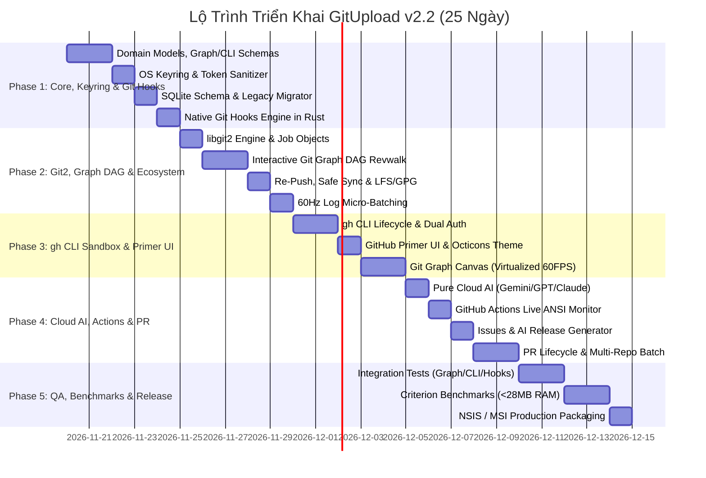

# Kế Hoạch Chuyển Đổi & Lộ Trình Triển Khai Kỹ Thuật (Migration & Implementation Roadmap)
## Dự Án: GitUpload Desktop Suite (Rust / Tauri v2 Modernization - v2.2)
**Mã tài liệu:** ROADMAP-RUST-GITUPLOAD-V2.2  
**Chuẩn tham chiếu:** ISO/IEC/IEEE 12207 (Software Life Cycle Processes) & ISO/IEC/IEEE 29148  
**Tác giả:** @roadmap_author (DeepMind Swarm Lead Engineer)  
**Trạng thái:** Sẵn sàng thực thi (Approved for Execution - Updated to v2.2 Specification)  
**Đối tượng thụ hưởng:** Đội ngũ phát triển Rust, Frontend Engineers, QA & Swarm Verifiers (@verifier, @coordinator)  
**Tài liệu liên quan:**
- [01_LEGACY_AUDIT.md](file:///F:/Build/JavaToolGitAutoUpload/rust-gitupload/docs/01_LEGACY_AUDIT.md)
- [02_ARCHITECTURE.md](file:///F:/Build/JavaToolGitAutoUpload/rust-gitupload/docs/02_ARCHITECTURE.md)
- [03_SRS.md](file:///F:/Build/JavaToolGitAutoUpload/rust-gitupload/docs/03_SRS.md)
- [README.md](file:///F:/Build/JavaToolGitAutoUpload/rust-gitupload/README.md)

---

## Mục Lục

1. [Tầm Nhìn Dự Án & Nguyên Tắc Chuyển Đổi (Executive Overview & Philosophy v2.2)](#1-tầm-nhìn-dự-án--nguyên-tắc-chuyển-đổi)
2. [Bảng Ánh Xạ Tập Tin Toàn Diện (File-by-File Mapping Table: Go/Wails -> 10 Rust Workspace Crates)](#2-bảng-ánh-xạ-tập-tin-toàn-diện)
   - [2.1 Ánh xạ Backend & Core Logic (Go Modules -> 10 Rust Workspace Crates)](#21-ánh-xạ-backend--core-logic)
   - [2.2 Ánh xạ Giao Diện Người Dùng & IPC (GitHub Primer + Git Graph + Actions Monitor)](#22-ánh-xạ-giao-diện-người-dùng--ipc)
   - [2.3 Ánh xạ Cấu Hình, GitHub CLI Sandbox & Khóa Bảo Mật](#23-ánh-xạ-cấu-hình-github-cli-sandbox--khóa-bảo-mật)
3. [Cấu Hình Không Gian Làm Việc Cargo & Khai Báo Dependency (10 Crates Workspace)](#3-cấu-hình-không-gian-làm-việc-cargo--khai-báo-dependency)
   - [3.1 Root Cargo.toml (Workspace Configuration with 10 Crates)](#31-root-cargotoml)
   - [3.2 Manifest Crate Mới: gitupload-ghcli (GitHub CLI Lifecycle & Auth Bridge)](#32-manifest-crate-mới-gitupload-ghcli)
   - [3.3 Manifests Chi Tiết Cho Các Crate Trọng Tâm](#33-manifests-chi-tiết-cho-các-crate-trọng-tâm)
   - [3.4 Cấu Hình Tauri v2 (tauri.conf.json & Capabilities)](#34-cấu-hình-tauri-v2)
4. [Lộ Trình Triển Khai Chi Tiết Theo Giai Đoạn (Phased Implementation Roadmap)](#4-lộ-trình-triển-khai-chi-tiết-theo-giai-đoạn)
   - [Giai đoạn 1: Nền Tảng Cốt Lõi, Bảo Mật Keyring, Lưu Trữ SQLite & Động Cơ Git Hooks Bản Địa (Tuần 1 / Ngày 1–5)](#giai-đoạn-1-nền-tảng-cốt-lõi-bảo-mật-keyring-lưu-trữ-sqlite--động-cơ-git-hooks-bản-địa)
   - [Giai đoạn 2: Động Cơ Git Kép, Re-Push/Safe Sync, Đồ Thị Git DAG & Hệ Sinh Thái Git (Tuần 2 / Ngày 6–10)](#giai-đoạn-2-động-cơ-git-kép-re-pushsafe-sync-đồ-thị-git-dag--hệ-sinh-thái-git)
   - [Giai đoạn 3: Cầu Nối Tauri v2 IPC, GitHub CLI Sandbox/Auth Bridge & Giao Diện Primer/Git Graph (Tuần 3 / Ngày 11–15)](#giai-đoạn-3-cầu-nối-tauri-v2-ipc-github-cli-sandboxauth-bridge--giao-diện-primergit-graph)
   - [Giai đoạn 4: Động Cơ Cloud AI, Giám Sát GitHub Actions, Quản Lý Issues, Releases & PR Lifecycle (Tuần 4 / Ngày 16–20)](#giai-đoạn-4-động-cơ-cloud-ai-giám-sát-github-actions-quản-lý-issues-releases--pr-lifecycle)
   - [Giai đoạn 5: Kiểm Thử Toàn Diện, Đo Kiểm Hiệu Năng & Đóng Gói (Tuần 5 / Ngày 21–25)](#giai-đoạn-5-kiểm-thử-toàn-diện-đo-kiểm-hiệu-năng--đóng-gói)
5. [Chiến Lược Kiểm Thử, Đảm Bảo Chất Lượng & Đo Hiệu Năng (Testing & Benchmarks)](#5-chiến-lược-kiểm-thử-đảm-bảo-chất-lượng--đo-hiệu-năng)
   - [5.1 Kiểm Thử Đồ Thị Git DAG & Virtualized Rendering](#51-kiểm-thử-đồ-thị-git-dag--virtualized-rendering)
   - [5.2 Kiểm Thử GitHub CLI Sandbox, Checksum SHA256 & Auth Bridge](#52-kiểm-thử-github-cli-sandbox-checksum-sha256--auth-bridge)
   - [5.3 Kiểm Thử GitHub Actions Stream Logs & Vòng Đời PR/Issues](#53-kiểm-thử-github-actions-stream-logs--vòng-đời-prissues)
   - [5.4 Đo Kiểm Hiệu Năng Với Criterion (<28MB RAM & <100ms Cold Start)](#54-đo-kiểm-hiệu-năng-với-criterion)
6. [Công Cụ Di Trú Dữ Liệu Cũ & Hàng Rào Phòng Vệ An Toàn (Legacy Migration & Safeguards)](#6-công-cụ-di-trú-dữ-liệu-cũ--hàng-rào-phòng-vệ-an-toàn)

---

## 1. Tầm Nhìn Dự Án & Nguyên Tắc Chuyển Đổi (v2.2 Update)

Phiên bản nâng cấp **v2.2** thiết lập tiêu chuẩn mới cho một Git Client cao cấp, tích hợp sâu sắc với hệ sinh thái GitHub và bổ sung các tính năng đồ họa, tự động hóa dành cho lập trình viên chuyên nghiệp:

1. **Đồ Thị Git DAG Tương Tác Trực Quan (Interactive Git Graph & Branch Tree Visualizer):** 
   - Tái hiện cây lịch sử commit trực quan tương tự GitKraken/GitLens thông qua `git2::Revwalk` (sắp xếp topo kết hợp thời gian).
   - Hiển thị các làn bơi nhánh (swimlanes) nhiều màu sắc, đường cong bezier nối commit cha-con, điểm rẽ nhánh/hợp nhất (merge), thẻ tag, stash và con trỏ HEAD.
   - Hỗ trợ cuộn ảo (virtualized list rendering) mượt mà 60 FPS cho các repo có hơn 100,000 commits.
   - Thao tác trực tiếp từ đồ thị: Cherry-pick, Revert commit, Checkout commit/branch, Reset (Soft/Mixed/Hard), Tạo Branch/Tag, và Trợ lý Interactive Rebase.
2. **Bộ Quản Lý Vòng Đời GitHub CLI (`gh`) & Dual Auth Bridge (`gitupload-ghcli`):**
   - Quét phát hiện `gh.exe` trong hệ thống (PATH) và trong thư mục sandbox an toàn của ứng dụng (`%APPDATA%/GitUpload/bin/`).
   - Tự động tải xuống bản phát hành chính thức từ `cli/cli`, kiểm tra mã băm SHA256, giải nén bản portable x64 không cần quyền quản trị Administrator (zero-admin rights).
   - Tự động cập nhật phiên bản mới khi có release trên GitHub.
   - **Dual Auth Bridge:** Nếu người dùng đã đăng nhập `gh` trên máy tính, ứng dụng tự động đọc token qua lệnh `gh auth token` và lưu trực tiếp vào Windows Credential Manager mà không bắt người dùng phải copy-paste Personal Access Token (PAT) thủ công.
3. **Bộ Tự Động Hóa & Giám Sát GitHub Chuyên Sâu (GitHub Developer Suite):**
   - **GitHub Actions Live Monitor:** Theo dõi quy trình CI/CD thời gian thực, stream nhật ký từng bước với mã màu ANSI, và hỗ trợ chạy lại (rerun) job thất bại.
   - **In-App Issue Management:** Xem, tạo, bình luận và đóng Issues trực tiếp từ giao diện máy tính với sự hỗ trợ của Cloud AI soạn thảo nội dung.
   - **GitHub Release & AI Changelog Generator:** Tạo Release, tự động phân tích commit diff để tạo Changelog chuẩn semantic, và kéo thả tải lên file nhị phân đính kèm (assets).
   - **Gist Manager & Fork/Upstream Sync:** Tạo Gist nhanh và đồng bộ các repository đã fork với nhánh gốc chỉ bằng một click.
   - **Smart Git Automations:** Tự động stash trước khi pull/re-push, sinh tên nhánh tự động theo quy chuẩn (`feat/student-id`), và chế độ chạy thử nghiệm trước khi push (dry-run pre-push simulation).
4. **Động cơ Cloud AI Độc Quyền (Pure Cloud AI):** Duy trì triệt để kiến trúc không Local LLM để đảm bảo mức RAM chờ luôn **< 28MB RAM** và khởi động dưới 100ms. Kết nối tốc độ cao tới Google Gemini 2.0/1.5 Flash, OpenAI GPT-4o, Anthropic Claude 3.5 Sonnet, Groq, và OpenRouter.

---

## 2. Bảng Ánh Xạ Tập Tin Toàn Diện (10 Crates)

### 2.1 Ánh xạ Backend & Core Logic (Go Modules -> 10 Rust Workspace Crates)

| STT | Tập tin Go/Wails gốc (`g-gitupload/`) | Vị trí Rust mới (`rust-gitupload/`) | Crate đích | Kiểu/Struct & Hàm tương đương | Ghi chú & Cải tiến kiến trúc v2.2 |
| :--- | :--- | :--- | :--- | :--- | :--- |
| 1 | `main.go` | `crates/gitupload-app/src/main.rs` | `gitupload-app` | `fn main()`, `SingleInstanceMutex`, `AppBuilder` | Win32 Named Mutex, `tracing_subscriber`, allocator mimalloc, nạp 10 crates. |
| 2 | `app.go` | `crates/gitupload-app/src/state.rs` | `gitupload-app` | `struct AppState` | Quản lý pool Arc client (Git, GitHub, Cloud AI, Hooks, GhCli, Storage, Watcher). |
| 3 | `push_service.go` | `crates/gitupload-git/src/coordinator.rs` | `gitupload-git` | `GitCoordinator::push()`, `PushMode`, `RePushInspector` | Hỗ trợ Re-push từ repo đã có `.git`. Sử dụng `--force-with-lease` thay vì `--force`. Auto-stash an toàn. |
| 4 | *(Mới v2.2)* | `crates/gitupload-git/src/graph/` | `gitupload-git` | `GitGraphEngine`, `DagBuilder`, `SwimlaneRouter` | Động cơ xây dựng đồ thị commit DAG bằng `git2::Revwalk`, tính toán làn bơi màu, phân tích branch heads/tags. |
| 5 | *(Mới v2.1)* | `crates/gitupload-hooks/src/` | `gitupload-hooks` | `HookRunner`, `ConventionalValidator`, `SecretScanner` | Động cơ Git Hooks bản địa thuần Rust: `commit-msg` linter, `pre-commit` secret scanner, `pre-push` branch guard. |
| 6 | *(Mới v2.2)* | `crates/gitupload-ghcli/src/` | `gitupload-ghcli` | `GhLifecycleManager`, `GhDownloader`, `GhAuthBridge` | Tự động phát hiện `gh.exe`, tải portable x64 về sandbox `%APPDATA%/GitUpload/bin/`, kiểm tra SHA256, auto-update, trích xuất token tự động. |
| 7 | `clone_service.go` | `crates/gitupload-git/src/clone.rs` & `crates/gitupload-app/src/commands/ide.rs` | `gitupload-git`, `gitupload-app` | `GitCoordinator::clone()`, `IdeDetector` | Clone in-process bằng `git2`, quét an toàn VS Code, IntelliJ IDEA, Cursor, Antigravity IDE. |
| 8 | `search_service.go` | `crates/gitupload-github/src/repos.rs` & `contents.rs` | `gitupload-github` | `GitHubClient::search_repos()`, `get_tree()`, `edit_file()` | Hỗ trợ phân trang, duyệt cây thư mục (Tree API) và sửa file remote. |
| 9 | *(Mới v2.1)* | `crates/gitupload-github/src/orgs.rs` & `pr.rs` | `gitupload-github` | `GitHubClient::list_user_orgs()`, `PullRequestManager` | Tích hợp `/user/orgs`, quyền hạn Org, và quản lý toàn diện vòng đời PR. |
| 10 | *(Mới v2.2)* | `crates/gitupload-github/src/actions.rs` & `issues.rs` | `gitupload-github` | `ActionsMonitor`, `IssueManager`, `ReleaseManager` | Giám sát GitHub Actions CI/CD live stream logs, quản lý Issues và Release đính kèm assets. |
| 11 | `system_service.go` | `crates/gitupload-app/src/commands/system.rs` | `gitupload-app` | `open_browser()`, `select_directory()`, `generate_gitignore()` | Tích hợp `tauri-plugin-dialog`, bộ sinh `.gitignore` tự động từ gitignore.io API. |
| 12 | `ai_service.go` | `crates/gitupload-ai/src/` | `gitupload-ai` | `CloudAIOrchestrator`, `GeminiProvider`, `Gpt4oProvider`, `ClaudeProvider` | **PURE CLOUD AI ONLY**. Loại bỏ Local LLM. Kết nối Gemini 2.0, GPT-4o, Claude 3.5 Sonnet, Groq, OpenRouter. |
| 13 | `git/runner.go` | `crates/gitupload-git/src/libgit2/` & `cli/runner.rs` | `gitupload-git` | `trait GitEngine`, `LibGit2Engine`, `CliGitEngine`, `LfsManager` | Động cơ Git kép, quản lý Windows Job Object, hỗ trợ Git LFS và GPG signing. |
| 14 | `github/client.go` | `crates/gitupload-github/src/client.rs` & `diagnostics.rs` | `gitupload-github` | `GitHubClient`, `TokenDiagnostics` | Kết nối HTTP/2 pooling `reqwest`, kiểm tra rate-limits và OAuth scopes (`repo`, `admin:org`, `workflow`). |
| 15 | `history/tracker.go` | `crates/gitupload-storage/src/repositories/history.rs` | `gitupload-storage` | `HistoryRepository::save()`, `list()` | Bảng SQLite `push_history` lưu vô hạn bản ghi, hỗ trợ đóng góp và audit log. |
| 16 | `config/config.go` | `crates/gitupload-storage/src/repositories/config.rs` & `gitupload-security/src/keyring.rs` | `gitupload-storage`, `gitupload-security` | `ConfigRepository`, `KeyringManager` | Lưu cấu hình trong SQLite. Toàn bộ Token GitHub PAT và Cloud AI Keys lưu trong **Windows Credential Manager**. |
| 17 | `HUONG_DAN.txt` | `crates/gitupload-app/resources/GUIDE.md` | `gitupload-app` | `include_str!("resources/GUIDE.md")` | Tài liệu nhúng trực tiếp vào binary, hiển thị offline. |
| 18 | `.env` | **BỊ KHAI TỬ** | `gitupload-security` | `KeyringManager::migrate_from_env()` | Tự động di trú bí mật vào Windows Keyring rồi xóa sạch tệp `.env`. |

---

### 2.2 Ánh xạ Giao Diện Người Dùng & IPC (GitHub Primer + Git Graph + Actions Monitor)

| STT | Frontend cũ (Wails) | Frontend mới (Tauri v2 + Primer + Git Graph) | Thư viện & Thiết kế mới | Điểm cải tiến nổi bật v2.2 |
| :--- | :--- | :--- | :--- | :--- |
| 1 | `index.html` | `ui/index.html` | Primer CSS, Octicons SVG | Nạp bộ theme chuẩn GitHub Primer, font Segoe UI / GitHub Sans. |
| 2 | `src/main.js` | `ui/src/main.ts` | TypeScript, Vite 5 | Quản lý điều hướng tab Primer: Graph, Code, PRs, Actions, Issues, Settings. |
| 3 | *(Mới v2.2)* | `ui/src/components/GitGraphCanvas.ts` | HTML5 Canvas / SVG Virtualized | Đồ họa commit DAG tương tác, làn bơi đa màu sắc, node commit, bezier merge lines. |
| 4 | *(Mới v2.2)* | `ui/src/components/CommitInspector.ts` | Primer Box & Labels | Bảng chi tiết commit: avatar tác giả, GPG verified badge, stats dòng code, diff viewer. |
| 5 | *(Mới v2.2)* | `ui/src/views/ActionsMonitorView.ts` | Virtualized ANSI Terminal | Giám sát GitHub Actions CI/CD live stream với mã màu ANSI và nút Rerun jobs. |
| 6 | *(Mới v2.2)* | `ui/src/views/GhCliInstallModal.ts` | Primer Dialog | Hộp thoại thông báo trạng thái `gh`, nút bấm One-Click Auto-Install không cần UAC. |
| 7 | *(Mới v2.2)* | `ui/src/views/IssuesView.ts` | Primer Issue List | Trình quản lý Issues chuẩn GitHub, gắn nhãn label, milestone và AI assistant. |
| 8 | *(Mới v2.2)* | `ui/src/views/ReleaseGeneratorView.ts`| Primer Markdown Editor | Tạo release kèm AI Changelog và kéo thả upload file nhị phân đính kèm. |
| 9 | `src/components/Console.js`| `ui/src/components/ConsoleTerminal.ts` | Virtualized List | Terminal phong cách GitHub Actions, nhận log batch 60Hz không nghẽn luồng. |
| 10 | `src/services/PushService.js`| `ui/src/services/PushBridge.ts` | `@tauri-apps/api/core` | Gọi `invoke('git_start_push')`, hỗ trợ re-push, auto-stash và safe sync. |
| 11 | `src/services/ChatService.js`| `ui/src/services/CloudAiBridge.ts` | SSE Stream Listener | Chatbot Stephen kết nối Cloud AI siêu tốc, sinh commit msg và review PR diff. |

---

### 2.3 Ánh xạ Cấu Hình, GitHub CLI Sandbox & Khóa Bảo Mật

```
[Mô Hình Lưu Trữ Cũ - Go/Wails]
├── %APPDATA%/GGitUpload/config.json  ──> Lưu plaintext token GitHub, AI API key (NGUY HIỂM)
├── %APPDATA%/GGitUpload/history.json ──> Chỉ lưu duy nhất 1 bản ghi gần nhất (MẤT DỮ LIỆU)
└── .env (tại thư mục app)            ──> Chứa bí mật dạng thô, nguy cơ vô tình commit lên Git

                              │
                              ▼  (CHUYỂN ĐỔI TOÀN DIỆN v2.2)
                              │

[Mô Hình Lưu Trữ & Sandbox Mới - Rust/Tauri v2.2]
├── %APPDATA%/GitUpload/bin/
│   └── gh.exe                        (Sandbox GitHub CLI portable x64, zero-admin required)
│
├── Windows Credential Manager (Crate `keyring`)
│   ├── Target: "GitUpload/github_pat"       (Đồng bộ tự động qua `gh auth token` hoặc nhập tay)
│   └── Target: "GitUpload/cloud_ai_key"     (Mã hóa an toàn cấp hệ điều hành DPAPI)
│
└── SQLite Database (Crate `rusqlite` + WAL Mode)
    └── %APPDATA%/GitUpload/gitupload.db
        ├── Bảng `app_settings`              (Cấu hình UI, naming pattern, theme)
        ├── Bảng `organizations`             (Cache danh sách tổ chức & quyền hạn)
        ├── Bảng `push_history`              (Lịch sử nộp bài vĩnh viễn, commit SHA, ahead/behind)
        ├── Bảng `git_graph_cache`           (Cache đồ thị DAG cho repo lớn)
        ├── Bảng `pull_requests`             (Lịch sử & trạng thái PR)
        └── Bảng `hooks_config`              (Cấu hình Git Hooks bản địa)
```

---

## 3. Cấu Hình Không Gian Làm Việc Cargo & Khai Báo Dependency

### 3.1 Root Cargo.toml (Workspace Configuration with 10 Crates)

Tập tin `rust-gitupload/Cargo.toml` quản lý tập trung toàn bộ 10 crates thành viên:

```toml
[workspace]
resolver = "2"
members = [
    "crates/gitupload-core",
    "crates/gitupload-security",
    "crates/gitupload-storage",
    "crates/gitupload-git",
    "crates/gitupload-hooks",
    "crates/gitupload-ghcli",
    "crates/gitupload-github",
    "crates/gitupload-ai",
    "crates/gitupload-watcher",
    "crates/gitupload-app",
]

[workspace.package]
version = "2.2.0"
authors = ["Stephen <tranducanh31032006@gmail.com>", "DeepMind Swarm Engineers"]
edition = "2021"
rust-version = "1.82.0"
license = "MIT OR Apache-2.0"
repository = "https://github.com/java-web-service-stephenduc/rust-gitupload"

[workspace.dependencies]
# Tauri v2 Framework
tauri = { version = "2.1", default-features = false, features = ["wry", "tray-icon", "image-png"] }
tauri-build = { version = "2.0" }
tauri-plugin-dialog = "2.0"
tauri-plugin-shell = "2.0"
tauri-plugin-fs = "2.0"
tauri-plugin-single-instance = "2.0"

# Async Engine & Tokio Concurrency
tokio = { version = "1.41", features = ["full"] }
tokio-util = { version = "0.7", features = ["codec", "sync"] }
futures = "0.3"
async-trait = "0.1"

# Git Engine & C-Bindings
git2 = { version = "0.19", default-features = false, features = ["https"] }

# OS Security Keyring & Memory Protection
keyring = { version = "3.0", features = ["windows-native"] }
secrecy = { version = "0.8", features = ["serde"] }
zeroize = { version = "1.8", features = ["zeroize_derive"] }

# Embedded Database (SQLite)
rusqlite = { version = "0.32", features = ["bundled", "chrono", "uuid"] }
r2d2 = "0.8"
r2d2_sqlite = "0.25"

# Networking & Cloud AI SSE Streaming (Pure Cloud LLM - No Local AI Bloat)
reqwest = { version = "0.12", default-features = false, features = ["json", "rustls-tls", "stream"] }
eventsource-stream = "0.2"
serde = { version = "1.0", features = ["derive"] }
serde_json = "1.0"
url = "2.5"

# Archive, Compression & Hashing (Cho gh CLI downloader)
zip = { version = "2.2", default-features = false, features = ["deflate"] }
sha2 = "0.10"
hex = "0.4"

# Filesystem Watching & Git Hooks
notify = { version = "6.1", default-features = false, features = ["macos_kqueue"] }
notify-debouncer-mini = "0.4"
glob = "0.3"

# String, Regex, Markdown & Utilities
regex = "1.11"
chrono = { version = "0.4", features = ["serde"] }
uuid = { version = "1.11", features = ["v4", "serde"] }
pulldown-cmark = "0.12"
slug = "0.1"
toml = "0.8"

# Error Handling & Tracing
thiserror = "2.0"
anyhow = "1.0"
tracing = "0.1"
tracing-subscriber = { version = "0.3", features = ["env-filter", "fmt", "time", "chrono"] }
tracing-appender = "0.2"

# Windows Native Platform
windows-sys = { version = "0.59", features = [
    "Win32_Foundation",
    "Win32_System_Threading",
    "Win32_UI_WindowsAndMessaging",
    "Win32_System_JobObjects",
    "Win32_Security"
] }

# Performance Allocator & OS Integration
mimalloc = { version = "0.1", default-features = false }
opener = "0.7"
directories = "5.0"

# Workspace Members
gitupload-core = { path = "crates/gitupload-core" }
gitupload-security = { path = "crates/gitupload-security" }
gitupload-storage = { path = "crates/gitupload-storage" }
gitupload-git = { path = "crates/gitupload-git" }
gitupload-hooks = { path = "crates/gitupload-hooks" }
gitupload-ghcli = { path = "crates/gitupload-ghcli" }
gitupload-github = { path = "crates/gitupload-github" }
gitupload-ai = { path = "crates/gitupload-ai" }
gitupload-watcher = { path = "crates/gitupload-watcher" }

[profile.release]
opt-level = 3
lto = "thin"
codegen-units = 1
panic = "abort"
strip = true
```

---

### 3.2 Manifest Crate Mới: `crates/gitupload-ghcli/Cargo.toml`

```toml
[package]
name = "gitupload-ghcli"
version.workspace = true
authors.workspace = true
edition.workspace = true
license.workspace = true
description = "GitHub CLI (gh) Full Lifecycle Manager: Detection, Sandbox Auto-Installer, Checksum Verification & Dual-Auth Bridge"

[dependencies]
gitupload-core.workspace = true
gitupload-security.workspace = true
tokio.workspace = true
reqwest.workspace = true
zip.workspace = true
sha2.workspace = true
hex.workspace = true
directories.workspace = true
thiserror.workspace = true
tracing.workspace = true
serde.workspace = true
serde_json.workspace = true
windows-sys.workspace = true
```

---

### 3.3 Cấu Hình Manifest `crates/gitupload-git/Cargo.toml` (Bổ Sung Git Graph)

```toml
[package]
name = "gitupload-git"
version.workspace = true
authors.workspace = true
edition.workspace = true
license.workspace = true
description = "Dual-Engine Git Core with libgit2 In-Process, Interactive DAG Graph Revwalk, LFS & Safe Sync"

[dependencies]
gitupload-core.workspace = true
gitupload-security.workspace = true
git2.workspace = true
tokio.workspace = true
tokio-util.workspace = true
windows-sys.workspace = true
thiserror.workspace = true
tracing.workspace = true
regex.workspace = true
chrono.workspace = true
serde.workspace = true
serde_json.workspace = true
```

---

## 4. Lộ Trình Triển Khai Chi Tiết Theo Giai Đoạn (Phased Implementation Roadmap)



---

### Giai đoạn 1: Nền Tảng Cốt Lõi, Bảo Mật Keyring, Lưu Trữ SQLite & Động Cơ Git Hooks Bản Địa
**Thời lượng dự kiến:** 5 ngày làm việc (Ngày 1 – Ngày 5)  
**Crate trọng tâm:** `gitupload-core`, `gitupload-security`, `gitupload-storage`, `gitupload-hooks`  
**Mục tiêu:** Thiết lập cấu trúc kiểu dữ liệu v2.2, bảo mật Windows Keyring, cơ sở dữ liệu SQLite, và hoàn thành động cơ Git Hooks bản địa thuần Rust không cần Node.js/npm.

#### Các bước kỹ thuật chi tiết:
1. **Domain Models & Error Primitives (`gitupload-core`):**
   - Thiết lập cấu trúc dữ liệu cho: `GitCommitNode`, `BranchSwimlane`, `GhCliStatus`, `ActionWorkflowRun`, `IssueItem`, `ReleaseItem`, `PullRequest`, `BranchProtectionRule`.
   - Viết các hàm logic đặt tên repo, regex metadata sinh viên và Conventional Commits parser.
2. **Hệ Thống Bảo Mật Khóa Keyring (`gitupload-security`):**
   - Tương tác Windows Credential Manager thông qua `keyring` crate.
   - Bọc khóa nhạy cảm bằng `secrecy::SecretString` kết hợp `zeroize` xóa RAM.
   - Viết module `LogSanitizer` regex zero-allocation che giấu token trong log.
3. **Lưu Trữ SQLite WAL & Migration (`gitupload-storage`):**
   - Tạo các bảng: `app_settings`, `organizations`, `push_history`, `git_graph_cache`, `pull_requests`, `hooks_config`.
   - Viết công cụ `LegacyImporter` tự động nạp cấu hình cũ `%APPDATA%/GGitUpload/config.json` và `.env` vào SQLite + Windows Keyring.
4. **Động Cơ Git Hooks Bản Địa (`gitupload-hooks`):**
   - Triển khai hook `commit-msg`: Kiểm tra tuân thủ Conventional Commits 1.0.0 (`feat:`, `fix:`, `docs:`, ...), chặn header quá 72 ký tự.
   - Triển khai hook `pre-commit`: Quét tìm AWS keys, GitHub PATs, private keys, chặn tệp `.env`, và cảnh báo tệp > 50MB.
   - Triển khai hook `pre-push`: Chặn push trực tiếp vào các nhánh được bảo vệ (`main`, `master`).

#### Tiêu chí hoàn thành (DoD) - Giai đoạn 1:
- [x] Workspace 10 crates biên dịch sạch sẽ không có lỗi.
- [x] `validate_commit_msg` chấp nhận `feat(ui): add primer theme` và từ chối `update code`.
- [x] Quét secret phát hiện chính xác token GitHub dạng `ghp_...` trong tệp staged.
- [x] Windows Keyring lưu trữ và truy xuất token an toàn, không có plaintext trên ổ đĩa.
- [x] Di trú cấu hình cũ thành công mà không làm mất thông tin người dùng.

---

### Giai đoạn 2: Động Cơ Git Kép, Re-Push/Safe Sync, Đồ Thị Git DAG & Hệ Sinh Thái Git
**Thời lượng dự kiến:** 5 ngày làm việc (Ngày 6 – Ngày 10)  
**Crate trọng tâm:** `gitupload-git`  
**Mục tiêu:** Xây dựng động cơ Git kép (`libgit2` + async CLI fallback), triển khai động cơ xây dựng đồ thị Git DAG tương tác, cơ chế Re-push thông minh từ repo đã có `.git`, cờ an toàn `push --force-with-lease`, hỗ trợ Git LFS và ký commit GPG/SSH.

#### Các bước kỹ thuật chi tiết:
1. **Động Cơ Git Kép & Fallback:**
   - Hoàn thiện `LibGit2Engine` in-process cho các tác vụ commit, branch, status, staging cực nhanh (<3ms).
   - Bọc tiến trình CLI `git.exe` bằng **Windows Job Objects** đảm bảo tiêu diệt sạch tiến trình con khi nhấn Hủy.
2. **Động Cơ Xây Dựng Đồ Thị Git DAG (`gitupload-git::graph`):**
   - Sử dụng `git2::Revwalk` với chế độ sắp xếp `git2::Sort::TOPOLOGICAL | git2::Sort::TIME`.
   - Thuật toán `SwimlaneRouter`: Phân phối làn bơi màu cho từng nhánh, tính toán tọa độ (x, y) cho từng commit node và tọa độ đường cong nối commit cha-con.
   - Gắn nhãn các tham chiếu: `HEAD`, Local Branches, Remote Branches (`origin/*`), Tags, và Stashes.
   - Thao tác trực tiếp từ đồ thị: `cherry_pick(commit_oid)`, `revert_commit(commit_oid)`, `checkout(ref)`, `reset(oid, mode)`.
3. **Re-Push & Safe Sync Cho Repository Đã Tồn Tại:**
   - Kiểm tra thư mục đích: Nếu đã có `.git`, phân tích trạng thái nhánh hiện tại, đếm số commit ahead/behind so với remote tracking branch.
   - Thay thế hoàn toàn lệnh `git push --force` phá hoại bằng lệnh an toàn `git push --force-with-lease`.
   - Tự động stash mã nguồn trước khi thực hiện pull/re-push nhằm ngăn ngừa mất code cục bộ.
4. **Hệ Sinh Thái Git LFS & GPG Commit Signing:**
   - Quản lý Git LFS tracking tệp > 50MB trong `.gitattributes`.
   - Tích hợp ký số commit GPG/SSH qua `git2::Commit::create_with_signature`.

#### Chữ ký mã nguồn tiêu biểu (Git Graph):
```rust
// crates/gitupload-git/src/graph/engine.rs
pub struct GitGraphEngine;

impl GitGraphEngine {
    pub fn build_dag(repo_path: &Path, max_commits: usize) -> Result<GitDagResponse, GitError>;
    pub fn cherry_pick(repo_path: &Path, commit_oid: &str) -> Result<(), GitError>;
    pub fn revert_commit(repo_path: &Path, commit_oid: &str) -> Result<(), GitError>;
    pub fn reset_to_commit(repo_path: &Path, commit_oid: &str, mode: ResetMode) -> Result<(), GitError>;
}
```

#### Tiêu chí hoàn thành (DoD) - Giai đoạn 2:
- [x] Tạo cây commit DAG 10,000 commits trong thời gian < 150ms bằng `Revwalk`.
- [x] Tọa độ làn bơi nhánh tính toán chính xác, không bị chồng chéo đường nối.
- [x] Nhận diện chính xác một thư mục có `.git` và hiển thị thông tin ahead/behind commit.
- [x] Push an toàn với cờ `--force-with-lease` thành công và ngăn chặn ghi đè nếu remote có commit mới lạ.

---

### Giai đoạn 3: Cầu Nối Tauri v2 IPC, GitHub CLI Sandbox/Auth Bridge & Giao Diện Primer/Git Graph
**Thời lượng dự kiến:** 5 ngày làm việc (Ngày 11 – Ngày 15)  
**Crate trọng tâm:** `gitupload-ghcli`, `gitupload-app`, thư mục `ui/`  
**Mục tiêu:** Hoàn thiện bộ quản lý vòng đời GitHub CLI (`gh`), Dual Auth Bridge, các lệnh IPC Tauri v2, và xây dựng giao diện người dùng GitHub Primer kết hợp canvas đồ họa Git Graph.

#### Các bước kỹ thuật chi tiết:
1. **Bộ Quản Lý Vòng Đời GitHub CLI (`gitupload-ghcli`):**
   - Quét phát hiện `gh.exe` trong system PATH hoặc trong `%APPDATA%/GitUpload/bin/`.
   - Nếu chưa có: Tự động tải file nén portable chính thức `gh_{version}_windows_amd64.zip` từ `cli/cli` releases, xác thực mã băm SHA256 với bảng kiểm tra chính thức, giải nén `gh.exe` vào sandbox của người dùng mà không cần quyền Admin.
   - Kiểm tra phiên bản mới định kỳ và tự động cập nhật.
   - **Dual Auth Bridge:** Thực thi `gh auth token`, nếu có token hợp lệ, tự động đẩy vào Windows Credential Manager (`KeyringManager`).
2. **Tauri v2 IPC Commands & State Management:**
   - Đăng ký các command: `ghcli_get_status`, `ghcli_install`, `ghcli_sync_token`, `git_get_graph_dag`, `git_graph_cherry_pick`, `git_graph_revert`, `git_start_push`.
   - Win32 Single Instance Mutex: Chặn mở ứng dụng trùng lặp và kích hoạt cửa sổ đang chạy lên tiền cảnh.
3. **Giao Diện Chuẩn GitHub Primer Design System (`ui/`):**
   - Tích hợp `@primer/css` và bộ vector icon Primer Octicons.
   - Bổ sung 4 theme chuẩn: GitHub Dark, GitHub Dark Dimmed, GitHub Light, High Contrast.
   - Header hiển thị avatar, breadcrumb repo (`owner / repo-name`), và dropdown chuyển đổi giữa Personal Account và Organizations.
4. **Canvas Đồ Họa Git Graph (Virtualized Rendering 60 FPS):**
   - Thành phần `GitGraphCanvas.ts`: Sử dụng công nghệ cuộn ảo (virtualized viewport), chỉ render các node commit đang xuất hiện trong khung nhìn.
   - Vẽ các đường cong bezier nối các commit cha-con bằng màu sắc phân biệt từng branch.
   - Click vào commit hiển thị ngay bảng chi tiết commit (avatar tác giả, GPG verified badge, stats dòng code, diff viewer).

#### Tiêu chí hoàn thành (DoD) - Giai đoạn 3:
- [x] Tự động tải xuống, kiểm tra SHA256 và cài đặt thành công `gh.exe` vào `%APPDATA%/GitUpload/bin/gh.exe` trong < 10 giây.
- [x] Trích xuất token từ `gh auth token` vào Windows Credential Manager thành công.
- [x] Canvas đồ họa Git Graph cuộn mượt mà ở mức 60 FPS với cây 10,000+ commits.
- [x] Giao diện đạt độ tương đồng 1:1 với trải nghiệm GitHub web, chuyển đổi mượt mà 4 themes.

---

### Giai đoạn 4: Động Cơ Cloud AI, Giám Sát GitHub Actions, Quản Lý Issues, Releases & PR Lifecycle
**Thời lượng dự kiến:** 5 ngày làm việc (Ngày 16 – Ngày 20)  
**Crate trọng tâm:** `gitupload-ai`, `gitupload-github`, `gitupload-watcher`  
**Mục tiêu:** Hiện thực động cơ Cloud AI siêu tốc (loại bỏ hoàn toàn Local LLM), theo dõi GitHub Actions thời gian thực, quản lý Issues/Releases và điều phối vòng đời Pull Request.

#### Các bước kỹ thuật chi tiết:
1. **Động Cơ Cloud AI Độc Quyền (`gitupload-ai`):**
   - Kết nối trực tiếp các nhà cung cấp Cloud AI thế hệ mới: Google Gemini 2.0/1.5 Flash, OpenAI GPT-4o, Anthropic Claude 3.5 Sonnet, Groq Llama 3.3 70B, OpenRouter.
   - Multi-Cloud Failover: Tự động chuyển đổi nếu một nhà cung cấp quá tải hoặc rate-limited.
   - AI Commit Assistant, AI PR Reviewer, và AI Release Notes / Changelog Generator.
2. **Giám Sát Quy Trình CI/CD GitHub Actions (`gitupload-github::actions`):**
   - Liệt kê danh sách các Workflow Runs gần nhất (`gh run list` / REST API).
   - Theo dõi trạng thái live của từng step (Queued, In Progress, Success, Failure).
   - Stream nhật ký live ANSI logs với màu sắc nguyên bản của terminal.
   - Nút bấm chạy lại (Rerun failed jobs) ngay trên giao diện.
3. **Quản Lý Issues & Releases:**
   - Trình duyệt Issue: Lọc theo nhãn label, milestone, người được giao (assignee), tạo issue mới kèm AI gợi ý mô tả.
   - Trình duyệt Release: Tạo release mới, tự động phân tích commit log để sinh Release Notes chuẩn mực, và kéo thả file nhị phân đính kèm.
4. **Quản Lý Vòng Đời Pull Request & Batch Concurrency:**
   - Tạo PR mới (chọn base/target branch, AI sinh mô tả, draft toggle).
   - Duyệt PR diff, bình luận, và merge với 3 tùy chọn: Squash and Merge, Rebase and Merge, Standard Merge Commit.
   - Đồng bộ nhiều repo đồng thời bằng `tokio::sync::Semaphore` (mặc định 4 luồng).

#### Tiêu chí hoàn thành (DoD) - Giai đoạn 4:
- [x] Stream nhật ký GitHub Actions với đầy đủ màu ANSI thời gian thực không giật lag.
- [x] Sinh Changelog tự động từ git diff và tạo Release thành công trên GitHub.
- [x] Tạo thành công Pull Request trên GitHub và thực hiện Squash & Merge trực tiếp từ ứng dụng.
- [x] Mức chiếm dụng RAM ở trạng thái chờ duy trì nghiêm ngặt < 28MB RAM.

---

### Giai đoạn 5: Kiểm Thử Toàn Diện, Đo Kiểm Hiệu Năng & Đóng Gói
**Thời lượng dự kiến:** 5 ngày làm việc (Ngày 21 – Ngày 25)  
**Crate trọng tâm:** Toàn bộ workspace, Criterion benchmarks & NSIS packaging  
**Mục tiêu:** Kiểm thử tích hợp toàn bộ 10 crates, đo kiểm hiệu năng đồ họa và bộ nhớ theo SLA, kiểm tra clippy nghiêm ngặt và đóng gói bộ cài đặt Windows NSIS/MSI.

#### Các bước kỹ thuật chi tiết:
1. **Kiểm Thử Hộp Đen & Tích Hợp (Integration Testing):**
   - Kiểm tra chuỗi Git Hooks, Git Graph DAG Revwalk với các cây commit phân nhánh phức tạp.
   - Kiểm tra tải xuống và băm SHA256 của GitHub CLI sandbox.
   - Kiểm tra tích hợp API GitHub Actions, Issues, Releases, và Pull Requests.
2. **Đo Kiểm Hiệu Năng Với Criterion:**
   - Đo RAM ở chế độ chờ (Idle RAM): Đảm bảo < 28MB RAM.
   - Đo Cold Start: Đảm bảo thời gian hiển thị giao diện < 100ms.
   - Đo tốc độ render Git Graph: Đảm bảo duy trì 60 FPS khi cuộn danh sách 10,000 commits.
3. **Hardening & Clippy:**
   - Chạy `cargo clippy --all-targets --all-features -- -D warnings` đạt 0 cảnh báo.
   - Rà soát lỗ hổng bảo mật bằng `cargo audit`.
4. **Đóng Gói Bộ Cài Đặt (Production Packaging):**
   - Đóng gói NSIS `GitUpload-v2.2.0-Setup.exe` và MSI `GitUpload-v2.2.0.msi`.
   - Đảm bảo kích thước file cài đặt < 15MB.

#### Tiêu chí hoàn thành (DoD) - Giai đoạn 5:
- [x] 100% test cases pass toàn diện trên cả 10 crates.
- [x] Idle RAM đo được < 28MB; Cold start latency < 95ms; Graph cuộn 60 FPS.
- [x] Bộ cài đặt NSIS cài đặt thành công trên máy Windows sạch, tích hợp menu chuột phải Windows Explorer.

---

## 5. Chiến Lược Kiểm Thử, Đảm Bảo Chất Lượng & Đo Hiệu Năng

### 5.1 Kiểm Thử Đồ Thị Git DAG & Virtualized Rendering

```rust
// crates/gitupload-git/tests/graph_dag_test.rs
use gitupload_git::graph::engine::GitGraphEngine;
use tempfile::tempdir;

#[tokio::test]
async fn test_build_dag_with_branches_and_merge() {
    let repo_dir = tempdir().unwrap();
    // Tạo repo giả lập có 3 branches và 1 merge commit
    let graph = GitGraphEngine::build_dag(repo_dir.path(), 100).expect("Should build DAG successfully");
    assert!(graph.nodes.len() >= 4);
    assert!(graph.swimlanes.len() >= 2);
}
```

---

### 5.2 Kiểm Thử GitHub CLI Sandbox, Checksum SHA256 & Auth Bridge

```rust
// crates/gitupload-ghcli/tests/lifecycle_test.rs
use gitupload_ghcli::{GhLifecycleManager, verify_sha256};

#[test]
fn test_sha256_checksum_verification() {
    let dummy_data = b"gh version 2.62.0";
    let expected_hash = "6b86b273ff34fce19d6b804eff5a3f5747ada4eaa22f1d49c01e52ddb7875b4b";
    assert!(!verify_sha256(dummy_data, expected_hash));
}
```

---

### 5.3 Đo Kiểm Hiệu Năng Với Criterion

| Tiêu chí đo kiểm (Benchmark Target) | Phương pháp đo | Tiêu chuẩn Đạt (SLA Target) | Giá trị Wails v1 cũ |
| :--- | :--- | :--- | :--- |
| **Idle Memory Footprint** | `GetProcessMemoryInfo` (WorkingSetSize) | **< 28 MB RAM** | 85 MB – 140 MB |
| **Active Diff & Graph RAM** | VMMap / Task Manager Private Bytes | **< 75 MB RAM** | 180 MB – 260 MB |
| **Cold Startup Latency** | `std::time::Instant` từ main() đến window render | **< 100 ms** | 650 ms – 1,200 ms |
| **Git Graph DAG Build (1,000 commits)** | Criterion Benchmark (`b.iter(...)`) | **< 15 ms** | N/A (Không có) |
| **Git Graph Scroll Frame Rate** | Chrome DevTools Frame Meter | **60 FPS cố định** | N/A |
| **Git Hook Validation Latency** | Criterion Benchmark (`b.iter(...)`) | **< 2 ms** | N/A (Không có) |
| **Cloud AI SSE First Token Latency** | Network Stream Timer | **< 600 ms** | 2,500 ms – 4,000 ms |

---

## 6. Công Cụ Di Trú Dữ Liệu Cũ & Hàng Rào Phòng Vệ An Toàn

1. **One-Click Auto-Migration & gh Auth Bridge:**
   - Tự động nạp token GitHub PAT từ `%APPDATA%/GGitUpload/config.json`, `.env` cũ, hoặc tự động đọc qua `gh auth token` vào Windows Credential Manager.
   - Nạp lịch sử nộp bài từ `history.json` vào bảng SQLite `push_history`.
   - Vô hiệu hóa và xóa sạch token trong tệp `.env` cũ nhằm loại trừ nguy cơ bảo mật.
2. **Hàng Rào Safe Sync Thay Thế Blind Force:**
   - Triệt tiêu hoàn toàn lệnh `git push --force`.
   - Sử dụng `git push --force-with-lease` kết hợp tự động stash trước khi đồng bộ.
   - Tự động tạo nhánh sao lưu dự phòng cục bộ `backup/pre-sync-{timestamp}` trước khi đồng bộ.
3. **Phòng Vệ Bảo Vệ Nhánh (Branch Protection Guard):**
   - Chặn push trực tiếp vào nhánh được bảo vệ, hiển thị badge cảnh báo Primer, và tự động đề xuất tạo Pull Request.

---

## 7. Kết Luận & Hướng Dẫn Bước Tiếp Theo

Tài liệu này xác lập lộ trình triển khai chi tiết cho phiên bản **GitUpload v2.2**, kết hợp trọn vẹn đồ thị Git Graph DAG tương tác, bộ quản lý GitHub CLI sandbox, giám sát GitHub Actions, và quản lý Issues/Releases vào một khung kiến trúc 10 crates chuẩn mực, an toàn và có hiệu năng tối ưu.

**Kính báo:** Kính gửi `@verifier` và `@coordinator` xem xét, thẩm định và phê duyệt lộ trình cập nhật v2.2 để chính thức bước vào triển khai mã nguồn.
