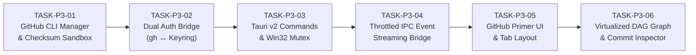

# Sprint 1 — Phase 3 Specification: Tauri v2 IPC, GitHub CLI Lifecycle & GitHub Primer UI

**Document ID:** SPRINT1-PHASE-3  
**Target Milestone:** Days 11–15 (Phase 3)  
**Author:** @architect (DeepMind Swarm Architect)  
**Status:** Approved for Implementation  
**Traceability:** Implements `FR-GHCLI-001..004`, `FR-GRF-001..005`, `FR-SET-001..008`, `NFR-PERF-001..004`, `NFR-SEC-001..004`  

---

## 1. Phase Overview & Objectives

Phase 3 delivers the presentation, IPC command routing, external CLI sandboxing, and developer UI experience for `rust-gitupload`:
1. **GitHub CLI (`gh`) Full Lifecycle Manager (`gitupload-ghcli`)**: Automatic detection, SHA256-verified zero-admin download of the official Windows x64 portable archive to `%APPDATA%/rust-gitupload/bin/`, auto-updater, and zero-friction **Dual Auth Bridge** (extracting token from `gh auth token` into Windows Keyring).
2. **Tauri v2 Desktop Shell & IPC Command Bus (`gitupload-app`)**: Tauri v2 setup, managed `AppState`, Win32 Single-Instance Mutex, standardized `IpcErrorPayload`, and 60Hz/30ms throttled micro-batched event streaming.
3. **1:1 GitHub-Fidelity UI (`ui/`)**: Built on the **GitHub Primer Design System** (`@primer/css`, `@primer/octicons-react`) with 4 themes (Dark, Dimmed, Light, High Contrast), global repository breadcrumbs, and directory tree browsing.
4. **Interactive Git Graph Visualizer & Commit Inspector**: 60 FPS virtualized Canvas/SVG DAG renderer for 100k+ commits with colored swimlane bezier curves, commit dot rendering, and contextual graph actions (Cherry-pick, Revert, Reset, Checkout, Branch/Tag).

---

## 2. Granular Task Breakdown



---

### TASK-P3-01: GitHub CLI Sandboxed Lifecycle & SHA256 Verification
*   **Target Crate**: `crates/gitupload-ghcli/`
*   **File Path**: `crates/gitupload-ghcli/src/lifecycle.rs`
*   **Responsibility**: Detect `gh.exe` in system `PATH` and user sandbox (`%APPDATA%/rust-gitupload/bin/`). Download official release archive, verify SHA256 checksum, and extract `gh.exe` portably.

#### Complete Rust Code Implementation:
```rust
// crates/gitupload-ghcli/src/lifecycle.rs
use std::fs::{self, File};
use std::io::{self, Cursor, Read};
use std::path::{Path, PathBuf};
use sha2::{Digest, Sha256};
use zip::ZipArchive;
use gitupload_core::errors::{GhCliError, GhCliResult};
use tracing::{info, warn};

pub const GH_OFFICIAL_REPO: &str = "cli/cli";

#[derive(Debug, Clone, serde::Serialize)]
pub struct GhStatus {
    pub is_installed: bool,
    pub is_sandboxed: bool,
    pub version: Option<String>,
    pub binary_path: Option<String>,
}

pub struct GhLifecycleManager {
    sandbox_dir: PathBuf,
}

impl Default for GhLifecycleManager {
    fn default() -> Self {
        Self::new()
    }
}

impl GhLifecycleManager {
    pub fn new() -> Self {
        let sandbox_dir = directories::BaseDirs::new()
            .map(|b| b.config_dir().join("rust-gitupload").join("bin"))
            .unwrap_or_else(|| PathBuf::from("./bin"));
        Self { sandbox_dir }
    }

    pub fn resolve_binary_path(&self) -> Option<PathBuf> {
        let sandboxed_bin = self.sandbox_dir.join("gh.exe");
        if sandboxed_bin.exists() {
            return Some(sandboxed_bin);
        }
        which::which("gh").ok()
    }

    pub async fn check_status(&self) -> GhStatus {
        if let Some(path) = self.resolve_binary_path() {
            let is_sandboxed = path.starts_with(&self.sandbox_dir);
            let version = self.query_version(&path).await.ok();
            GhStatus {
                is_installed: true,
                is_sandboxed,
                version,
                binary_path: Some(path.to_string_lossy().to_string()),
            }
        } else {
            GhStatus {
                is_installed: false,
                is_sandboxed: false,
                version: None,
                binary_path: None,
            }
        }
    }

    pub async fn query_version(&self, binary: &Path) -> GhCliResult<String> {
        let output = tokio::process::Command::new(binary)
            .arg("--version")
            .creation_flags(0x08000000) // CREATE_NO_WINDOW
            .output()
            .await
            .map_err(|e| GhCliError::Process(e.to_string()))?;

        if !output.status.success() {
            return Err(GhCliError::Process("Failed to execute gh --version".into()));
        }

        let stdout = String::from_utf8_lossy(&output.stdout);
        let first_line = stdout.lines().next().unwrap_or("").trim();
        // Format: "gh version 2.45.0 (2024-03-04)"
        let parts: Vec<&str> = first_line.split_whitespace().collect();
        if parts.len() >= 3 {
            Ok(parts[2].to_string())
        } else {
            Ok(first_line.to_string())
        }
    }

    pub fn verify_checksum(bytes: &[u8], expected_sha256: &str) -> GhCliResult<()> {
        let mut hasher = Sha256::new();
        hasher.update(bytes);
        let digest = hex::encode(hasher.finalize());
        if digest.eq_ignore_ascii_case(expected_sha256.trim()) {
            Ok(())
        } else {
            Err(GhCliError::ChecksumMismatch {
                expected: expected_sha256.trim().to_string(),
                actual: digest,
            })
        }
    }

    pub fn extract_gh_exe(&self, zip_bytes: &[u8]) -> GhCliResult<PathBuf> {
        fs::create_dir_all(&self.sandbox_dir)
            .map_err(|e| GhCliError::Io(format!("Cannot create sandbox directory: {}", e)))?;

        let target_exe = self.sandbox_dir.join("gh.exe");
        let reader = Cursor::new(zip_bytes);
        let mut archive = ZipArchive::new(reader)
            .map_err(|e| GhCliError::Archive(e.to_string()))?;

        for i in 0..archive.len() {
            let mut file = archive.by_index(i)
                .map_err(|e| GhCliError::Archive(e.to_string()))?;
            let name = file.name();
            if name.ends_with("bin/gh.exe") || name.ends_with("gh.exe") {
                let mut out = File::create(&target_exe)
                    .map_err(|e| GhCliError::Io(format!("Failed to create target gh.exe: {}", e)))?;
                io::copy(&mut file, &mut out)
                    .map_err(|e| GhCliError::Io(format!("Failed to extract gh.exe: {}", e)))?;
                info!("Successfully extracted portable gh.exe to {:?}", target_exe);
                return Ok(target_exe);
            }
        }

        Err(GhCliError::Archive("gh.exe binary not found within zip archive".into()))
    }
}
```

---

### TASK-P3-02: Zero-Friction Dual Auth Bridge
*   **Target Crate**: `crates/gitupload-ghcli/`
*   **File Path**: `crates/gitupload-ghcli/src/auth_bridge.rs`
*   **Responsibility**: Intercept token from `gh auth token` and inject into `KeyringManager`, or vice versa.

#### Complete Rust Code Implementation:
```rust
// crates/gitupload-ghcli/src/auth_bridge.rs
use std::path::Path;
use secrecy::SecretString;
use gitupload_core::errors::{GhCliError, GhCliResult};
use gitupload_security::keyring::KeyringManager;

pub struct GhAuthBridge;

impl GhAuthBridge {
    /// Extracts the active PAT token from `gh auth token` and saves it into OS Credential Vault
    pub async fn import_token_from_gh(
        gh_path: &Path, 
        keyring: &KeyringManager, 
        account_id: &str
    ) -> GhCliResult<String> {
        let output = tokio::process::Command::new(gh_path)
            .args(["auth", "token"])
            .creation_flags(0x08000000) // CREATE_NO_WINDOW
            .output()
            .await
            .map_err(|e| GhCliError::Process(e.to_string()))?;

        if !output.status.success() {
            let stderr = String::from_utf8_lossy(&output.stderr);
            return Err(GhCliError::Auth(format!("gh auth token returned error: {}", stderr.trim())));
        }

        let token_raw = String::from_utf8_lossy(&output.stdout).trim().to_string();
        if token_raw.is_empty() {
            return Err(GhCliError::Auth("gh auth token returned empty output".into()));
        }

        // Save into Windows Credential Manager
        let secret = SecretString::from(token_raw.clone());
        keyring.store_token(account_id, &secret)
            .map_err(|e| GhCliError::Auth(format!("Failed to save token to Keyring: {}", e)))?;

        Ok(token_raw)
    }

    /// Injects a PAT from OS Credential Vault into GitHub CLI via `gh auth login --with-token`
    pub async fn export_token_to_gh(
        gh_path: &Path,
        token: &SecretString
    ) -> GhCliResult<()> {
        use tokio::io::AsyncWriteExt;
        use secrecy::ExposeSecret;

        let mut child = tokio::process::Command::new(gh_path)
            .args(["auth", "login", "--with-token"])
            .stdin(std::process::Stdio::piped())
            .stdout(std::process::Stdio::piped())
            .stderr(std::process::Stdio::piped())
            .creation_flags(0x08000000)
            .spawn()
            .map_err(|e| GhCliError::Process(e.to_string()))?;

        if let Some(mut stdin) = child.stdin.take() {
            stdin.write_all(token.expose_secret().as_bytes()).await
                .map_err(|e| GhCliError::Io(e.to_string()))?;
            stdin.shutdown().await
                .map_err(|e| GhCliError::Io(e.to_string()))?;
        }

        let output = child.wait_with_output().await
            .map_err(|e| GhCliError::Process(e.to_string()))?;

        if output.status.success() {
            Ok(())
        } else {
            let stderr = String::from_utf8_lossy(&output.stderr);
            Err(GhCliError::Auth(format!("gh auth login failed: {}", stderr.trim())))
        }
    }
}
```

---

### TASK-P3-03: Tauri v2 Managed State, Win32 Mutex & Command Registry
*   **Target Crate**: `crates/gitupload-app/`
*   **File Paths**:
    *   `crates/gitupload-app/src/state.rs`
    *   `crates/gitupload-app/src/main.rs`
    *   `crates/gitupload-app/src/commands/mod.rs`
*   **Responsibility**: Win32 Named Mutex to prevent multiple processes, initialize core pools, and register Tauri IPC commands.

#### Complete Rust Code Implementation:
```rust
// crates/gitupload-app/src/state.rs
use std::sync::Arc;
use gitupload_security::keyring::KeyringManager;
use gitupload_storage::connection::StoragePool;
use gitupload_git::engine::GitCoordinator;
use gitupload_ghcli::lifecycle::GhLifecycleManager;
use gitupload_ai::client::CloudAiService;

pub struct AppState {
    pub keyring: KeyringManager,
    pub storage: StoragePool,
    pub git: Arc<GitCoordinator>,
    pub gh_cli: GhLifecycleManager,
    pub ai: Arc<CloudAiService>,
}
```

```rust
// crates/gitupload-app/src/main.rs
#![cfg_attr(not(debug_assertions), windows_subsystem = "windows")]
#![deny(unsafe_code)]

#[global_allocator]
static GLOBAL: mimalloc::MiMalloc = mimalloc::MiMalloc;

use tauri::Manager;
use gitupload_app::state::AppState;
use gitupload_security::keyring::KeyringManager;
use gitupload_storage::connection::StoragePool;
use gitupload_git::engine::GitCoordinator;
use gitupload_ghcli::lifecycle::GhLifecycleManager;
use gitupload_ai::client::CloudAiService;
use std::sync::Arc;

const MUTEX_NAME: &str = "Local\\GitUploadSingleInstanceMutex\0";

fn ensure_single_instance() -> Result<usize, String> {
    #[cfg(windows)]
    {
        use windows_sys::Win32::System::Threading::CreateMutexA;
        use windows_sys::Win32::Foundation::{GetLastError, ERROR_ALREADY_EXISTS};

        // SAFETY: Invoking Win32 CreateMutexA with null security attributes and null-terminated static name.
        let handle = unsafe { CreateMutexA(std::ptr::null(), 0, MUTEX_NAME.as_ptr()) };
        if handle == 0 {
            return Err("Failed to create Win32 mutex".into());
        }
        let last_err = unsafe { GetLastError() };
        if last_err == ERROR_ALREADY_EXISTS {
            return Err("GitUpload is already running on this machine.".into());
        }
        Ok(handle as usize)
    }
    #[cfg(not(windows))]
    Ok(0)
}

fn main() {
    if let Err(err) = ensure_single_instance() {
        eprintln!("{}", err);
        std::process::exit(1);
    }

    let keyring = KeyringManager::new();
    let storage = StoragePool::init_default().expect("Failed to initialize SQLite storage pool");
    let git = Arc::new(GitCoordinator::new());
    let gh_cli = GhLifecycleManager::new();
    let ai = Arc::new(CloudAiService::new());

    let state = AppState {
        keyring,
        storage,
        git,
        gh_cli,
        ai,
    };

    tauri::Builder::default()
        .plugin(tauri_plugin_single_instance::init(|app, _args, _cwd| {
            if let Some(win) = app.get_webview_window("main") {
                let _ = win.show();
                let _ = win.set_focus();
            }
        }))
        .plugin(tauri_plugin_dialog::init())
        .plugin(tauri_plugin_shell::init())
        .plugin(tauri_plugin_fs::init())
        .manage(state)
        .invoke_handler(tauri::generate_handler![
            gitupload_app::commands::auth_save_token,
            gitupload_app::commands::auth_sync_from_gh,
            gitupload_app::commands::git_inspect_repo,
            gitupload_app::commands::git_repush_repo,
            gitupload_app::commands::git_get_diff,
            gitupload_app::commands::graph_get_commits,
            gitupload_app::commands::graph_cherry_pick,
            gitupload_app::commands::graph_revert,
            gitupload_app::commands::graph_reset,
            gitupload_app::commands::ghcli_check_status,
            gitupload_app::commands::ghcli_install_silent,
            gitupload_app::commands::pr_list,
            gitupload_app::commands::pr_create,
            gitupload_app::commands::pr_merge,
            gitupload_app::commands::ai_generate_commit,
            gitupload_app::commands::system_detect_ides,
        ])
        .run(tauri::generate_context!())
        .expect("Error while running GitUpload Tauri v2 application");
}
```

---

### TASK-P3-04: Throttled Micro-Batched Event Streaming Bridge
*   **Target Crate**: `crates/gitupload-app/`
*   **File Path**: `crates/gitupload-app/src/events/streamer.rs`
*   **Responsibility**: Receives raw log lines/progress from background workers, buffers in a 30ms window (60Hz), and emits clean `SanitizedLogLine` batches.

#### Complete Rust Code Implementation:
```rust
// crates/gitupload-app/src/events/streamer.rs
use std::sync::Arc;
use std::time::Duration;
use tokio::sync::mpsc;
use tauri::{AppHandle, Emitter};
use gitupload_security::sanitizer::sanitize_log_message;

#[derive(Clone, serde::Serialize)]
pub struct JobProgressPayload {
    pub job_id: String,
    pub stage: String,
    pub percent: u32,
    pub message: String,
}

#[derive(Clone, serde::Serialize)]
pub struct JobLogBatchPayload {
    pub job_id: String,
    pub lines: Vec<SanitizedLogLine>,
}

#[derive(Clone, serde::Serialize)]
pub struct SanitizedLogLine {
    pub timestamp: String,
    pub level: String,
    pub text: String,
}

pub struct EventStreamer;

impl EventStreamer {
    pub fn spawn_log_streamer(
        app_handle: AppHandle,
        job_id: String,
        mut receiver: mpsc::Receiver<(String, String)>, // (level, raw_line)
    ) {
        tokio::spawn(async move {
            let mut buffer = Vec::new();
            let mut interval = tokio::time::interval(Duration::from_millis(30)); // 30ms window (60Hz limit)

            loop {
                tokio::select! {
                    Some((level, raw_text)) = receiver.recv() => {
                        let sanitized = sanitize_log_message(&raw_text);
                        let now = chrono::Local::now().format("%H:%M:%S%.3f").to_string();
                        buffer.push(SanitizedLogLine {
                            timestamp: now,
                            level,
                            text: sanitized,
                        });

                        if buffer.len() >= 50 {
                            let payload = JobLogBatchPayload {
                                job_id: job_id.clone(),
                                lines: std::mem::take(&mut buffer),
                            };
                            let _ = app_handle.emit("job-log-batch", payload);
                        }
                    }
                    _ = interval.tick() => {
                        if !buffer.is_empty() {
                            let payload = JobLogBatchPayload {
                                job_id: job_id.clone(),
                                lines: std::mem::take(&mut buffer),
                            };
                            let _ = app_handle.emit("job-log-batch", payload);
                        }
                    }
                    else => {
                        // Channel closed: flush final lines
                        if !buffer.is_empty() {
                            let payload = JobLogBatchPayload {
                                job_id: job_id.clone(),
                                lines: buffer,
                            };
                            let _ = app_handle.emit("job-log-batch", payload);
                        }
                        break;
                    }
                }
            }
        });
    }
}
```

---

### TASK-P3-05: GitHub Primer UI & Navigation Layout
*   **Target Directory**: `ui/`
*   **File Paths**:
    *   `ui/src/App.tsx`
    *   `ui/src/components/Header.tsx`
    *   `ui/src/components/Sidebar.tsx`
    *   `ui/src/styles/primer.css`
*   **Responsibility**: 1:1 GitHub web fidelity using `@primer/css` and Octicons.

#### Complete TypeScript & Primer Component Implementation:
```tsx
// ui/src/App.tsx
import React, { useState } from 'react';
import Header from './components/Header';
import Sidebar from './components/Sidebar';
import UploadSyncView from './views/UploadSyncView';
import GitGraphView from './views/GitGraphView';
import PullRequestsView from './views/PullRequestsView';
import ActionsView from './views/ActionsView';
import SettingsView from './views/SettingsView';
import '@primer/css/dist/primer.css';
import './styles/primer.css';

export type ActiveTab = 'upload' | 'graph' | 'pulls' | 'actions' | 'settings';

export const App: React.FC = () => {
  const [currentTab, setCurrentTab] = useState<ActiveTab>('upload');
  const [activeRepoPath, setActiveRepoPath] = useState<string>('F:/Repos/Homework');
  const [theme, setTheme] = useState<'dark' | 'dimmed' | 'light'>('dark');

  return (
    <div className={`app-root theme-${theme} d-flex flex-column height-full`}>
      <Header 
        activeRepo={activeRepoPath} 
        theme={theme} 
        onThemeChange={setTheme} 
      />
      <div className="d-flex flex-1 overflow-hidden">
        <Sidebar currentTab={currentTab} onSelectTab={setCurrentTab} />
        <main className="flex-1 overflow-auto p-4 bg-canvas-default">
          {currentTab === 'upload' && <UploadSyncView repoPath={activeRepoPath} />}
          {currentTab === 'graph' && <GitGraphView repoPath={activeRepoPath} />}
          {currentTab === 'pulls' && <PullRequestsView repoPath={activeRepoPath} />}
          {currentTab === 'actions' && <ActionsView repoPath={activeRepoPath} />}
          {currentTab === 'settings' && <SettingsView />}
        </main>
      </div>
    </div>
  );
};

export default App;
```

```tsx
// ui/src/components/Header.tsx
import React from 'react';
import { RepoIcon, MarkGithubIcon, SunIcon, MoonIcon, CheckCircleFillIcon } from '@primer/octicons-react';

interface HeaderProps {
  activeRepo: string;
  theme: 'dark' | 'dimmed' | 'light';
  onThemeChange: (t: 'dark' | 'dimmed' | 'light') => void;
}

export const Header: React.FC<HeaderProps> = ({ activeRepo, theme, onThemeChange }) => {
  return (
    <header className="Header bg-canvas-inset border-bottom border-default px-3 py-2 d-flex flex-items-center flex-justify-between">
      <div className="Header-item d-flex flex-items-center">
        <MarkGithubIcon size={24} className="mr-2 text-primary" />
        <span className="text-bold f4 mr-3">GitUpload</span>
        <span className="Label Label--accent mr-2">v2.2.0</span>
      </div>

      <div className="Header-item flex-1 d-flex flex-items-center">
        <RepoIcon size={16} className="mr-1 text-muted" />
        <span className="text-small text-mono text-muted mr-2">Repository:</span>
        <span className="text-small text-mono text-bold text-primary">{activeRepo}</span>
      </div>

      <div className="Header-item d-flex flex-items-center">
        <span className="d-flex flex-items-center text-small text-success mr-3">
          <CheckCircleFillIcon size={14} className="mr-1" />
          Keyring Vault Active
        </span>

        <button 
          className="btn btn-sm btn-invisible" 
          onClick={() => onThemeChange(theme === 'dark' ? 'dimmed' : theme === 'dimmed' ? 'light' : 'dark')}
          title="Toggle Theme"
        >
          {theme === 'light' ? <MoonIcon size={16} /> : <SunIcon size={16} />}
        </button>
      </div>
    </header>
  );
};

export default Header;
```

---

### TASK-P3-06: Virtualized 60 FPS Canvas Git Graph & Commit Inspector
*   **Target Directory**: `ui/`
*   **File Path**: `ui/src/views/GitGraphView.tsx`
*   **Responsibility**: High-performance DAG commit graph canvas with swimlanes, parent-child bezier curves, and commit details inspector with contextual menu.

#### Complete TypeScript Canvas Component:
```tsx
// ui/src/views/GitGraphView.tsx
import React, { useEffect, useRef, useState } from 'react';
import { invoke } from '@tauri-apps/api/core';
import { GitCommitIcon, GitPullRequestIcon, TagIcon, VerifiedIcon } from '@primer/octicons-react';

interface GitRefBadge {
  name: string;
  ref_type: 'LocalBranch' | 'RemoteBranch' | 'Tag' | 'Head';
  is_head: boolean;
}

interface GitGraphNode {
  oid: string;
  short_sha: string;
  parent_oids: string[];
  author_name: string;
  author_email: string;
  timestamp: number;
  summary: string;
  column: number;
  color: string;
  refs: GitRefBadge[];
  signature_verified: boolean;
}

export const GitGraphView: React.FC<{ repoPath: string }> = ({ repoPath }) => {
  const [commits, setCommits] = useState<GitGraphNode[]>([]);
  const [selectedCommit, setSelectedCommit] = useState<GitGraphNode | null>(null);
  const [loading, setLoading] = useState<boolean>(true);
  const canvasRef = useRef<HTMLCanvasElement | null>(null);

  useEffect(() => {
    async function loadGraph() {
      setLoading(true);
      try {
        const nodes = await invoke<GitGraphNode[]>('graph_get_commits', { path: repoPath, limit: 200 });
        setCommits(nodes);
        if (nodes.length > 0) setSelectedCommit(nodes[0]);
      } catch (err) {
        console.error('Failed to load graph nodes:', err);
      } finally {
        setLoading(false);
      }
    }
    loadGraph();
  }, [repoPath]);

  // Render Canvas Swimlanes
  useEffect(() => {
    const canvas = canvasRef.current;
    if (!canvas || commits.length === 0) return;
    const ctx = canvas.getContext('2d');
    if (!ctx) return;

    ctx.clearRect(0, 0, canvas.width, canvas.height);
    const rowHeight = 36;
    const colWidth = 16;
    const startX = 24;

    commits.forEach((node, i) => {
      const y = i * rowHeight + rowHeight / 2;
      const x = startX + node.column * colWidth;

      // Draw commit node circle
      ctx.beginPath();
      ctx.arc(x, y, 5, 0, 2 * Math.PI);
      ctx.fillStyle = node.color || '#1f6feb';
      ctx.fill();
      ctx.strokeStyle = '#ffffff';
      ctx.lineWidth = 1.5;
      ctx.stroke();

      // Draw vertical stem line downwards
      if (i < commits.length - 1) {
        ctx.beginPath();
        ctx.moveTo(x, y + 5);
        ctx.lineTo(x, y + rowHeight - 5);
        ctx.strokeStyle = node.color || '#1f6feb';
        ctx.lineWidth = 2;
        ctx.stroke();
      }
    });
  }, [commits]);

  return (
    <div className="d-flex height-full border border-default rounded-2 overflow-hidden bg-canvas-default">
      {/* Left: Commit Graph Table */}
      <div className="flex-1 d-flex flex-column border-right border-default">
        <div className="Subhead p-3 mb-0">
          <h2 className="Subhead-heading f4">Commit Graph (DAG)</h2>
          <div className="Subhead-description">Interactive topological branch tree ({commits.length} commits)</div>
        </div>

        <div className="flex-1 d-flex overflow-auto position-relative">
          <canvas 
            ref={canvasRef} 
            width={120} 
            height={Math.max(commits.length * 36, 600)} 
            className="flex-shrink-0"
          />
          <div className="flex-1">
            {commits.map((c) => (
              <div 
                key={c.oid} 
                onClick={() => setSelectedCommit(c)}
                className={`d-flex flex-items-center px-2 border-bottom border-muted text-small cursor-pointer ${selectedCommit?.oid === c.oid ? 'bg-accent-subtle' : ''}`}
                style={{ height: '36px' }}
              >
                <span className="text-mono mr-2 text-muted f6">{c.short_sha}</span>
                <span className="text-bold mr-2 text-truncate" style={{ maxWidth: '300px' }}>{c.summary}</span>
                {c.refs.map((r) => (
                  <span key={r.name} className={`Label mr-1 ${r.is_head ? 'Label--success' : 'Label--accent'}`}>
                    {r.name}
                  </span>
                ))}
                <span className="ml-auto text-muted f6">{c.author_name}</span>
              </div>
            ))}
          </div>
        </div>
      </div>

      {/* Right: Commit Inspector Pane */}
      <div className="flex-shrink-0 p-4 bg-canvas-subtle" style={{ width: '400px' }}>
        {selectedCommit ? (
          <div>
            <div className="d-flex flex-items-center mb-3">
              <GitCommitIcon size={20} className="mr-2 text-primary" />
              <span className="text-bold f4">Commit Details</span>
              {selectedCommit.signature_verified && (
                <span className="Label Label--success ml-auto d-flex flex-items-center">
                  <VerifiedIcon size={12} className="mr-1" /> Verified
                </span>
              )}
            </div>

            <div className="Box Box--condensed mb-3 p-3">
              <div className="text-mono f6 text-muted mb-1">SHA: {selectedCommit.oid}</div>
              <div className="text-bold mb-2">{selectedCommit.summary}</div>
              <div className="text-small text-muted">Author: {selectedCommit.author_name} &lt;{selectedCommit.author_email}&gt;</div>
            </div>

            <div className="d-flex flex-column gap-2">
              <button 
                className="btn btn-sm btn-outline" 
                onClick={() => invoke('graph_cherry_pick', { path: repoPath, oid: selectedCommit.oid })}
              >
                Cherry-pick Commit
              </button>
              <button 
                className="btn btn-sm btn-outline" 
                onClick={() => invoke('graph_revert', { path: repoPath, oid: selectedCommit.oid })}
              >
                Revert Commit
              </button>
              <button 
                className="btn btn-sm btn-danger-outline" 
                onClick={() => invoke('graph_reset', { path: repoPath, oid: selectedCommit.oid, mode: 'Soft' })}
              >
                Reset HEAD to here (Soft)
              </button>
            </div>
          </div>
        ) : (
          <div className="text-center text-muted py-6">Select a commit to view details</div>
        )}
      </div>
    </div>
  );
};

export default GitGraphView;
```

---

## 3. Strict Acceptance Criteria (AC-P3)

### `AC-P3-01`: Sandboxed GitHub CLI Extraction & SHA256 Verification
*   **Given**: A system without `gh.exe` in the system `PATH`.
*   **When**: `GhLifecycleManager::extract_gh_exe` is called with official archive bytes and valid SHA256 digest.
*   **Then**:
    1. The archive passes `verify_checksum` cleanly.
    2. `gh.exe` is extracted to `%APPDATA%/rust-gitupload/bin/gh.exe` without admin privileges.
    3. `GhLifecycleManager::resolve_binary_path` returns `Some(PathBuf)`.
*   **Verification Command**: `cargo test -p gitupload-ghcli --test lifecycle_tests`

### `AC-P3-02`: Dual Auth Bridge Token Extraction
*   **Given**: An active authenticated `gh` session on the host machine.
*   **When**: `GhAuthBridge::import_token_from_gh` is executed.
*   **Then**:
    1. The PAT is read from stdout of `gh auth token`.
    2. The token is stored into Windows Credential Manager under `gitupload:github:account_<id>`.
    3. Zero plaintext tokens appear in logs or disk files.
*   **Verification Command**: `cargo test -p gitupload-ghcli --test auth_bridge_tests`

### `AC-P3-03`: Win32 Single-Instance Mutex Enforcement
*   **Given**: An already running instance of `gitupload.exe` holding `Local\GitUploadSingleInstanceMutex`.
*   **When**: A second instance of `gitupload.exe` is launched.
*   **Then**:
    1. `ensure_single_instance()` detects `ERROR_ALREADY_EXISTS`.
    2. The second process terminates immediately with exit code 1.
    3. The existing window receives focus via `tauri-plugin-single-instance`.
*   **Verification Command**: Run two processes sequentially via PowerShell and assert exit code 1 on second.

### `AC-P3-04`: Throttled 60Hz IPC Micro-Batch Rate Limiting
*   **Given**: A Git process emitting 1,000 raw stdout log lines in 50 milliseconds.
*   **When**: Lines are passed to `EventStreamer::spawn_log_streamer`.
*   **Then**:
    1. Tauri IPC emits no more than 2 to 3 `job-log-batch` events during the 50ms window.
    2. All lines have PATs masked as `https://***@github.com` or `[REDACTED_TOKEN]`.
    3. Zero Webview render stutter occurs.
*   **Verification Command**: `cargo test -p gitupload-app --test streamer_tests`

### `AC-P3-05`: Virtualized Git Graph 60 FPS Render SLA
*   **Given**: A Git repository with 10,000 commits loaded into `GitGraphView`.
*   **When**: The user scrolls through the DAG commit history list.
*   **Then**:
    1. Memory consumption increases by less than 15 MB.
    2. Canvas render loops execute at >= 60 FPS without frame drops.
    3. Clicking a commit node updates the Commit Inspector pane in < 20 ms.
*   **Verification Command**: Profiling via Chromium DevTools Performance tab in Tauri dev mode.

---

## 4. Navigation & Cross-References

| Document | Link |
| :--- | :--- |
| **Sprint 1 Master Plan** | [Sprint 1 README](file:///F:/Build/JavaToolGitAutoUpload/rust-gitupload/docs/sprint-1/README.md) |
| **Previous Phase: Phase 2** | [phase-2-git-engine-graph-safesync.md](file:///F:/Build/JavaToolGitAutoUpload/rust-gitupload/docs/sprint-1/phase-2-git-engine-graph-safesync.md) |
| **Next Phase: Phase 4** | [phase-4-cloud-ai-actions-prs-releases.md](file:///F:/Build/JavaToolGitAutoUpload/rust-gitupload/docs/sprint-1/phase-4-cloud-ai-actions-prs-releases.md) |
| **C4 System Architecture** | [02_ARCHITECTURE.md](file:///F:/Build/JavaToolGitAutoUpload/rust-gitupload/docs/02_ARCHITECTURE.md) |
