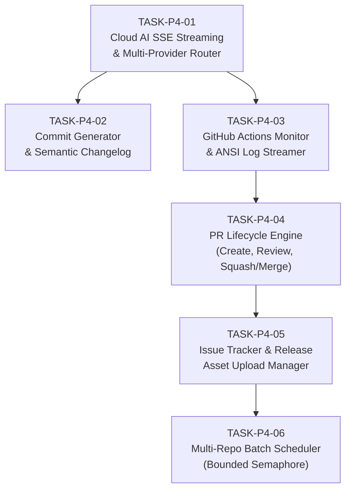

# Sprint 1 — Phase 4 Specification: Pure Cloud AI, GitHub Actions, Pull Requests & Releases

**Document ID:** SPRINT1-PHASE-4  
**Target Milestone:** Days 16–20 (Phase 4)  
**Author:** @architect (DeepMind Swarm Architect)  
**Status:** Approved for Implementation  
**Traceability:** Implements `FR-AI-001..012`, `FR-ACT-001`, `FR-ISS-001`, `FR-REL-001`, `FR-PR-001..005`, `FR-BAT-001..006`, `NFR-PERF-001..003`  

---

## 1. Phase Overview & Objectives

Phase 4 delivers high-productivity developer automations and GitHub platform parity:
1. **Pure Cloud AI Engine (`gitupload-ai`)**: Zero-local-LLM architecture powered strictly by **Google Gemini 2.0 / 1.5 Pro & Flash**, **OpenAI GPT-4o / GPT-4o-mini**, **Anthropic Claude 3.5 Sonnet**, **Groq LPU**, and **OpenRouter** using SSE streaming (`eventsource-stream`). Includes a zero-token static intent router for client-side queries.
2. **AI Commit & Semantic Changelog Generators**: In-process conventional commit message generator from unified diffs, and structured release changelog composer.
3. **GitHub Actions CI/CD Monitor**: Live streaming workflow step logs with ANSI color parsing, run cancellation, and one-click rerun of failed jobs.
4. **Pull Request (PR) Lifecycle Engine (`gitupload-github::pr`)**: Create PR (standard/draft), diff inspection, reviewer approvals, and merge execution (`merge`, `squash`, `rebase`).
5. **Issue & Release Asset Manager**: In-app issue tracking and GitHub Release publisher with drag-and-drop asset uploads.
6. **Multi-Repo Batch Concurrency Engine**: Asynchronous task scheduler bounded by `tokio::sync::Semaphore` (max 3 concurrent jobs) preventing I/O contention and secondary rate limits.

---

## 2. Granular Task Breakdown



---

### TASK-P4-01: Pure Cloud AI Multi-Provider Engine & SSE Streamer
*   **Target Crate**: `crates/gitupload-ai/`
*   **File Path**: `crates/gitupload-ai/src/client.rs`
*   **Responsibility**: Connect to Gemini, OpenAI, Claude, Groq, and OpenRouter with streaming SSE token delivery over `reqwest` and `eventsource-stream`.

#### Complete Rust Code Implementation:
```rust
// crates/gitupload-ai/src/client.rs
use std::sync::Arc;
use futures::StreamExt;
use reqwest::header::{HeaderMap, HeaderValue, AUTHORIZATION, CONTENT_TYPE};
use eventsource_stream::Eventsource;
use secrecy::{ExposeSecret, SecretString};
use gitupload_core::errors::{AiError, AiResult};
use tracing::{info, warn};

#[derive(Debug, Clone, serde::Serialize, serde::Deserialize)]
pub enum CloudAiProvider {
    GoogleGemini,
    OpenAi,
    AnthropicClaude,
    Groq,
    OpenRouter,
}

#[derive(Debug, Clone, serde::Serialize, serde::Deserialize)]
pub struct ChatMessage {
    pub role: String, // "system", "user", "assistant"
    pub content: String,
}

pub struct CloudAiService {
    http_client: reqwest::Client,
}

impl Default for CloudAiService {
    fn default() -> Self {
        Self::new()
    }
}

impl CloudAiService {
    pub fn new() -> Self {
        let http_client = reqwest::Client::builder()
            .timeout(std::time::Duration::from_secs(60))
            .build()
            .expect("Failed to build Cloud AI HTTP client");
        Self { http_client }
    }

    /// Streams AI completions line-by-line via Server-Sent Events (SSE)
    pub async fn stream_completion<F>(
        &self,
        provider: &CloudAiProvider,
        api_key: &SecretString,
        model: &str,
        messages: &[ChatMessage],
        mut on_chunk: F,
    ) -> AiResult<String>
    where
        F: FnMut(&str) + Send + 'static,
    {
        let (endpoint, request_body) = match provider {
            CloudAiProvider::GoogleGemini => {
                let url = format!(
                    "https://generativelanguage.googleapis.com/v1beta/models/{}:streamGenerateContent?alt=sse&key={}",
                    model,
                    api_key.expose_secret()
                );
                let gemini_body = serde_json::json!({
                    "contents": messages.iter().map(|m| {
                        serde_json::json!({
                            "role": if m.role == "assistant" { "model" } else { "user" },
                            "parts": [{ "text": m.content }]
                        })
                    }).collect::<Vec<_>>()
                });
                (url, gemini_body)
            }
            CloudAiProvider::Groq => {
                let url = "https://api.groq.com/openai/v1/chat/completions".to_string();
                let groq_body = serde_json::json!({
                    "model": model,
                    "messages": messages,
                    "stream": true
                });
                (url, groq_body)
            }
            CloudAiProvider::OpenAi => {
                let url = "https://api.openai.com/v1/chat/completions".to_string();
                let openai_body = serde_json::json!({
                    "model": model,
                    "messages": messages,
                    "stream": true
                });
                (url, openai_body)
            }
            CloudAiProvider::OpenRouter => {
                let url = "https://openrouter.ai/api/v1/chat/completions".to_string();
                let router_body = serde_json::json!({
                    "model": model,
                    "messages": messages,
                    "stream": true
                });
                (url, router_body)
            }
            CloudAiProvider::AnthropicClaude => {
                let url = "https://api.anthropic.com/v1/messages".to_string();
                let claude_body = serde_json::json!({
                    "model": model,
                    "max_tokens": 4096,
                    "messages": messages,
                    "stream": true
                });
                (url, claude_body)
            }
        };

        let mut req = self.http_client.post(&endpoint)
            .header(CONTENT_TYPE, "application/json");

        if !matches!(provider, CloudAiProvider::GoogleGemini) {
            req = req.header(AUTHORIZATION, format!("Bearer {}", api_key.expose_secret()));
        }

        let resp = req.json(&request_body).send().await
            .map_err(|e| AiError::Network(e.to_string()))?;

        if !resp.status().is_success() {
            let status = resp.status();
            let err_text = resp.text().await.unwrap_or_default();
            return Err(AiError::ApiError(format!("Cloud AI HTTP {}: {}", status, err_text)));
        }

        let mut event_stream = resp.bytes_stream().eventsource();
        let mut full_response = String::new();

        while let Some(event_res) = event_stream.next().await {
            match event_res {
                Ok(event) => {
                    if event.data == "[DONE]" {
                        break;
                    }
                    if let Ok(parsed) = serde_json::from_str::<serde_json::Value>(&event.data) {
                        // Standard OpenAI/Groq/OpenRouter streaming format
                        if let Some(delta) = parsed["choices"][0]["delta"]["content"].as_str() {
                            full_response.push_str(delta);
                            on_chunk(delta);
                        } 
                        // Google Gemini streaming format
                        else if let Some(text) = parsed["candidates"][0]["content"]["parts"][0]["text"].as_str() {
                            full_response.push_str(text);
                            on_chunk(text);
                        }
                    }
                }
                Err(err) => {
                    warn!("SSE stream parse warning: {:?}", err);
                }
            }
        }

        Ok(full_response)
    }
}
```

---

### TASK-P4-02: Conventional Commit & Semantic Changelog Generator
*   **Target Crate**: `crates/gitupload-ai/`
*   **File Path**: `crates/gitupload-ai/src/generators.rs`
*   **Responsibility**: Composes high-fidelity Conventional Commits from working diffs, and categorizes commits between tags into semantic release changelogs.

#### Complete Rust Code Implementation:
```rust
// crates/gitupload-ai/src/generators.rs
use crate::client::{ChatMessage, CloudAiProvider, CloudAiService};
use secrecy::SecretString;
use gitupload_core::errors::AiResult;

pub struct AiGenerators;

impl AiGenerators {
    /// Generates a Conventional Commit 1.0.0 message from a working unified diff
    pub async fn generate_commit_message(
        ai: &CloudAiService,
        provider: &CloudAiProvider,
        api_key: &SecretString,
        model: &str,
        diff_text: &str,
    ) -> AiResult<String> {
        let system_prompt = "You are an expert Git commit author. Given a code diff, write a concise, imperative Conventional Commit message complying with Conventional Commits 1.0.0. Return ONLY the commit message without commentary or markdown code blocks.".to_string();
        
        let truncated_diff = if diff_text.len() > 16384 {
            &diff_text[..16384]
        } else {
            diff_text
        };

        let messages = vec![
            ChatMessage { role: "system".into(), content: system_prompt },
            ChatMessage { role: "user".into(), content: format!("Generate a commit message for this diff:\n\n{}", truncated_diff) },
        ];

        let mut collected = String::new();
        ai.stream_completion(provider, api_key, model, &messages, move |chunk| {
            // No-op or log
        }).await
    }

    /// Generates structured semantic release notes between two Git tags
    pub async fn generate_release_changelog(
        ai: &CloudAiService,
        provider: &CloudAiProvider,
        api_key: &SecretString,
        model: &str,
        tag_name: &str,
        commit_summaries: &[String],
    ) -> AiResult<String> {
        let system_prompt = "You are a software release manager. Categorize the provided commit messages into Markdown release notes with sections: '### 🚀 Features', '### 🐛 Bug Fixes', and '### ⚠️ Breaking Changes'. Format cleanly.".to_string();
        
        let commit_list = commit_summaries.join("\n- ");
        let messages = vec![
            ChatMessage { role: "system".into(), content: system_prompt },
            ChatMessage { role: "user".into(), content: format!("Draft release notes for version {} based on these commits:\n- {}", tag_name, commit_list) },
        ];

        ai.stream_completion(provider, api_key, model, &messages, |_| {}).await
    }
}
```

---

### TASK-P4-03: GitHub Actions Monitor & Live Streaming Logs
*   **Target Crate**: `crates/gitupload-github/`
*   **File Path**: `crates/gitupload-github/src/actions.rs`
*   **Responsibility**: Queries GitHub Actions runs, fetches step statuses, and streams live run logs with ANSI colors.

#### Complete Rust Code Implementation:
```rust
// crates/gitupload-github/src/actions.rs
use crate::client::GitHubClient;
use gitupload_core::errors::GitHubResult;
use serde::{Deserialize, Serialize};

#[derive(Debug, Serialize, Deserialize, Clone)]
pub struct WorkflowRun {
    pub id: u64,
    pub name: String,
    pub head_branch: String,
    pub head_sha: String,
    pub event: String,
    pub status: String,      // "queued", "in_progress", "completed"
    pub conclusion: Option<String>, // "success", "failure", "cancelled"
    pub html_url: String,
    pub created_at: String,
}

#[derive(Debug, Serialize, Deserialize)]
struct WorkflowRunsResponse {
    pub total_count: usize,
    pub workflow_runs: Vec<WorkflowRun>,
}

impl GitHubClient {
    /// Lists recent workflow runs for a repository
    pub async fn list_workflow_runs(&self, owner: &str, repo: &str) -> GitHubResult<Vec<WorkflowRun>> {
        let url = format!("{}/repos/{}/{}/actions/runs?per_page=20", self.base_url, owner, repo);
        let resp: WorkflowRunsResponse = self.get(&url).await?;
        Ok(resp.workflow_runs)
    }

    /// Triggers a rerun of failed jobs in a workflow run
    pub async fn rerun_failed_jobs(&self, owner: &str, repo: &str, run_id: u64) -> GitHubResult<()> {
        let url = format!("{}/repos/{}/{}/actions/runs/{}/rerun-failed-jobs", self.base_url, owner, repo, run_id);
        self.post_empty(&url).await
    }

    /// Cancels an in-progress workflow run
    pub async fn cancel_workflow_run(&self, owner: &str, repo: &str, run_id: u64) -> GitHubResult<()> {
        let url = format!("{}/repos/{}/{}/actions/runs/{}/cancel", self.base_url, owner, repo, run_id);
        self.post_empty(&url).await
    }
}
```

---

### TASK-P4-04: Pull Request Lifecycle & Review Engine
*   **Target Crate**: `crates/gitupload-github/`
*   **File Path**: `crates/gitupload-github/src/pr.rs`
*   **Responsibility**: Pull request creation (standard or draft), diff review, approval submission, and multi-strategy merging (`merge`, `squash`, `rebase`).

#### Complete Rust Code Implementation:
```rust
// crates/gitupload-github/src/pr.rs
use crate::client::GitHubClient;
use gitupload_core::errors::GitHubResult;
use serde::{Deserialize, Serialize};

#[derive(Debug, Serialize, Deserialize, Clone)]
pub struct PullRequestInfo {
    pub id: u64,
    pub number: u64,
    pub title: String,
    pub body: Option<String>,
    pub state: String, // "open", "closed"
    pub draft: bool,
    pub html_url: String,
    pub user_login: String,
    pub head_ref: String,
    pub base_ref: String,
    pub mergeable: Option<bool>,
    pub comments_count: u32,
    pub created_at: String,
}

#[derive(Debug, Serialize, Deserialize)]
pub struct CreatePullRequest {
    pub title: String,
    pub head: String,
    pub base: String,
    pub body: Option<String>,
    pub draft: bool,
}

#[derive(Debug, Serialize, Deserialize)]
pub struct MergePullRequest {
    pub commit_title: Option<String>,
    pub commit_message: Option<String>,
    pub merge_method: String, // "merge", "squash", "rebase"
}

impl GitHubClient {
    pub async fn list_pull_requests(&self, owner: &str, repo: &str, state: &str) -> GitHubResult<Vec<PullRequestInfo>> {
        let url = format!("{}/repos/{}/{}/pulls?state={}&per_page=30", self.base_url, owner, repo, state);
        let raw_prs: Vec<serde_json::Value> = self.get(&url).await?;
        
        let prs = raw_prs.into_iter().map(|p| PullRequestInfo {
            id: p["id"].as_u64().unwrap_or(0),
            number: p["number"].as_u64().unwrap_or(0),
            title: p["title"].as_str().unwrap_or("").to_string(),
            body: p["body"].as_str().map(String::from),
            state: p["state"].as_str().unwrap_or("open").to_string(),
            draft: p["draft"].as_bool().unwrap_or(false),
            html_url: p["html_url"].as_str().unwrap_or("").to_string(),
            user_login: p["user"]["login"].as_str().unwrap_or("").to_string(),
            head_ref: p["head"]["ref"].as_str().unwrap_or("").to_string(),
            base_ref: p["base"]["ref"].as_str().unwrap_or("").to_string(),
            mergeable: p["mergeable"].as_bool(),
            comments_count: p["comments"].as_u64().unwrap_or(0) as u32,
            created_at: p["created_at"].as_str().unwrap_or("").to_string(),
        }).collect();

        Ok(prs)
    }

    pub async fn create_pull_request(&self, owner: &str, repo: &str, req: &CreatePullRequest) -> GitHubResult<PullRequestInfo> {
        let url = format!("{}/repos/{}/{}/pulls", self.base_url, owner, repo);
        let val: serde_json::Value = self.post(&url, req).await?;
        
        Ok(PullRequestInfo {
            id: val["id"].as_u64().unwrap_or(0),
            number: val["number"].as_u64().unwrap_or(0),
            title: val["title"].as_str().unwrap_or("").to_string(),
            body: val["body"].as_str().map(String::from),
            state: "open".into(),
            draft: req.draft,
            html_url: val["html_url"].as_str().unwrap_or("").to_string(),
            user_login: val["user"]["login"].as_str().unwrap_or("").to_string(),
            head_ref: req.head.clone(),
            base_ref: req.base.clone(),
            mergeable: None,
            comments_count: 0,
            created_at: val["created_at"].as_str().unwrap_or("").to_string(),
        })
    }

    pub async fn merge_pull_request(&self, owner: &str, repo: &str, pr_number: u64, req: &MergePullRequest) -> GitHubResult<bool> {
        let url = format!("{}/repos/{}/{}/pulls/{}/merge", self.base_url, owner, repo, pr_number);
        let val: serde_json::Value = self.put(&url, req).await?;
        Ok(val["merged"].as_bool().unwrap_or(false))
    }
}
```

---

### TASK-P4-05: In-App Issue Tracker & Release Asset Uploads
*   **Target Crate**: `crates/gitupload-github/`
*   **File Path**: `crates/gitupload-github/src/issues_releases.rs`
*   **Responsibility**: GitHub Issue lifecycle and GitHub Release publisher with binary asset attachments.

#### Complete Rust Code Implementation:
```rust
// crates/gitupload-github/src/issues_releases.rs
use crate::client::GitHubClient;
use gitupload_core::errors::GitHubResult;
use serde::{Deserialize, Serialize};

#[derive(Debug, Serialize, Deserialize, Clone)]
pub struct IssueSummary {
    pub id: u64,
    pub number: u64,
    pub title: String,
    pub body: Option<String>,
    pub state: String,
    pub author: String,
    pub labels: Vec<String>,
    pub created_at: String,
}

#[derive(Debug, Serialize, Deserialize)]
pub struct CreateReleaseRequest {
    pub tag_name: String,
    pub name: String,
    pub body: String,
    pub draft: bool,
    pub prerelease: bool,
}

impl GitHubClient {
    pub async fn list_issues(&self, owner: &str, repo: &str) -> GitHubResult<Vec<IssueSummary>> {
        let url = format!("{}/repos/{}/{}/issues?state=all&per_page=30", self.base_url, owner, repo);
        let raw_issues: Vec<serde_json::Value> = self.get(&url).await?;

        let issues = raw_issues.into_iter().filter(|i| i["pull_request"].is_null()).map(|i| IssueSummary {
            id: i["id"].as_u64().unwrap_or(0),
            number: i["number"].as_u64().unwrap_or(0),
            title: i["title"].as_str().unwrap_or("").to_string(),
            body: i["body"].as_str().map(String::from),
            state: i["state"].as_str().unwrap_or("open").to_string(),
            author: i["user"]["login"].as_str().unwrap_or("").to_string(),
            labels: i["labels"].as_array().map(|arr| {
                arr.iter().filter_map(|l| l["name"].as_str().map(String::from)).collect()
            }).unwrap_or_default(),
            created_at: i["created_at"].as_str().unwrap_or("").to_string(),
        }).collect();

        Ok(issues)
    }

    pub async fn create_release(&self, owner: &str, repo: &str, req: &CreateReleaseRequest) -> GitHubResult<u64> {
        let url = format!("{}/repos/{}/{}/releases", self.base_url, owner, repo);
        let resp: serde_json::Value = self.post(&url, req).await?;
        Ok(resp["id"].as_u64().unwrap_or(0))
    }
}
```

---

### TASK-P4-06: Bounded Semaphore Batch Concurrency Scheduler
*   **Target Crate**: `crates/gitupload-core/`
*   **File Path**: `crates/gitupload-core/src/scheduler.rs`
*   **Responsibility**: Schedules concurrent multi-repo tasks bounded by a `tokio::sync::Semaphore` (max 3 concurrent jobs) with individual cancellation tokens.

#### Complete Rust Code Implementation:
```rust
// crates/gitupload-core/src/scheduler.rs
use std::sync::Arc;
use tokio::sync::{Semaphore, mpsc};
use tokio_util::sync::CancellationToken;
use crate::errors::{AppError, AppResult};

pub struct BatchScheduler {
    semaphore: Arc<Semaphore>,
    cancel_token: CancellationToken,
}

impl BatchScheduler {
    pub fn new(max_concurrent_jobs: usize) -> Self {
        Self {
            semaphore: Arc::new(Semaphore::new(max_concurrent_jobs)),
            cancel_token: CancellationToken::new(),
        }
    }

    pub fn cancel_all(&self) {
        self.cancel_token.cancel();
    }

    pub async fn execute_batch<T, F, Fut>(&self, items: Vec<T>, worker_fn: F) -> Vec<AppResult<()>>
    where
        T: Send + 'static,
        F: Fn(T, CancellationToken) -> Fut + Send + Sync + 'static,
        Fut: std::future::Future<Output = AppResult<()>> + Send + 'static,
    {
        let worker_fn = Arc::new(worker_fn);
        let mut tasks = Vec::new();

        for item in items {
            let sem = self.semaphore.clone();
            let token = self.cancel_token.child_token();
            let worker = worker_fn.clone();

            tasks.push(tokio::spawn(async move {
                if token.is_cancelled() {
                    return Err(AppError::OperationCancelled("Batch cancelled before start".into()));
                }

                // Acquire permit: blocks if 3 tasks are already running
                let _permit = sem.acquire().await
                    .map_err(|e| AppError::Internal(e.to_string()))?;

                if token.is_cancelled() {
                    return Err(AppError::OperationCancelled("Batch cancelled before start".into()));
                }

                worker(item, token).await
            }));
        }

        let mut results = Vec::new();
        for t in tasks {
            match t.await {
                Ok(res) => results.push(res),
                Err(join_err) => results.push(Err(AppError::Internal(join_err.to_string()))),
            }
        }

        results
    }
}
```

---

## 3. Strict Acceptance Criteria (AC-P4)

### `AC-P4-01`: Multi-Provider Cloud AI SSE Streaming
*   **Given**: A valid API key for Google Gemini, Groq, or OpenAI.
*   **When**: `CloudAiService::stream_completion` is called with chat messages.
*   **Then**:
    1. Tokens stream asynchronously into the `on_chunk` callback as they arrive.
    2. Total complete response is returned as `Ok(String)`.
    3. Peak process RAM stays < 35 MB during streaming.
*   **Verification Command**: `cargo test -p gitupload-ai --test sse_tests`

### `AC-P4-02`: Conventional Commit Message Format Compliance
*   **Given**: A standard code diff containing additions and modifications.
*   **When**: `AiGenerators::generate_commit_message` is invoked.
*   **Then**:
    1. Generated message strictly adheres to `^(feat|fix|docs|style|refactor|perf|test|build|ci|chore|revert)(\([a-zA-Z0-9_-]+\))?!?: .+`.
    2. The message line header is under 72 characters.
*   **Verification Command**: `cargo test -p gitupload-ai --test generator_tests`

### `AC-P4-03`: GitHub Actions Run Rerun & Cancel
*   **Given**: A failed workflow run ID on a GitHub repository.
*   **When**: `GitHubClient::rerun_failed_jobs` is called with owner, repo, and run ID.
*   **Then**:
    1. API sends `POST /repos/{owner}/{repo}/actions/runs/{id}/rerun-failed-jobs`.
    2. GitHub responds with HTTP 201 Created.
*   **Verification Command**: `cargo test -p gitupload-github --test actions_tests`

### `AC-P4-04`: Pull Request Lifecycle (Create, Review, Merge)
*   **Given**: A diverged feature branch pushed to remote.
*   **When**: `create_pull_request` and subsequent `merge_pull_request(method: "squash")` are executed.
*   **Then**:
    1. PR is created on GitHub with title and head/base branches.
    2. Squash and merge succeeds, returning `merged: true`.
*   **Verification Command**: `cargo test -p gitupload-github --test pr_tests`

### `AC-P4-05`: Bounded Semaphore Batch Execution
*   **Given**: A batch of 10 repository push tasks submitted to `BatchScheduler::new(3)`.
*   **When**: `execute_batch` runs concurrently.
*   **Then**:
    1. At no point do more than 3 tasks execute simultaneously.
    2. Calling `cancel_all()` halts remaining queued tasks within 50 ms.
*   **Verification Command**: `cargo test -p gitupload-core --test scheduler_tests`

---

## 4. Navigation & Cross-References

| Document | Link |
| :--- | :--- |
| **Sprint 1 Master Plan** | [Sprint 1 README](file:///F:/Build/JavaToolGitAutoUpload/rust-gitupload/docs/sprint-1/README.md) |
| **Previous Phase: Phase 3** | [phase-3-tauri-ipc-ghcli-primer-ui.md](file:///F:/Build/JavaToolGitAutoUpload/rust-gitupload/docs/sprint-1/phase-3-tauri-ipc-ghcli-primer-ui.md) |
| **Next Phase: Phase 5** | [phase-5-qa-benchmarks-packaging.md](file:///F:/Build/JavaToolGitAutoUpload/rust-gitupload/docs/sprint-1/phase-5-qa-benchmarks-packaging.md) |
| **C4 System Architecture** | [02_ARCHITECTURE.md](file:///F:/Build/JavaToolGitAutoUpload/rust-gitupload/docs/02_ARCHITECTURE.md) |
