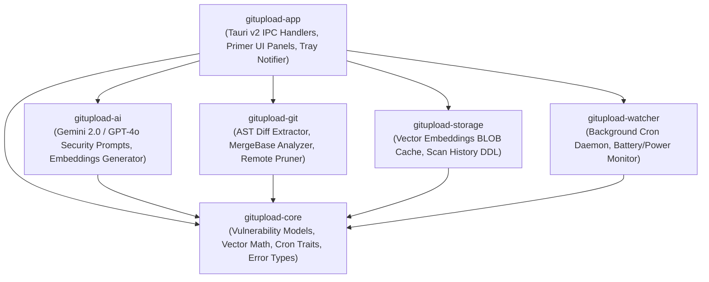

# Sprint 3 — Master Execution Guide: AI DevSecOps & Deep Code Intelligence (v2.4)

**Sprint ID:** SPRINT-3-V2.4  
**Target Milestone:** Days 36–50 (Sprint 3)  
**Theme:** AI DevSecOps, Semantic Code Intelligence & Autonomous Maintenance  
**Author:** @architect (DeepMind Swarm Architect)  
**Status:** Approved for Implementation  
**Audience:** Core Developers, AI Engineers, Security Verifiers, QA Team  

---

## 1. Executive Summary & Sprint Mission

Sprint 3 transforms **GitUpload** from an authentic GitHub desktop client into an **autonomous AI DevSecOps powerhouse**. While Sprint 1 delivered the foundational 10-crate core, Primer UI, and dual Git engine, and Sprint 2 introduced team collaboration and multi-remote mirroring, **Sprint 3 elevates developer workflow security, code search, and repository maintenance**:

1. **Pre-Push AI Vulnerability Scanner (DevSecOps)**: Automatic AST and diff inspection detecting OWASP Top 10 vulnerabilities, CWE security risks, hardcoded credentials, and memory safety anti-patterns before commits are pushed, complete with 1-click Cloud AI automated patch application.
2. **Semantic Commit & History Search**: Natural language vector embeddings and in-process cosine similarity engine enabling semantic searches across thousands of historical commits (e.g., *"when did we fix the auth token memory leak?"*) in under 50ms.
3. **Automated Stale Branch Cleaner**: Topological analysis detecting merged, squashed, and abandoned local and remote feature branches, providing safe bulk pruning with branch protection guardrails.
4. **Autonomous Background Sync Daemon**: Energy-aware Tokio cron scheduler performing silent background fetches, tracking ahead/behind deltas, and triggering auto-sync without UI interruption while consuming < 0.5% CPU.
5. **Comprehensive DevSecOps & QA Benchmark Suite**: Automated regression harnesses validating AI vulnerability detection accuracy, sub-50ms search query SLAs, and minimal battery impact.

---

## 2. Sprint 3 Phase Directory & Specification Index

All Sprint 3 phase specifications are organized under `docs/sprint-3/` and mirrored via `docs/sprint 3/`:

| Phase | Specification Document | Primary Focus | Key Deliverables |
| :--- | :--- | :--- | :--- |
| **Phase 1** | [`phase-1-ai-vulnerability-scanner.md`](file:///F:/Build/JavaToolGitAutoUpload/rust-gitupload/docs/sprint-3/phase-1-ai-vulnerability-scanner.md) | Pre-Push DevSecOps Scanner | AST diff parser, OWASP/CWE detector, 1-click Cloud AI code patcher (`TASK-P1-01..05`) |
| **Phase 2** | [`phase-2-semantic-commit-search.md`](file:///F:/Build/JavaToolGitAutoUpload/rust-gitupload/docs/sprint-3/phase-2-semantic-commit-search.md) | Natural Language History Search | Cloud vector embeddings, SQLite BLOB vector storage, fast cosine similarity ranker (`TASK-P2-01..05`) |
| **Phase 3** | [`phase-3-stale-branch-cleaner.md`](file:///F:/Build/JavaToolGitAutoUpload/rust-gitupload/docs/sprint-3/phase-3-stale-branch-cleaner.md) | Repo Hygiene & Stale Pruning | Squashed/merged branch detector, remote ref pruner, dry-run safety dialog (`TASK-P3-01..05`) |
| **Phase 4** | [`phase-4-background-scheduled-sync.md`](file:///F:/Build/JavaToolGitAutoUpload/rust-gitupload/docs/sprint-3/phase-4-background-scheduled-sync.md) | Background Autonomous Sync | Tokio cron engine, Windows power/battery awareness, silent fetch, tray alerts (`TASK-P4-01..05`) |
| **Phase 5** | [`phase-5-sprint3-qa-verification.md`](file:///F:/Build/JavaToolGitAutoUpload/rust-gitupload/docs/sprint-3/phase-5-sprint3-qa-verification.md) | Testing & Benchmark SLAs | AI detection test suite, <50ms search latency benchmark, <0.5% CPU battery audit (`TASK-P5-01..05`) |

---

## 3. Sprint 3 Architecture & Crate Allocation

Sprint 3 features are built modularly across the established 10 workspace crates:

---

## 4. Definition of Ready (DoR) & Definition of Done (DoD)

### 4.1 Definition of Ready (DoR)
1. Complete architectural specifications approved in `02_ARCHITECTURE.md` and Sprint 3 phase documents.
2. Sprint 1 & Sprint 2 crates compile cleanly without warnings on stable Rust 1.82+.
3. OS Credential Vault (`keyring`) verified for storing Cloud AI API keys securely.
4. SQLite WAL database migrations up to version `004` defined and tested.

### 4.2 Definition of Done (DoD)
1. **Compilation**: `cargo check --workspace` and `cargo clippy --workspace --all-targets -- -D warnings` pass with 0 errors/warnings.
2. **Safety**: `#![forbid(unsafe_code)]` preserved across all new modules.
3. **Tests**: 100% of unit and integration tests defined in each phase pass via `cargo test`.
4. **Performance SLAs**:
   - Pre-push vulnerability scan completes in < 2.5 seconds.
   - Semantic commit search over 10,000 commits completes in < 50 milliseconds.
   - Background sync daemon consumes < 0.5% CPU when idle and automatically suspends on low battery.
5. **Security**: Zero plaintext tokens or private code snippets written to unencrypted logs or disk.
