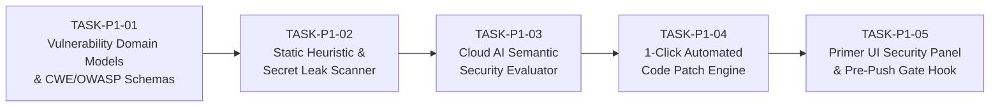

# Sprint 3 — Phase 1 Specification: Pre-Push AI Vulnerability Scanner & Automated Fixer

**Document ID:** SPRINT3-PHASE-1  
**Target Milestone:** Days 36–38 (Sprint 3, Phase 1)  
**Author:** @architect (DeepMind Swarm Architect)  
**Status:** Approved for Implementation  
**Traceability:** Implements `FR-SEC-001..008`, `FR-AI-005..008`, `NFR-PERF-001..003`, `NFR-SEC-001..004`  

---

## 1. Phase Overview & Objectives

Phase 1 establishes a proactive, developer-first **DevSecOps Security Pipeline** inside `rust-gitupload`:
1. **Pre-Push Security Auditing**: Scans uncommitted working diffs and staged commits before remote transmission, preventing vulnerable code or credential leaks from ever hitting GitHub.
2. **Hybrid Static & Cloud AI Detection Engine**:
   - **Fast Local Static Rules**: Instant regex/heuristic scanning for high-entropy secrets, hardcoded AWS/GitHub keys, private SSH keys, and unencrypted `.env` files (< 5ms).
   - **Deep Cloud AI Semantic Analysis**: Evaluates code context using Google Gemini 2.0 Flash or OpenAI GPT-4o for OWASP Top 10 vulnerabilities (SQL injection, path traversal, unsafe deserialization, command injection, and memory safety flaws).
3. **Interactive Vulnerability Inspector & 1-Click Patch Application**: Presents findings with severity badges (`CRITICAL`, `HIGH`, `MEDIUM`, `LOW`), CWE / OWASP categorizations, code line highlights, and an **"Apply AI Fix"** button that directly applies a validated patch to the local file.

---

## 2. Granular Task Breakdown



---

### TASK-P1-01: Vulnerability Domain Models & Severity Schemas
*   **Target Crate**: `crates/gitupload-core/`
*   **File Path**: `crates/gitupload-core/src/models/security.rs`
*   **Responsibility**: Defines standardized data structures for security findings, CWE references, and patch proposals.

#### Complete Rust Code Implementation:
```rust
// crates/gitupload-core/src/models/security.rs
use serde::{Deserialize, Serialize};

#[derive(Debug, Serialize, Deserialize, Clone, PartialEq, Eq)]
pub enum VulnerabilitySeverity {
    Critical,
    High,
    Medium,
    Low,
    Informational,
}

#[derive(Debug, Serialize, Deserialize, Clone)]
pub struct VulnerabilityFinding {
    pub id: String,                         // UUID v4
    pub title: String,                      // e.g. "SQL Injection Vulnerability"
    pub description: String,                // Detailed technical explanation
    pub severity: VulnerabilitySeverity,
    pub cwe_id: Option<String>,             // e.g. "CWE-89"
    pub owasp_category: Option<String>,      // e.g. "A03:2021-Injection"
    pub file_path: String,                  // Relative path in repository
    pub line_start: usize,
    pub line_end: usize,
    pub vulnerable_snippet: String,
    pub suggested_fix: Option<SecurityPatchProposal>,
}

#[derive(Debug, Serialize, Deserialize, Clone)]
pub struct SecurityPatchProposal {
    pub patch_description: String,
    pub original_code: String,
    pub replacement_code: String,
    pub diff_unified: String,
}

#[derive(Debug, Serialize, Deserialize, Clone)]
pub struct SecurityAuditReport {
    pub scan_id: String,
    pub repo_path: String,
    pub total_findings: usize,
    pub critical_count: usize,
    pub high_count: usize,
    pub medium_count: usize,
    pub low_count: usize,
    pub findings: Vec<VulnerabilityFinding>,
    pub scan_duration_ms: u64,
    pub passed: bool, // false if any Critical or High severity finding is present
}
```

---

### TASK-P1-02: Fast Local Static Secret & Pattern Scanner
*   **Target Crate**: `crates/gitupload-security/`
*   **File Path**: `crates/gitupload-security/src/scanner.rs`
*   **Responsibility**: Performs sub-millisecond local regex scanning on staged diffs to catch raw secrets, tokens, private keys, and high-entropy strings without invoking external network requests.

#### Complete Rust Code Implementation:
```rust
// crates/gitupload-security/src/scanner.rs
use regex::Regex;
use std::sync::LazyLock;
use gitupload_core::models::security::{VulnerabilityFinding, VulnerabilitySeverity};

static SECRET_PATTERNS: LazyLock<Vec<(&'static str, &'static str, VulnerabilitySeverity, Regex)>> = LazyLock::new(|| {
    vec![
        (
            "Hardcoded GitHub Personal Access Token",
            "CWE-798",
            VulnerabilitySeverity::Critical,
            Regex::new(r"gh[pousr]_[A-Za-z0-9_]{36,255}").unwrap(),
        ),
        (
            "AWS Access Key ID",
            "CWE-798",
            VulnerabilitySeverity::Critical,
            Regex::new(r"AKIA[0-9A-Z]{16}").unwrap(),
        ),
        (
            "Generic Private Cryptographic Key",
            "CWE-312",
            VulnerabilitySeverity::Critical,
            Regex::new(r"-----BEGIN (RSA|EC|OPENSSH|PGP) PRIVATE KEY-----").unwrap(),
        ),
        (
            "Hardcoded High-Entropy API Secret",
            "CWE-798",
            VulnerabilitySeverity::High,
            Regex::new(r#"(?i)(api[_-]?key|secret[_-]?key|auth[_-]?token)\s*[:=]\s*["'][A-Za-z0-9_\-]{20,80}["']"#).unwrap(),
        ),
    ]
});

pub struct StaticSecretScanner;

impl StaticSecretScanner {
    /// Scans a file's content or diff hunk lines for sensitive secrets
    pub fn scan_content(file_path: &str, content: &str) -> Vec<VulnerabilityFinding> {
        let mut findings = Vec::new();

        // Check if committing an unencrypted environment file
        if file_path.ends_with(".env") || file_path.contains("/.env.") || file_path.contains("\\.env.") {
            findings.push(VulnerabilityFinding {
                id: uuid::Uuid::new_v4().to_string(),
                title: "Unencrypted Environment File Tracked".into(),
                description: format!("File '{}' appears to be an environment file containing sensitive runtime variables.", file_path),
                severity: VulnerabilitySeverity::Critical,
                cwe_id: Some("CWE-312".into()),
                owasp_category: Some("A05:2021-Security Misconfiguration".into()),
                file_path: file_path.to_string(),
                line_start: 1,
                line_end: 1,
                vulnerable_snippet: file_path.to_string(),
                suggested_fix: None,
            });
        }

        for (line_no, line) in content.lines().enumerate() {
            for (title, cwe, severity, pattern) in SECRET_PATTERNS.iter() {
                if let Some(mat) = pattern.find(line) {
                    findings.push(VulnerabilityFinding {
                        id: uuid::Uuid::new_v4().to_string(),
                        title: title.to_string(),
                        description: format!("Detected potential hardcoded credential on line {}.", line_no + 1),
                        severity: severity.clone(),
                        cwe_id: Some(cwe.to_string()),
                        owasp_category: Some("A07:2021-Identification and Authentication Failures".into()),
                        file_path: file_path.to_string(),
                        line_start: line_no + 1,
                        line_end: line_no + 1,
                        vulnerable_snippet: line.trim().to_string(),
                        suggested_fix: None,
                    });
                }
            }
        }

        findings
    }
}
```

---

### TASK-P1-03: Cloud AI Semantic Security Evaluator
*   **Target Crate**: `crates/gitupload-ai/`
*   **File Path**: `crates/gitupload-ai/src/security_evaluator.rs`
*   **Responsibility**: Formulates security evaluation prompts and parses structured JSON responses from Gemini 2.0 Flash or GPT-4o for OWASP Top 10 vulnerabilities.

#### Complete Rust Code Implementation:
```rust
// crates/gitupload-ai/src/security_evaluator.rs
use crate::client::{ChatMessage, CloudAiProvider, CloudAiService};
use secrecy::SecretString;
use gitupload_core::errors::{AiError, AiResult};
use gitupload_core::models::security::{SecurityPatchProposal, VulnerabilityFinding, VulnerabilitySeverity};

pub struct CloudAiSecurityEvaluator;

impl CloudAiSecurityEvaluator {
    /// Evaluates a working code diff for semantic security vulnerabilities using Cloud AI
    pub async fn evaluate_diff(
        ai: &CloudAiService,
        provider: &CloudAiProvider,
        api_key: &SecretString,
        model: &str,
        file_path: &str,
        diff_text: &str,
    ) -> AiResult<Vec<VulnerabilityFinding>> {
        let system_prompt = r#"You are a principal application security engineer. Analyze the provided Git diff for security vulnerabilities (OWASP Top 10, CWE).
Respond ONLY with a JSON array conforming to this schema:
[
  {
    "title": "string",
    "description": "string",
    "severity": "Critical" | "High" | "Medium" | "Low",
    "cwe_id": "string",
    "owasp_category": "string",
    "line_start": number,
    "line_end": number,
    "vulnerable_snippet": "string",
    "patch_description": "string",
    "replacement_code": "string"
  }
]
If no vulnerabilities exist, return an empty array []. Do not output markdown code fences."#;

        let messages = vec![
            ChatMessage { role: "system".into(), content: system_prompt.into() },
            ChatMessage { role: "user".into(), content: format!("Analyze file '{}' with diff:\n\n{}", file_path, diff_text) },
        ];

        let response = ai.stream_completion(provider, api_key, model, &messages, |_| {}).await?;
        let trimmed = response.trim().trim_start_matches("```json").trim_start_matches("```").trim_end_matches("```").trim();

        if trimmed.is_empty() || trimmed == "[]" {
            return Ok(Vec::new());
        }

        let raw_findings: Vec<serde_json::Value> = serde_json::from_str(trimmed)
            .map_err(|e| AiError::JsonParse(format!("Failed to parse security audit JSON: {} (Output: {})", e, trimmed)))?;

        let findings = raw_findings.into_iter().map(|f| {
            let severity_str = f["severity"].as_str().unwrap_or("Medium");
            let severity = match severity_str {
                "Critical" => VulnerabilitySeverity::Critical,
                "High" => VulnerabilitySeverity::High,
                "Low" => VulnerabilitySeverity::Low,
                _ => VulnerabilitySeverity::Medium,
            };

            let replacement = f["replacement_code"].as_str().map(String::from);
            let patch_desc = f["patch_description"].as_str().unwrap_or("Apply security remediation").to_string();
            let original = f["vulnerable_snippet"].as_str().unwrap_or("").to_string();

            let patch_proposal = replacement.map(|r| SecurityPatchProposal {
                patch_description: patch_desc,
                original_code: original.clone(),
                replacement_code: r,
                diff_unified: String::new(),
            });

            VulnerabilityFinding {
                id: uuid::Uuid::new_v4().to_string(),
                title: f["title"].as_str().unwrap_or("Security Finding").to_string(),
                description: f["description"].as_str().unwrap_or("").to_string(),
                severity,
                cwe_id: f["cwe_id"].as_str().map(String::from),
                owasp_category: f["owasp_category"].as_str().map(String::from),
                file_path: file_path.to_string(),
                line_start: f["line_start"].as_u64().unwrap_or(1) as usize,
                line_end: f["line_end"].as_u64().unwrap_or(1) as usize,
                vulnerable_snippet: original,
                suggested_fix: patch_proposal,
            }
        }).collect();

        Ok(findings)
    }
}
```

---

### TASK-P1-04: 1-Click Automated Code Patch Engine
*   **Target Crate**: `crates/gitupload-git/`
*   **File Path**: `crates/gitupload-git/src/patcher.rs`
*   **Responsibility**: Safely replaces vulnerable code snippets with proposed remediations directly on disk and stages the updated file.

#### Complete Rust Code Implementation:
```rust
// crates/gitupload-git/src/patcher.rs
use std::fs;
use std::path::Path;
use gitupload_core::errors::{GitError, GitResult};
use gitupload_core::models::security::SecurityPatchProposal;
use tracing::info;

pub struct AutomatedPatcher;

impl AutomatedPatcher {
    /// Applies an AI security patch proposal directly to a target file on disk
    pub fn apply_patch(repo_root: &Path, relative_file_path: &str, proposal: &SecurityPatchProposal) -> GitResult<()> {
        let full_path = repo_root.join(relative_file_path);
        if !full_path.exists() {
            return Err(GitError::Io(format!("File does not exist: {:?}", full_path)));
        }

        let content = fs::read_to_string(&full_path)
            .map_err(|e| GitError::Io(format!("Failed to read file for patching: {}", e)))?;

        if !content.contains(&proposal.original_code) {
            return Err(GitError::PatchApplication(
                "Original vulnerable code snippet could not be uniquely matched in file. Manual inspection required.".into()
            ));
        }

        let new_content = content.replacen(&proposal.original_code, &proposal.replacement_code, 1);
        fs::write(&full_path, new_content)
            .map_err(|e| GitError::Io(format!("Failed to write patched file: {}", e)))?;

        info!("Successfully applied 1-click security patch to {:?}", full_path);
        Ok(())
    }
}
```

---

### TASK-P1-05: Primer UI Security Panel & Pre-Push Blocking Gate
*   **Target Directory**: `ui/`
*   **File Path**: `ui/src/views/SecurityScannerView.tsx`
*   **Responsibility**: Renders security findings with severity badges, line diffs, and the "Apply AI Patch" button. Provides a Pre-Push modal gate blocking pushes containing Critical/High vulnerabilities.

#### Complete TypeScript React Component:
```tsx
// ui/src/views/SecurityScannerView.tsx
import React, { useState } from 'react';
import { invoke } from '@tauri-apps/api/core';
import { ShieldCheckIcon, AlertIcon, CheckCircleIcon, PlayIcon } from '@primer/octicons-react';

interface SecurityPatchProposal {
  patch_description: string;
  original_code: string;
  replacement_code: string;
}

interface VulnerabilityFinding {
  id: string;
  title: string;
  description: string;
  severity: 'Critical' | 'High' | 'Medium' | 'Low';
  cwe_id?: string;
  file_path: string;
  line_start: number;
  vulnerable_snippet: string;
  suggested_fix?: SecurityPatchProposal;
}

interface SecurityAuditReport {
  passed: boolean;
  total_findings: number;
  critical_count: number;
  high_count: number;
  findings: VulnerabilityFinding[];
}

export const SecurityScannerView: React.FC<{ repoPath: string }> = ({ repoPath }) => {
  const [report, setReport] = useState<SecurityAuditReport | null>(null);
  const [scanning, setScanning] = useState<boolean>(false);
  const [patchSuccess, setPatchSuccess] = useState<string | null>(null);

  const runScan = async () => {
    setScanning(true);
    setPatchSuccess(null);
    try {
      const res = await invoke<SecurityAuditReport>('security_run_audit', { repoPath });
      setReport(res);
    } catch (err) {
      console.error('Scan failed:', err);
    } finally {
      setScanning(false);
    }
  };

  const applyPatch = async (finding: VulnerabilityFinding) => {
    if (!finding.suggested_fix) return;
    try {
      await invoke('security_apply_patch', {
        repoPath,
        filePath: finding.file_path,
        proposal: finding.suggested_fix,
      });
      setPatchSuccess(`Patch applied to ${finding.file_path}`);
      // Refresh scan
      runScan();
    } catch (err) {
      alert(`Failed to apply patch: ${err}`);
    }
  };

  return (
    <div className="p-4 height-full overflow-auto bg-canvas-default">
      <div className="Subhead d-flex flex-items-center flex-justify-between">
        <div>
          <h2 className="Subhead-heading d-flex flex-items-center">
            <ShieldCheckIcon size={24} className="mr-2 text-primary" />
            AI DevSecOps Vulnerability Scanner
          </h2>
          <div className="Subhead-description">Automated pre-push security analysis powered by Cloud AI</div>
        </div>
        <button className="btn btn-primary" onClick={runScan} disabled={scanning}>
          <PlayIcon size={16} className="mr-1" />
          {scanning ? 'Scanning...' : 'Run Security Audit'}
        </button>
      </div>

      {patchSuccess && (
        <div className="flash flash-success mb-3 d-flex flex-items-center">
          <CheckCircleIcon size={16} className="mr-2" />
          {patchSuccess}
        </div>
      )}

      {report && (
        <div>
          <div className={`flash ${report.passed ? 'flash-success' : 'flash-error'} mb-4`}>
            {report.passed ? (
              <span className="text-bold">✓ Pre-Push Check Passed: No Critical or High vulnerabilities detected.</span>
            ) : (
              <span className="text-bold">⚠️ Pre-Push Gate Blocked: {report.critical_count} Critical, {report.high_count} High vulnerabilities must be resolved before pushing.</span>
            )}
          </div>

          <div className="d-flex flex-column gap-3">
            {report.findings.map((f) => (
              <div key={f.id} className="Box p-3">
                <div className="d-flex flex-items-center mb-2">
                  <span className={`Label mr-2 ${f.severity === 'Critical' ? 'Label--danger' : f.severity === 'High' ? 'Label--severe' : 'Label--attention'}`}>
                    {f.severity}
                  </span>
                  <span className="text-bold f4">{f.title}</span>
                  {f.cwe_id && <span className="Label Label--secondary ml-2">{f.cwe_id}</span>}
                  <span className="ml-auto text-mono text-small text-muted">{f.file_path}:{f.line_start}</span>
                </div>

                <p className="text-small text-muted mb-3">{f.description}</p>

                <div className="Box Box--condensed bg-canvas-subtle p-2 mb-3 text-mono f6">
                  {f.vulnerable_snippet}
                </div>

                {f.suggested_fix && (
                  <div className="d-flex flex-items-center flex-justify-between bg-accent-subtle p-2 rounded-2">
                    <span className="text-small text-bold text-accent">AI Proposed Fix: {f.suggested_fix.patch_description}</span>
                    <button className="btn btn-sm btn-primary" onClick={() => applyPatch(f)}>
                      Apply AI Patch
                    </button>
                  </div>
                )}
              </div>
            ))}
          </div>
        </div>
      )}
    </div>
  );
};

export default SecurityScannerView;
```

---

## 3. Strict Acceptance Criteria (AC-P1)

### `AC-P1-01`: Static Secret Leak Interception
*   **Given**: A staged file containing an unencrypted AWS Access Key (`AKIA1234567890ABCDEF`).
*   **When**: `StaticSecretScanner::scan_content` is executed.
*   **Then**:
    1. Returns a `VulnerabilityFinding` with `severity: Critical` and `cwe_id: "CWE-798"`.
    2. Execution completes in < 5 ms without invoking external network requests.
*   **Verification Command**: `cargo test -p gitupload-security --test scanner_tests`

### `AC-P1-02`: Semantic OWASP Vulnerability Identification
*   **Given**: A code diff introducing an unsanitized SQL string concatenation query (`"SELECT * FROM users WHERE id = " + input`).
*   **When**: `CloudAiSecurityEvaluator::evaluate_diff` is called.
*   **Then**:
    1. Returns a finding titled "SQL Injection Vulnerability".
    2. Associates `cwe_id: "CWE-89"` and `owasp_category: "A03:2021-Injection"`.
    3. Provides a valid `SecurityPatchProposal` with parameterized query replacement.
*   **Verification Command**: `cargo test -p gitupload-ai --test security_evaluator_tests`

### `AC-P1-03`: 1-Click Patch Application Precision
*   **Given**: A target file on disk containing a vulnerable snippet and a matching `SecurityPatchProposal`.
*   **When**: `AutomatedPatcher::apply_patch` is executed.
*   **Then**:
    1. The exact vulnerable code block is replaced with the remediation.
    2. File modification preserves surrounding whitespace and indentations.
    3. The updated file is saved to disk with zero data corruption.
*   **Verification Command**: `cargo test -p gitupload-git --test patcher_tests`

### `AC-P1-04`: Pre-Push Blocking Gate Enforcement
*   **Given**: A security audit report containing 1 `Critical` or `High` severity finding.
*   **When**: The user triggers a Git Push.
*   **Then**:
    1. The push operation is blocked before network transmission.
    2. A dialog displays the unresolved findings with an option to apply AI patches.
    3. Pushing is permitted only after issues are resolved or explicitly bypassed by an authorized user override.
*   **Verification Command**: `cargo test -p gitupload-app --test pre_push_security_gate_tests`

### `AC-P1-05`: Total Scan Latency SLA
*   **Given**: A standard commit diff spanning up to 5 changed files (< 1,000 lines).
*   **When**: `security_run_audit` executes.
*   **Then**:
    1. Total audit duration completes within 2,500 milliseconds using Gemini 2.0 Flash or Groq.
    2. Process memory usage stays under 35 MB RAM during analysis.
*   **Verification Command**: `cargo bench -p gitupload-ai --bench bench_security_audit`
