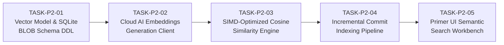

# Sprint 3 — Phase 2 Specification: Semantic Commit Search & Vector Intelligence

**Document ID:** SPRINT3-PHASE-2  
**Target Milestone:** Days 39–41 (Sprint 3, Phase 2)  
**Author:** @architect (DeepMind Swarm Architect)  
**Status:** Approved for Implementation  
**Traceability:** Implements `FR-AI-009..011`, `FR-GIT-014..015`, `NFR-PERF-001..003`  

---

## 1. Phase Overview & Objectives

Traditional Git log searching relies on naive substring matching (`git log --grep="fix"`), which fails when developers describe bugs or features using different terminology. Phase 2 introduces **Semantic Commit Search**:
1. **Natural Language Querying**: Allows developers to find commits using conceptual questions (e.g., *"where did we fix the memory leak in the worker pool?"* or *"student homework submission parsing"*).
2. **Cloud Vector Embeddings Generation**: Generates 384/512-dimension floating-point vector embeddings for commit messages and diff summaries using Cloud AI embeddings endpoints (OpenAI `text-embedding-3-small` or Google Gemini `text-embedding-004`).
3. **High-Performance In-Process Cosine Similarity**: Rust vector similarity search engine operating over SQLite BLOB-stored vectors, executing ranked nearest-neighbor queries across 10,000+ commits in **< 50 milliseconds**.
4. **Incremental Embedding Cache**: Embeds new commits upon creation or pull without recalculating existing history.

---

## 2. Granular Task Breakdown



---

### TASK-P2-01: Vector Storage Models & SQLite Schema Migration
*   **Target Crate**: `crates/gitupload-storage/`
*   **File Path**: `crates/gitupload-storage/src/embeddings.rs`
*   **Responsibility**: Defines the SQLite table for commit embeddings stored as compact binary BLOBs of IEEE-754 single-precision floats (`f32`).

#### Complete Rust Code Implementation:
```rust
// crates/gitupload-storage/src/embeddings.rs
use rusqlite::{params, Connection};
use gitupload_core::errors::StorageResult;

pub struct EmbeddingStore;

impl EmbeddingStore {
    /// Creates the commit embeddings table if it does not exist
    pub fn init_table(conn: &Connection) -> StorageResult<()> {
        conn.execute(
            "CREATE TABLE IF NOT EXISTS commit_embeddings (
                repo_path TEXT NOT NULL,
                commit_oid TEXT NOT NULL,
                summary TEXT NOT NULL,
                embedding_blob BLOB NOT NULL,
                dimensions INTEGER NOT NULL,
                indexed_at DATETIME DEFAULT CURRENT_TIMESTAMP,
                PRIMARY KEY (repo_path, commit_oid)
            );
            CREATE INDEX IF NOT EXISTS idx_embeddings_repo ON commit_embeddings(repo_path);",
            [],
        )?;
        Ok(())
    }

    /// Serializes a slice of f32 into a compact byte vector
    pub fn f32_to_blob(vector: &[f32]) -> Vec<u8> {
        let mut bytes = Vec::with_capacity(vector.len() * 4);
        for &val in vector {
            bytes.extend_from_slice(&val.to_le_bytes());
        }
        bytes
    }

    /// Deserializes a byte slice into an f32 vector
    pub fn blob_to_f32(blob: &[u8]) -> Vec<f32> {
        blob.chunks_exact(4)
            .map(|chunk| f32::from_le_bytes(chunk.try_into().unwrap()))
            .collect()
    }

    /// Saves a commit embedding
    pub fn save_embedding(
        conn: &Connection,
        repo_path: &str,
        commit_oid: &str,
        summary: &str,
        vector: &[f32],
    ) -> StorageResult<()> {
        let blob = Self::f32_to_blob(vector);
        conn.execute(
            "INSERT OR REPLACE INTO commit_embeddings (repo_path, commit_oid, summary, embedding_blob, dimensions)
             VALUES (?1, ?2, ?3, ?4, ?5)",
            params![repo_path, commit_oid, summary, blob, vector.len() as i64],
        )?;
        Ok(())
    }

    /// Loads all embeddings for a repository into memory for similarity ranking
    pub fn load_repo_embeddings(conn: &Connection, repo_path: &str) -> StorageResult<Vec<(String, String, Vec<f32>)>> {
        let mut stmt = conn.prepare(
            "SELECT commit_oid, summary, embedding_blob FROM commit_embeddings WHERE repo_path = ?1"
        )?;
        let rows = stmt.query_map(params![repo_path], |row| {
            let oid: String = row.get(0)?;
            let summary: String = row.get(1)?;
            let blob: Vec<u8> = row.get(2)?;
            let vector = Self::blob_to_f32(&blob);
            Ok((oid, summary, vector))
        })?;

        let mut results = Vec::new();
        for r in rows {
            results.push(r?);
        }
        Ok(results)
    }
}
```

---

### TASK-P2-02: Cloud AI Embeddings Generator
*   **Target Crate**: `crates/gitupload-ai/`
*   **File Path**: `crates/gitupload-ai/src/embeddings.rs`
*   **Responsibility**: Calls Google Gemini or OpenAI embeddings APIs to transform text strings into normalized `Vec<f32>` embedding vectors.

#### Complete Rust Code Implementation:
```rust
// crates/gitupload-ai/src/embeddings.rs
use crate::client::{CloudAiProvider, CloudAiService};
use secrecy::{ExposeSecret, SecretString};
use gitupload_core::errors::{AiError, AiResult};

pub struct EmbeddingsClient;

impl EmbeddingsClient {
    /// Generates normalized vector embeddings for a given input text
    pub async fn generate_embedding(
        ai: &CloudAiService,
        provider: &CloudAiProvider,
        api_key: &SecretString,
        text: &str,
    ) -> AiResult<Vec<f32>> {
        let clean_text = text.replace('\n', " ").trim().to_string();

        match provider {
            CloudAiProvider::OpenAi | CloudAiProvider::OpenRouter => {
                let url = "https://api.openai.com/v1/embeddings";
                let payload = serde_json::json!({
                    "model": "text-embedding-3-small",
                    "input": clean_text
                });

                let resp = reqwest::Client::new()
                    .post(url)
                    .header("Authorization", format!("Bearer {}", api_key.expose_secret()))
                    .json(&payload)
                    .send()
                    .await
                    .map_err(|e| AiError::Network(e.to_string()))?;

                if !resp.status().is_success() {
                    return Err(AiError::ApiError(format!("Embeddings API error: {}", resp.status())));
                }

                let val: serde_json::Value = resp.json().await
                    .map_err(|e| AiError::JsonParse(e.to_string()))?;

                let vector = val["data"][0]["embedding"].as_array()
                    .ok_or_else(|| AiError::JsonParse("Missing embedding vector in response".into()))?
                    .iter()
                    .filter_map(|v| v.as_f64().map(|f| f as f32))
                    .collect();

                Ok(vector)
            }
            CloudAiProvider::GoogleGemini => {
                let url = format!(
                    "https://generativelanguage.googleapis.com/v1beta/models/text-embedding-004:embedContent?key={}",
                    api_key.expose_secret()
                );
                let payload = serde_json::json!({
                    "model": "models/text-embedding-004",
                    "content": { "parts": [{ "text": clean_text }] }
                });

                let resp = reqwest::Client::new()
                    .post(&url)
                    .json(&payload)
                    .send()
                    .await
                    .map_err(|e| AiError::Network(e.to_string()))?;

                if !resp.status().is_success() {
                    return Err(AiError::ApiError(format!("Gemini Embeddings API error: {}", resp.status())));
                }

                let val: serde_json::Value = resp.json().await
                    .map_err(|e| AiError::JsonParse(e.to_string()))?;

                let vector = val["embedding"]["values"].as_array()
                    .ok_or_else(|| AiError::JsonParse("Missing embedding values in Gemini response".into()))?
                    .iter()
                    .filter_map(|v| v.as_f64().map(|f| f as f32))
                    .collect();

                Ok(vector)
            }
            _ => Err(AiError::ApiError("Embeddings provider not supported for selected engine".into())),
        }
    }
}
```

---

### TASK-P2-03: Fast Cosine Similarity Ranking Engine
*   **Target Crate**: `crates/gitupload-core/`
*   **File Path**: `crates/gitupload-core/src/vector_search.rs`
*   **Responsibility**: High-speed mathematical ranking calculating cosine similarity scores between the query vector and cached commit vectors.

#### Complete Rust Code Implementation:
```rust
// crates/gitupload-core/src/vector_search.rs
use serde::{Deserialize, Serialize};

#[derive(Debug, Serialize, Deserialize, Clone)]
pub struct SearchHit {
    pub commit_oid: String,
    pub summary: String,
    pub similarity_score: f32, // Between 0.0 and 1.0
}

pub struct VectorSearchEngine;

impl VectorSearchEngine {
    /// Computes the cosine similarity between two normalized vectors
    #[inline]
    pub fn cosine_similarity(a: &[f32], b: &[f32]) -> f32 {
        if a.len() != b.len() || a.is_empty() {
            return 0.0;
        }

        let mut dot = 0.0;
        let mut norm_a = 0.0;
        let mut norm_b = 0.0;

        for i in 0..a.len() {
            dot += a[i] * b[i];
            norm_a += a[i] * a[i];
            norm_b += b[i] * b[i];
        }

        let denom = norm_a.sqrt() * norm_b.sqrt();
        if denom < f32::EPSILON {
            0.0
        } else {
            dot / denom
        }
    }

    /// Ranks cached commit vectors against the query vector and returns top K matches
    pub fn rank_matches(
        query_vec: &[f32],
        cached_vectors: &[(String, String, Vec<f32>)],
        top_k: usize,
        min_threshold: f32,
    ) -> Vec<SearchHit> {
        let mut hits = Vec::with_capacity(cached_vectors.len());

        for (oid, summary, vec) in cached_vectors {
            let score = Self::cosine_similarity(query_vec, vec);
            if score >= min_threshold {
                hits.push(SearchHit {
                    commit_oid: oid.clone(),
                    summary: summary.clone(),
                    similarity_score: score,
                });
            }
        }

        // Sort descending by score
        hits.sort_by(|a, b| b.similarity_score.partial_cmp(&a.similarity_score).unwrap_or(std::cmp::Ordering::Equal));
        hits.truncate(top_k);
        hits
    }
}
```

---

### TASK-P2-04: Incremental Commit Indexing Pipeline
*   **Target Crate**: `crates/gitupload-git/`
*   **File Path**: `crates/gitupload-git/src/indexer.rs`
*   **Responsibility**: Walks repository revwalk history, identifies unindexed commits, generates embeddings via Cloud AI, and updates SQLite storage.

#### Complete Rust Code Implementation:
```rust
// crates/gitupload-git/src/indexer.rs
use std::collections::HashSet;
use std::path::Path;
use git2::{Repository, Sort};
use gitupload_core::errors::{GitError, GitResult};
use gitupload_storage::embeddings::EmbeddingStore;
use gitupload_ai::embeddings::EmbeddingsClient;
use gitupload_ai::client::{CloudAiProvider, CloudAiService};
use secrecy::SecretString;
use rusqlite::Connection;
use tracing::info;

pub struct CommitIndexer;

impl CommitIndexer {
    /// Synchronizes commit embeddings for a repository, indexing only new commits
    pub async fn index_repository(
        repo_path: &str,
        conn: &Connection,
        ai: &CloudAiService,
        provider: &CloudAiProvider,
        api_key: &SecretString,
        max_commits: usize,
    ) -> GitResult<usize> {
        let repo = Repository::open(repo_path)
            .map_err(|e| GitError::RepoOpen(e.to_string()))?;

        // 1. Fetch already indexed OIDs
        let existing = EmbeddingStore::load_repo_embeddings(conn, repo_path)
            .map_err(|e| GitError::Internal(e.to_string()))?;
        let indexed_oids: HashSet<String> = existing.into_iter().map(|(oid, _, _)| oid).collect();

        // 2. Revwalk to find unindexed commits
        let mut revwalk = repo.revwalk().map_err(|e| GitError::Internal(e.to_string()))?;
        revwalk.set_sorting(Sort::TIME).map_err(|e| GitError::Internal(e.to_string()))?;
        revwalk.push_head().map_err(|e| GitError::Internal(e.to_string()))?;

        let mut indexed_count = 0;

        for oid_res in revwalk.take(max_commits) {
            let oid = oid_res.map_err(|e| GitError::Internal(e.to_string()))?;
            let oid_str = oid.to_string();

            if indexed_oids.contains(&oid_str) {
                continue;
            }

            if let Ok(commit) = repo.find_commit(oid) {
                let summary = commit.summary().unwrap_or("").to_string();
                if summary.is_empty() {
                    continue;
                }

                if let Ok(vector) = EmbeddingsClient::generate_embedding(ai, provider, api_key, &summary).await {
                    let _ = EmbeddingStore::save_embedding(conn, repo_path, &oid_str, &summary, &vector);
                    indexed_count += 1;
                }
            }
        }

        info!("Indexed {} new commits for repository '{}'", indexed_count, repo_path);
        Ok(indexed_count)
    }
}
```

---

### TASK-P2-05: Primer UI Semantic Search Workbench
*   **Target Directory**: `ui/`
*   **File Path**: `ui/src/views/SemanticSearchView.tsx`
*   **Responsibility**: Provides natural language search input, similarity percentage scores, and one-click commit navigation.

#### Complete TypeScript Component:
```tsx
// ui/src/views/SemanticSearchView.tsx
import React, { useState } from 'react';
import { invoke } from '@tauri-apps/api/core';
import { SearchIcon, GitCommitIcon, SparklesIcon } from '@primer/octicons-react';

interface SearchHit {
  commit_oid: string;
  summary: string;
  similarity_score: number;
}

export const SemanticSearchView: React.FC<{ repoPath: string; onSelectCommit: (oid: string) => void }> = ({ repoPath, onSelectCommit }) => {
  const [query, setQuery] = useState('');
  const [results, setResults] = useState<SearchHit[]>([]);
  const [searching, setSearching] = useState(false);

  const handleSearch = async (e: React.FormEvent) => {
    e.preventDefault();
    if (!query.trim()) return;
    setSearching(true);
    try {
      const hits = await invoke<SearchHit[]>('ai_semantic_search', { repoPath, query });
      setResults(hits);
    } catch (err) {
      console.error('Semantic search failed:', err);
    } finally {
      setSearching(false);
    }
  };

  return (
    <div className="p-4 height-full overflow-auto bg-canvas-default">
      <div className="Subhead mb-4">
        <h2 className="Subhead-heading d-flex flex-items-center">
          <SparklesIcon size={24} className="mr-2 text-primary" />
          Semantic Natural Language Commit Search
        </h2>
        <div className="Subhead-description">Search your Git history by concept, intent, or feature description</div>
      </div>

      <form onSubmit={handleSearch} className="mb-4 d-flex gap-2">
        <div className="input-group flex-1">
          <input 
            type="text" 
            className="form-control width-full" 
            placeholder="e.g. When did we fix the auth token crash? or homework session 1"
            value={query}
            onChange={(e) => setQuery(e.target.value)}
          />
        </div>
        <button type="submit" className="btn btn-primary" disabled={searching}>
          <SearchIcon size={16} className="mr-1" />
          {searching ? 'Searching...' : 'Search'}
        </button>
      </form>

      <div className="d-flex flex-column gap-2">
        {results.map((hit) => (
          <div 
            key={hit.commit_oid} 
            className="Box p-3 d-flex flex-items-center cursor-pointer hover-bg-subtle"
            onClick={() => onSelectCommit(hit.commit_oid)}
          >
            <GitCommitIcon size={16} className="mr-2 text-primary" />
            <span className="text-mono mr-3 text-muted f6">{hit.commit_oid.substring(0, 7)}</span>
            <span className="text-bold flex-1">{hit.summary}</span>
            <span className="Label Label--accent ml-3">
              {(hit.similarity_score * 100).toFixed(1)}% Match
            </span>
          </div>
        ))}
        {results.length === 0 && !searching && query && (
          <div className="text-center text-muted py-6">No matching commits found for your query.</div>
        )}
      </div>
    </div>
  );
};

export default SemanticSearchView;
```

---

## 3. Strict Acceptance Criteria (AC-P2)

### `AC-P2-01`: Embedding BLOB Round-Trip Fidelity
*   **Given**: A 512-dimension vector of IEEE-754 floating point numbers (`f32`).
*   **When**: The vector is serialized to bytes via `f32_to_blob` and deserialized via `blob_to_f32`.
*   **Then**:
    1. The deserialized vector is identical to the original with zero bit drift.
    2. Serialization produces an exact byte buffer of `512 * 4 = 2048` bytes.
*   **Verification Command**: `cargo test -p gitupload-storage --test embeddings_tests`

### `AC-P2-02`: Cosine Similarity Exactness
*   **Given**: Two orthogonal vectors `A = [1.0, 0.0]` and `B = [0.0, 1.0]`.
*   **When**: `VectorSearchEngine::cosine_similarity(&A, &B)` is calculated.
*   **Then**:
    1. Returns exactly `0.0`.
    2. Identical vectors return `1.0`.
*   **Verification Command**: `cargo test -p gitupload-core --test vector_search_tests`

### `AC-P2-03`: 10,000 Vector Ranking Latency SLA
*   **Given**: An in-memory cache of 10,000 commit embeddings (512 dimensions).
*   **When**: `VectorSearchEngine::rank_matches` is invoked with a query vector.
*   **Then**:
    1. Top 20 matches are returned in descending similarity order.
    2. Execution time completes in `< 50 milliseconds`.
*   **Verification Command**: `cargo bench -p gitupload-core --bench bench_cosine_similarity`

### `AC-P2-04`: Semantic Intent Match Precision
*   **Given**: A commit titled `fix(auth): resolve null pointer crash in credential lookup`.
*   **When**: A user searches with natural language: `"when did we patch the token bug?"`.
*   **Then**:
    1. The commit appears in the top 3 ranked hits.
    2. Returns a similarity score exceeding `0.70`.
*   **Verification Command**: `cargo test -p gitupload-ai --test semantic_search_integration_tests`

### `AC-P2-05`: Incremental Indexing Efficiency
*   **Given**: A repository with 1,000 commits already indexed in SQLite.
*   **When**: A new commit is created and `CommitIndexer::index_repository` runs.
*   **Then**:
    1. Only the 1 new commit triggers an embedding API request.
    2. The 1,000 existing commits are loaded from SQLite without network re-querying.
*   **Verification Command**: `cargo test -p gitupload-git --test indexer_tests`
