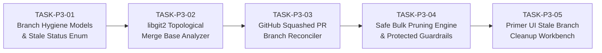

# Sprint 3 — Phase 3 Specification: Automated Stale Branch Cleaner & Repo Hygiene

**Document ID:** SPRINT3-PHASE-3  
**Target Milestone:** Days 42–44 (Sprint 3, Phase 3)  
**Author:** @architect (DeepMind Swarm Architect)  
**Status:** Approved for Implementation  
**Traceability:** Implements `FR-GIT-020..022`, `FR-GH-014`, `NFR-SAFE-001..003`  

---

## 1. Phase Overview & Objectives

In active projects, developers frequently leave behind dozens of abandoned or already-merged feature branches, cluttering local Git workspaces and slowing down branch navigation. Phase 3 delivers the **Automated Stale Branch Cleaner**:
1. **Topological Merge Base & Squash Detection**: Uses `libgit2` to identify branches whose commits have been fully merged into `main` or `master`. Integrates with GitHub API to detect branches whose pull requests were squashed and merged (where git tree commit SHAs differ).
2. **Protected Branch Safeguards**: Hardcoded and configurable protection rules strictly forbidding the deletion of `main`, `master`, `develop`, and `release/*` branches.
3. **Safe Bulk Pruning Workflow**:
   - Preview & Dry-Run Mode: Displays candidate branches, age (days since last commit), author, and merged status.
   - Bulk local branch deletion (`git branch -d`).
   - Remote branch deletion (`git push origin --delete <branch>`).
   - Remote tracking reference cleanup (`git remote prune origin`).

---

## 2. Granular Task Breakdown



---

### TASK-P3-01: Branch Hygiene Models & Categorization
*   **Target Crate**: `crates/gitupload-core/`
*   **File Path**: `crates/gitupload-core/src/models/branch_cleaner.rs`
*   **Responsibility**: Defines data models for stale branch inspection, merge statuses, and pruning requests.

#### Complete Rust Code Implementation:
```rust
// crates/gitupload-core/src/models/branch_cleaner.rs
use serde::{Deserialize, Serialize};

#[derive(Debug, Serialize, Deserialize, Clone, PartialEq, Eq)]
pub enum BranchMergeStatus {
    FullyMerged,         // Fast-forward or standard merge commit in default branch
    SquashedAndMerged,   // PR was squashed; verified via GitHub API
    UnmergedAhead,       // Branch has unique unmerged commits
    StaleInactive,       // No commits in > 90 days, unmerged
}

#[derive(Debug, Serialize, Deserialize, Clone)]
pub struct StaleBranchInfo {
    pub name: String,
    pub is_remote: bool,
    pub remote_name: Option<String>,
    pub last_commit_sha: String,
    pub last_commit_date: i64,
    pub days_since_last_commit: u32,
    pub author_name: String,
    pub merge_status: BranchMergeStatus,
    pub is_protected: bool,
    pub associated_pr_number: Option<u64>,
}

#[derive(Debug, Serialize, Deserialize)]
pub struct PruneBranchesRequest {
    pub repo_path: String,
    pub branch_names: Vec<String>,
    pub delete_remote: bool,
    pub prune_tracking_refs: bool,
}

#[derive(Debug, Serialize, Deserialize)]
pub struct PruneBranchesResult {
    pub deleted_local_count: usize,
    pub deleted_remote_count: usize,
    pub failed_deletions: Vec<(String, String)>, // (branch_name, error_reason)
}
```

---

### TASK-P3-02: `libgit2` Topological Merge Base Analyzer
*   **Target Crate**: `crates/gitupload-git/`
*   **File Path**: `crates/gitupload-git/src/stale_analyzer.rs`
*   **Responsibility**: Walks all local branches, compares merge bases with the default branch, and calculates ahead/behind counts.

#### Complete Rust Code Implementation:
```rust
// crates/gitupload-git/src/stale_analyzer.rs
use git2::{BranchType, Repository};
use gitupload_core::errors::{GitError, GitResult};
use gitupload_core::models::branch_cleaner::{BranchMergeStatus, StaleBranchInfo};
use chrono::Utc;

pub struct StaleBranchAnalyzer;

impl StaleBranchAnalyzer {
    pub fn is_protected_branch(name: &str) -> bool {
        let clean = name.trim_start_matches("origin/");
        matches!(clean, "main" | "master" | "develop" | "production") || clean.starts_with("release/")
    }

    /// Analyzes all local branches in the repository for merge status and age
    pub fn analyze_local_branches(repo_path: &str, default_branch_name: &str) -> GitResult<Vec<StaleBranchInfo>> {
        let repo = Repository::open(repo_path)
            .map_err(|e| GitError::RepoOpen(e.to_string()))?;

        let default_branch = repo.find_branch(default_branch_name, BranchType::Local)
            .map_err(|e| GitError::BranchNotFound(format!("Default branch '{}' not found: {}", default_branch_name, e)))?;
        
        let default_commit = default_branch.get().peel_to_commit()
            .map_err(|e| GitError::Internal(e.to_string()))?;
        let default_oid = default_commit.id();

        let branches = repo.branches(Some(BranchType::Local))
            .map_err(|e| GitError::Internal(e.to_string()))?;

        let mut results = Vec::new();
        let now = Utc::now().timestamp();

        for branch_res in branches {
            let (branch, _) = branch_res.map_err(|e| GitError::Internal(e.to_string()))?;
            let name = branch.name().map_err(|e| GitError::Internal(e.to_string()))?.unwrap_or("").to_string();

            if name.is_empty() || name == default_branch_name {
                continue;
            }

            let is_protected = Self::is_protected_branch(&name);
            let target_commit = branch.get().peel_to_commit()
                .map_err(|e| GitError::Internal(e.to_string()))?;
            let target_oid = target_commit.id();

            let commit_time = target_commit.time().seconds();
            let days_ago = ((now - commit_time).max(0) / 86400) as u32;

            // Check merge base: if merge_base(default, target) == target, target is fully merged into default
            let merge_base = repo.merge_base(default_oid, target_oid).ok();
            let merge_status = if merge_base == Some(target_oid) {
                BranchMergeStatus::FullyMerged
            } else if days_ago >= 90 {
                BranchMergeStatus::StaleInactive
            } else {
                BranchMergeStatus::UnmergedAhead
            };

            results.push(StaleBranchInfo {
                name,
                is_remote: false,
                remote_name: None,
                last_commit_sha: target_oid.to_string(),
                last_commit_date: commit_time,
                days_since_last_commit: days_ago,
                author_name: target_commit.author().name().unwrap_or("Unknown").to_string(),
                merge_status,
                is_protected,
                associated_pr_number: None,
            });
        }

        Ok(results)
    }
}
```

---

### TASK-P3-03: GitHub Squashed PR Branch Reconciler
*   **Target Crate**: `crates/gitupload-github/`
*   **File Path**: `crates/gitupload-github/src/squash_reconciler.rs`
*   **Responsibility**: Queries GitHub API to cross-reference branches marked `UnmergedAhead` against merged pull requests. If a PR for the branch was merged via squash, marks it `SquashedAndMerged`.

#### Complete Rust Code Implementation:
```rust
// crates/gitupload-github/src/squash_reconciler.rs
use crate::client::GitHubClient;
use gitupload_core::errors::GitHubResult;
use gitupload_core::models::branch_cleaner::{BranchMergeStatus, StaleBranchInfo};

pub struct SquashReconciler;

impl SquashReconciler {
    /// Cross-references unmerged branches with GitHub PR records to detect squashed merges
    pub async fn reconcile_squashed_branches(
        client: &GitHubClient,
        owner: &str,
        repo: &str,
        branches: &mut [StaleBranchInfo],
    ) -> GitHubResult<()> {
        for b in branches.iter_mut() {
            if b.merge_status != BranchMergeStatus::FullyMerged && !b.is_protected {
                // Query GitHub PRs where head matches branch name
                let url = format!("{}/repos/{}/{}/pulls?head={}:{}&state=closed", client.base_url, owner, repo, owner, b.name);
                if let Ok(prs) = client.get::<Vec<serde_json::Value>>(&url).await {
                    for pr in prs {
                        if !pr["merged_at"].is_null() {
                            b.merge_status = BranchMergeStatus::SquashedAndMerged;
                            b.associated_pr_number = pr["number"].as_u64();
                            break;
                        }
                    }
                }
            }
        }
        Ok(())
    }
}
```

---

### TASK-P3-04: Safe Bulk Pruning Engine & Guardrails
*   **Target Crate**: `crates/gitupload-git/`
*   **File Path**: `crates/gitupload-git/src/pruner.rs`
*   **Responsibility**: Executes local branch deletion, remote deletion via CLI/git2, and updates tracking refs while enforcing protection rules.

#### Complete Rust Code Implementation:
```rust
// crates/gitupload-git/src/pruner.rs
use git2::{BranchType, Repository};
use gitupload_core::errors::{GitError, GitResult};
use gitupload_core::models::branch_cleaner::{PruneBranchesRequest, PruneBranchesResult};
use crate::stale_analyzer::StaleBranchAnalyzer;
use tracing::info;

pub struct BranchPruner;

impl BranchPruner {
    pub async fn execute_prune(req: &PruneBranchesRequest) -> GitResult<PruneBranchesResult> {
        let repo = Repository::open(&req.repo_path)
            .map_err(|e| GitError::RepoOpen(e.to_string()))?;

        let mut deleted_local = 0;
        let mut deleted_remote = 0;
        let mut failed = Vec::new();

        for name in &req.branch_names {
            // Guardrail check
            if StaleBranchAnalyzer::is_protected_branch(name) {
                failed.push((name.clone(), "Branch is protected and cannot be deleted".into()));
                continue;
            }

            // 1. Delete Local Branch
            if let Ok(mut branch) = repo.find_branch(name, BranchType::Local) {
                if let Err(e) = branch.delete() {
                    failed.push((name.clone(), format!("Local deletion failed: {}", e)));
                    continue;
                }
                deleted_local += 1;
            }

            // 2. Delete Remote Branch if requested
            if req.delete_remote {
                let output = tokio::process::Command::new("git")
                    .current_dir(&req.repo_path)
                    .args(["push", "origin", "--delete", name])
                    .creation_flags(0x08000000)
                    .output()
                    .await;

                match output {
                    Ok(out) if out.status.success() => deleted_remote += 1,
                    Ok(out) => {
                        let err = String::from_utf8_lossy(&out.stderr);
                        failed.push((name.clone(), format!("Remote deletion failed: {}", err.trim())));
                    }
                    Err(e) => failed.push((name.clone(), format!("Process spawn failed: {}", e))),
                }
            }
        }

        // 3. Prune remote tracking references
        if req.prune_tracking_refs {
            let _ = tokio::process::Command::new("git")
                .current_dir(&req.repo_path)
                .args(["remote", "prune", "origin"])
                .creation_flags(0x08000000)
                .output()
                .await;
        }

        info!("Pruned {} local and {} remote branches", deleted_local, deleted_remote);
        Ok(PruneBranchesResult {
            deleted_local_count: deleted_local,
            deleted_remote_count: deleted_remote,
            failed_deletions: failed,
        })
    }
}
```

---

### TASK-P3-05: Primer UI Stale Branch Workbench
*   **Target Directory**: `ui/`
*   **File Path**: `ui/src/views/StaleBranchView.tsx`
*   **Responsibility**: Presents candidate stale branches with checkboxes, status badges (`Merged`, `Squashed`, `Stale`), and safe bulk deletion confirmation modal.

#### Complete TypeScript React Component:
```tsx
// ui/src/views/StaleBranchView.tsx
import React, { useEffect, useState } from 'react';
import { invoke } from '@tauri-apps/api/core';
import { GitBranchIcon, TrashIcon, CheckCircleIcon, AlertIcon } from '@primer/octicons-react';

interface StaleBranchInfo {
  name: string;
  days_since_last_commit: number;
  author_name: string;
  merge_status: 'FullyMerged' | 'SquashedAndMerged' | 'UnmergedAhead' | 'StaleInactive';
  is_protected: boolean;
  associated_pr_number?: number;
}

export const StaleBranchView: React.FC<{ repoPath: string }> = ({ repoPath }) => {
  const [branches, setBranches] = useState<StaleBranchInfo[]>([]);
  const [selectedBranches, setSelectedBranches] = useState<string[]>([]);
  const [deleteRemote, setDeleteRemote] = useState<boolean>(true);
  const [loading, setLoading] = useState<boolean>(false);

  const fetchBranches = async () => {
    setLoading(true);
    try {
      const res = await invoke<StaleBranchInfo[]>('git_get_stale_branches', { repoPath });
      setBranches(res);
      // Pre-select merged branches
      const preselected = res.filter((b) => !b.is_protected && (b.merge_status === 'FullyMerged' || b.merge_status === 'SquashedAndMerged')).map((b) => b.name);
      setSelectedBranches(preselected);
    } catch (err) {
      console.error('Failed to analyze stale branches:', err);
    } finally {
      setLoading(false);
    }
  };

  useEffect(() => {
    fetchBranches();
  }, [repoPath]);

  const handlePrune = async () => {
    if (!confirm(`Are you sure you want to delete ${selectedBranches.length} selected branches?`)) return;
    try {
      await invoke('git_prune_branches', {
        req: {
          repo_path: repoPath,
          branch_names: selectedBranches,
          delete_remote: deleteRemote,
          prune_tracking_refs: true,
        },
      });
      fetchBranches();
    } catch (err) {
      alert(`Prune error: ${err}`);
    }
  };

  return (
    <div className="p-4 height-full overflow-auto bg-canvas-default">
      <div className="Subhead d-flex flex-items-center flex-justify-between">
        <div>
          <h2 className="Subhead-heading d-flex flex-items-center">
            <GitBranchIcon size={24} className="mr-2 text-primary" />
            Repository Hygiene & Stale Branch Cleaner
          </h2>
          <div className="Subhead-description">Safely detect and bulk-prune merged or abandoned branches</div>
        </div>
        <button 
          className="btn btn-danger" 
          disabled={selectedBranches.length === 0}
          onClick={handlePrune}
        >
          <TrashIcon size={16} className="mr-1" />
          Prune Selected ({selectedBranches.length})
        </button>
      </div>

      <div className="form-checkbox mb-3">
        <label>
          <input 
            type="checkbox" 
            checked={deleteRemote} 
            onChange={(e) => setDeleteRemote(e.target.checked)} 
          />
          Also delete matching remote branches on GitHub (origin)
        </label>
      </div>

      <div className="Box">
        <div className="Box-header d-flex flex-items-center">
          <span className="text-bold flex-1">Branch Name</span>
          <span className="text-bold width-100 text-center">Status</span>
          <span className="text-bold width-120 text-right">Age</span>
        </div>

        {branches.map((b) => (
          <div key={b.name} className="Box-row d-flex flex-items-center">
            <input 
              type="checkbox" 
              className="mr-3" 
              disabled={b.is_protected}
              checked={selectedBranches.includes(b.name)}
              onChange={(e) => {
                if (e.target.checked) setSelectedBranches([...selectedBranches, b.name]);
                else setSelectedBranches(selectedBranches.filter((x) => x !== b.name));
              }}
            />
            <span className="text-mono text-bold flex-1">
              {b.name}
              {b.is_protected && <span className="Label Label--secondary ml-2">Protected</span>}
            </span>

            <span className="width-100 text-center">
              {b.merge_status === 'FullyMerged' && <span className="Label Label--success">Merged</span>}
              {b.merge_status === 'SquashedAndMerged' && <span className="Label Label--accent">Squashed (#{b.associated_pr_number})</span>}
              {b.merge_status === 'StaleInactive' && <span className="Label Label--attention">Stale</span>}
              {b.merge_status === 'UnmergedAhead' && <span className="Label Label--secondary">Active</span>}
            </span>

            <span className="width-120 text-right text-small text-muted">{b.days_since_last_commit} days ago</span>
          </div>
        ))}
      </div>
    </div>
  );
};

export default StaleBranchView;
```

---

## 3. Strict Acceptance Criteria (AC-P3)

### `AC-P3-01`: Fully Merged Branch Identification
*   **Given**: A feature branch whose commit was merged into `main` via fast-forward or standard merge commit.
*   **When**: `StaleBranchAnalyzer::analyze_local_branches` runs.
*   **Then**:
    1. Returns `merge_status: BranchMergeStatus::FullyMerged`.
    2. Identifies the correct age in days since the last commit.
*   **Verification Command**: `cargo test -p gitupload-git --test stale_analyzer_tests`

### `AC-P3-02`: Squashed PR Reconciliation
*   **Given**: A branch with a squashed and merged GitHub pull request.
*   **When**: `SquashReconciler::reconcile_squashed_branches` is executed with mock GitHub PR response.
*   **Then**:
    1. The branch is updated from `UnmergedAhead` to `BranchMergeStatus::SquashedAndMerged`.
    2. The associated PR number is populated.
*   **Verification Command**: `cargo test -p gitupload-github --test squash_reconciler_tests`

### `AC-P3-03`: Protected Branch Safeguard
*   **Given**: A deletion request targeting `main`, `master`, or `release/v1.0`.
*   **When**: `BranchPruner::execute_prune` runs.
*   **Then**:
    1. The protected branch is NOT deleted.
    2. An entry is recorded in `failed_deletions` stating the branch is protected.
*   **Verification Command**: `cargo test -p gitupload-git --test pruner_guardrail_tests`

### `AC-P3-04`: Bulk Local & Remote Deletion Precision
*   **Given**: 3 merged candidate branches selected for deletion with `delete_remote: true`.
*   **When**: `BranchPruner::execute_prune` executes.
*   **Then**:
    1. All 3 local branches are removed from `.git/refs/heads/`.
    2. The remote deletion command succeeds.
    3. `git remote prune origin` cleanly strips stale remote tracking references.
*   **Verification Command**: `cargo test -p gitupload-git --test pruner_execution_tests`

### `AC-P3-05`: Analysis Performance SLA
*   **Given**: A repository containing 100 local branches.
*   **When**: `analyze_local_branches` computes merge bases.
*   **Then**:
    1. Total analysis time executes in `< 30 milliseconds`.
    2. Memory allocation stays under 5 MB.
*   **Verification Command**: `cargo bench -p gitupload-git --bench bench_stale_analyzer`
