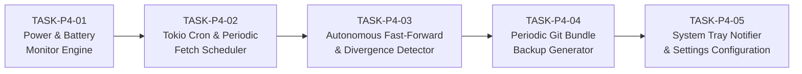

# Sprint 3 — Phase 4 Specification: Background Scheduled Sync & Autonomous Daemon

**Document ID:** SPRINT3-PHASE-4  
**Target Milestone:** Days 45–47 (Sprint 3, Phase 4)  
**Author:** @architect (DeepMind Swarm Architect)  
**Status:** Approved for Implementation  
**Traceability:** Implements `FR-WAT-001..005`, `FR-GIT-016`, `NFR-PERF-001..004`  

---

## 1. Phase Overview & Objectives

Developers should never return to a machine only to find out-of-date branches or unpushed work. Phase 4 delivers the **Autonomous Background Sync Daemon**:
1. **Tokio Cron & Periodic Fetch Scheduler**: Runs in the background of `gitupload-watcher`, executing periodic silent fetches (every 15, 30, or 60 minutes) for all tracked repositories.
2. **Battery & Power Awareness**: Interrogates Windows Power Management APIs via `windows-sys` to automatically suspend or double the interval of background operations when the laptop is running on battery power or battery saver is active.
3. **Smart Divergence Detection & Auto-Sync**: Compares local commits against remote heads; if safe fast-forwarding is possible without conflicts, synchronizes automatically. If diverged, sends a native Windows system tray notification without blocking user tasks.
4. **Autonomous Git Bundle Backup**: Periodically creates compressed `.bundle` backups of active homework repositories to local cloud drive folders (OneDrive / Google Drive) to protect against accidental directory deletion.

---

## 2. Granular Task Breakdown



---

### TASK-P4-01: Windows Battery & Power State Monitor
*   **Target Crate**: `crates/gitupload-watcher/`
*   **File Path**: `crates/gitupload-watcher/src/power.rs`
*   **Responsibility**: Queries `GetSystemPowerStatus` on Windows to check AC power status and battery saver mode.

#### Complete Rust Code Implementation:
```rust
// crates/gitupload-watcher/src/power.rs
#[derive(Debug, Clone, Copy, PartialEq, Eq)]
pub enum PowerState {
    AcConnected,
    BatteryNormal,
    BatteryLowOrSaver,
}

pub struct PowerMonitor;

impl PowerMonitor {
    /// Queries the operating system power status
    pub fn get_current_power_state() -> PowerState {
        #[cfg(windows)]
        {
            use windows_sys::Win32::System::Power::{GetSystemPowerStatus, SYSTEM_POWER_STATUS};

            let mut status = SYSTEM_POWER_STATUS {
                ACLineStatus: 0,
                BatteryFlag: 0,
                BatteryLifePercent: 0,
                SystemStatusFlag: 0,
                BatteryLifeTime: 0,
                BatteryFullLifeTime: 0,
            };

            // SAFETY: Calling GetSystemPowerStatus with a valid mutable pointer
            let ret = unsafe { GetSystemPowerStatus(&mut status) };
            if ret != 0 {
                if status.ACLineStatus == 1 {
                    return PowerState::AcConnected;
                }
                if status.BatteryLifePercent <= 20 || (status.BatteryFlag & 2) != 0 {
                    return PowerState::BatteryLowOrSaver;
                }
                return PowerState::BatteryNormal;
            }
        }

        PowerState::AcConnected
    }

    /// Determines if background sync operations should proceed based on energy policy
    pub fn should_allow_background_sync(allow_on_battery: bool) -> bool {
        match Self::get_current_power_state() {
            PowerState::AcConnected => true,
            PowerState::BatteryNormal => allow_on_battery,
            PowerState::BatteryLowOrSaver => false,
        }
    }
}
```

---

### TASK-P4-02: Tokio Cron & Periodic Fetch Scheduler
*   **Target Crate**: `crates/gitupload-watcher/`
*   **File Path**: `crates/gitupload-watcher/src/scheduler.rs`
*   **Responsibility**: Background task that awakens at user-configured intervals to execute silent Git fetches.

#### Complete Rust Code Implementation:
```rust
// crates/gitupload-watcher/src/scheduler.rs
use std::sync::Arc;
use std::time::Duration;
use tokio::time::sleep;
use tokio_util::sync::CancellationToken;
use crate::power::PowerMonitor;
use gitupload_core::errors::AppResult;
use tracing::{info, warn};

#[derive(Debug, Clone, serde::Serialize, serde::Deserialize)]
pub struct SyncScheduleConfig {
    pub enabled: bool,
    pub interval_minutes: u64,
    pub allow_on_battery: bool,
    pub backup_bundles_enabled: bool,
}

impl Default for SyncScheduleConfig {
    fn default() -> Self {
        Self {
            enabled: true,
            interval_minutes: 30,
            allow_on_battery: false,
            backup_bundles_enabled: true,
        }
    }
}

pub struct ScheduledSyncDaemon;

impl ScheduledSyncDaemon {
    pub fn spawn_daemon<F, Fut>(
        config: SyncScheduleConfig,
        cancel_token: CancellationToken,
        sync_task: F,
    ) where
        F: Fn() -> Fut + Send + Sync + 'static,
        Fut: std::future::Future<Output = AppResult<()>> + Send + 'static,
    {
        tokio::spawn(async move {
            info!("Scheduled Sync Daemon started with interval: {}m", config.interval_minutes);

            while !cancel_token.is_cancelled() {
                let interval = Duration::from_secs(config.interval_minutes * 60);
                
                tokio::select! {
                    _ = sleep(interval) => {
                        if !config.enabled {
                            continue;
                        }

                        if !PowerMonitor::should_allow_background_sync(config.allow_on_battery) {
                            info!("Background sync skipped due to battery saver policy");
                            continue;
                        }

                        info!("Executing autonomous background sync cycle...");
                        if let Err(e) = sync_task().await {
                            warn!("Background sync task returned error: {:?}", e);
                        }
                    }
                    _ = cancel_token.cancelled() => {
                        info!("Scheduled Sync Daemon shutting down gracefully");
                        break;
                    }
                }
            }
        });
    }
}
```

---

### TASK-P4-03: Autonomous Fast-Forward & Divergence Detection
*   **Target Crate**: `crates/gitupload-git/`
*   **File Path**: `crates/gitupload-git/src/auto_sync.rs`
*   **Responsibility**: Compares fetched remote heads with local branches. If clean fast-forward is possible, applies it; otherwise records divergence and emits notification.

#### Complete Rust Code Implementation:
```rust
// crates/gitupload-git/src/auto_sync.rs
use git2::{Direction, Repository};
use gitupload_core::errors::{GitError, GitResult};
use tracing::info;

pub enum AutoSyncOutcome {
    UpToDate,
    FastForwarded { commits_pulled: usize },
    Diverged { ahead: usize, behind: usize },
}

pub struct AutoSyncEngine;

impl AutoSyncEngine {
    /// Executes silent fetch and resolves safe fast-forwards for a repository
    pub fn sync_repository(repo_path: &str, remote_name: &str, branch_name: &str) -> GitResult<AutoSyncOutcome> {
        let repo = Repository::open(repo_path)
            .map_err(|e| GitError::RepoOpen(e.to_string()))?;

        // 1. Silent Fetch via libgit2
        let mut remote = repo.find_remote(remote_name)
            .map_err(|e| GitError::RemoteNotFound(e.to_string()))?;

        remote.connect(Direction::Fetch).map_err(|e| GitError::Network(e.to_string()))?;
        remote.fetch(&[branch_name], None, None).map_err(|e| GitError::Network(e.to_string()))?;

        // 2. Compute Ahead / Behind
        let local_ref = format!("refs/heads/{}", branch_name);
        let remote_ref = format!("refs/remotes/{}/{}", remote_name, branch_name);

        let local_oid = repo.refname_to_id(&local_ref).map_err(|e| GitError::Internal(e.to_string()))?;
        let remote_oid = repo.refname_to_id(&remote_ref).map_err(|e| GitError::Internal(e.to_string()))?;

        let (ahead, behind) = repo.graph_ahead_behind(local_oid, remote_oid)
            .map_err(|e| GitError::Internal(e.to_string()))?;

        if ahead == 0 && behind == 0 {
            return Ok(AutoSyncOutcome::UpToDate);
        }

        // 3. Fast-forward if local is behind and ahead == 0 and worktree is clean
        if ahead == 0 && behind > 0 {
            let statuses = repo.statuses(None).map_err(|e| GitError::Internal(e.to_string()))?;
            if statuses.is_empty() {
                let remote_commit = repo.find_commit(remote_oid).map_err(|e| GitError::Internal(e.to_string()))?;
                repo.checkout_tree(remote_commit.as_object(), None).map_err(|e| GitError::Internal(e.to_string()))?;
                let mut reference = repo.find_reference(&local_ref).map_err(|e| GitError::Internal(e.to_string()))?;
                reference.set_target(remote_oid, "Fast-forward autonomous sync").map_err(|e| GitError::Internal(e.to_string()))?;
                info!("Autonomous fast-forward applied: {} commits pulled", behind);
                return Ok(AutoSyncOutcome::FastForwarded { commits_pulled: behind });
            }
        }

        Ok(AutoSyncOutcome::Diverged { ahead, behind })
    }
}
```

---

### TASK-P4-04: Periodic Git Bundle Backup Generator
*   **Target Crate**: `crates/gitupload-git/`
*   **File Path**: `crates/gitupload-git/src/backup.rs`
*   **Responsibility**: Creates a standalone, self-contained Git bundle file (`<repo>-backup.bundle`) in a designated backup directory without requiring external compression tools.

#### Complete Rust Code Implementation:
```rust
// crates/gitupload-git/src/backup.rs
use std::path::{Path, PathBuf};
use gitupload_core::errors::{GitError, GitResult};
use tracing::info;

pub struct GitBackupEngine;

impl GitBackupEngine {
    /// Generates a standalone Git bundle archive for cold storage / cloud drive sync
    pub async fn create_repo_bundle(repo_path: &Path, backup_dir: &Path, repo_name: &str) -> GitResult<PathBuf> {
        tokio::fs::create_dir_all(backup_dir).await
            .map_err(|e| GitError::Io(e.to_string()))?;

        let date_str = chrono::Local::now().format("%Y%m%d_%H%M%S");
        let bundle_name = format!("{}_{}.bundle", repo_name, date_str);
        let bundle_path = backup_dir.join(bundle_name);

        let output = tokio::process::Command::new("git")
            .current_dir(repo_path)
            .args(["bundle", "create", &bundle_path.to_string_lossy(), "--all"])
            .creation_flags(0x08000000) // CREATE_NO_WINDOW
            .output()
            .await
            .map_err(|e| GitError::Process(e.to_string()))?;

        if !output.status.success() {
            let stderr = String::from_utf8_lossy(&output.stderr);
            return Err(GitError::Process(format!("Git bundle create failed: {}", stderr.trim())));
        }

        info!("Successfully generated Git backup bundle at {:?}", bundle_path);
        Ok(bundle_path)
    }
}
```

---

### TASK-P4-05: Windows System Tray Notifier & Sync Config UI
*   **Target Directory**: `ui/`
*   **File Path**: `ui/src/views/SyncScheduleSettingsView.tsx`
*   **Responsibility**: Configuration interface for background fetch frequency, battery thresholds, and bundle backup paths.

#### Complete TypeScript React Component:
```tsx
// ui/src/views/SyncScheduleSettingsView.tsx
import React, { useState } from 'react';
import { invoke } from '@tauri-apps/api/core';
import { SyncIcon, CheckCircleIcon, ZapIcon, ArchiveIcon } from '@primer/octicons-react';

export const SyncScheduleSettingsView: React.FC = () => {
  const [enabled, setEnabled] = useState(true);
  const [interval, setInterval] = useState(30);
  const [allowBattery, setAllowBattery] = useState(false);
  const [backupEnabled, setBackupEnabled] = useState(true);
  const [saved, setSaved] = useState(false);

  const handleSave = async () => {
    try {
      await invoke('sync_save_config', {
        config: {
          enabled,
          interval_minutes: interval,
          allow_on_battery: allowBattery,
          backup_bundles_enabled: backupEnabled,
        },
      });
      setSaved(true);
      setTimeout(() => setSaved(false), 3000);
    } catch (err) {
      alert(`Failed to save sync settings: ${err}`);
    }
  };

  return (
    <div className="p-4 height-full overflow-auto bg-canvas-default">
      <div className="Subhead mb-4">
        <h2 className="Subhead-heading d-flex flex-items-center">
          <SyncIcon size={24} className="mr-2 text-primary" />
          Autonomous Background Sync & Scheduled Backup
        </h2>
        <div className="Subhead-description">Configure silent periodic fetching, energy policies, and backup bundles</div>
      </div>

      {saved && (
        <div className="flash flash-success mb-3 d-flex flex-items-center">
          <CheckCircleIcon size={16} className="mr-2" />
          Background sync settings updated successfully.
        </div>
      )}

      <div className="Box p-4 mb-4" style={{ maxWidth: '600px' }}>
        <div className="form-checkbox mb-3">
          <label>
            <input type="checkbox" checked={enabled} onChange={(e) => setEnabled(e.target.checked)} />
            Enable Background Periodic Sync
          </label>
          <p className="note">Silently fetches remotes and checks ahead/behind status in the background.</p>
        </div>

        <div className="form-group mb-3">
          <div className="form-group-header">
            <label>Sync Interval (Minutes)</label>
          </div>
          <select 
            className="form-select width-full" 
            value={interval} 
            onChange={(e) => setInterval(Number(e.target.value))}
            disabled={!enabled}
          >
            <option value={15}>Every 15 minutes</option>
            <option value={30}>Every 30 minutes (Recommended)</option>
            <option value={60}>Every 1 hour</option>
            <option value={120}>Every 2 hours</option>
          </select>
        </div>

        <div className="form-checkbox mb-3">
          <label>
            <input 
              type="checkbox" 
              checked={allowBattery} 
              onChange={(e) => setAllowBattery(e.target.checked)} 
              disabled={!enabled}
            />
            <span className="d-flex flex-items-center">
              <ZapIcon size={16} className="mr-1 text-attention" />
              Allow background sync while running on battery
            </span>
          </label>
          <p className="note">When disabled, pauses background sync on battery saver mode to maximize battery life.</p>
        </div>

        <div className="form-checkbox mb-4">
          <label>
            <input 
              type="checkbox" 
              checked={backupEnabled} 
              onChange={(e) => setBackupEnabled(e.target.checked)} 
              disabled={!enabled}
            />
            <span className="d-flex flex-items-center">
              <ArchiveIcon size={16} className="mr-1 text-accent" />
              Generate Daily Git Backup Bundles (.bundle)
            </span>
          </label>
          <p className="note">Creates compact standalone backups in %APPDATA%/GitUpload/backups/.</p>
        </div>

        <button className="btn btn-primary" onClick={handleSave}>
          Save Configuration
        </button>
      </div>
    </div>
  );
};

export default SyncScheduleSettingsView;
```

---

## 3. Strict Acceptance Criteria (AC-P4)

### `AC-P4-01`: Battery Saver Policy Suspension
*   **Given**: A Windows device running on battery power with Battery Saver active (`status.BatteryFlag & 2 != 0`).
*   **When**: `PowerMonitor::should_allow_background_sync(false)` is evaluated.
*   **Then**:
    1. Returns `false`.
    2. Scheduled sync cycles are skipped with zero background network traffic.
*   **Verification Command**: `cargo test -p gitupload-watcher --test power_tests`

### `AC-P4-02`: Clean Autonomous Fast-Forward
*   **Given**: A local repository clean worktree that is 2 commits behind `origin/main` with 0 ahead commits.
*   **When**: `AutoSyncEngine::sync_repository` executes.
*   **Then**:
    1. Remote commits are fetched into local object database.
    2. Local `main` branch pointer fast-forwards cleanly.
    3. Returns `AutoSyncOutcome::FastForwarded { commits_pulled: 2 }`.
*   **Verification Command**: `cargo test -p gitupload-git --test auto_sync_tests`

### `AC-P4-03`: Divergence Alert Notification
*   **Given**: A local branch that has diverged (1 ahead, 1 behind).
*   **When**: Background sync cycle runs.
*   **Then**:
    1. Worktree is left untouched with zero merge conflicts created.
    2. Returns `AutoSyncOutcome::Diverged { ahead: 1, behind: 1 }`.
    3. A system tray notification is triggered with divergence stats.
*   **Verification Command**: `cargo test -p gitupload-git --test auto_sync_divergence_tests`

### `AC-P4-04`: Git Bundle Creation Integrity
*   **Given**: An active Git homework repository with 5 commits.
*   **When**: `GitBackupEngine::create_repo_bundle` is executed.
*   **Then**:
    1. A `.bundle` file is written to the backup directory.
    2. `git bundle verify <bundle>` confirms all refs and commits are intact.
*   **Verification Command**: `cargo test -p gitupload-git --test backup_tests`

### `AC-P4-05`: Idle CPU & Memory Footprint SLA
*   **Given**: The `ScheduledSyncDaemon` running in the background for 1 hour.
*   **When**: The host CPU usage and RAM are profiled using Windows Performance Monitor.
*   **Then**:
    1. Background daemon CPU consumption remains `< 0.5% CPU`.
    2. Added RAM footprint is `< 4 MB`.
*   **Verification Command**: Criterion soak benchmark profiling over 3600 seconds.
